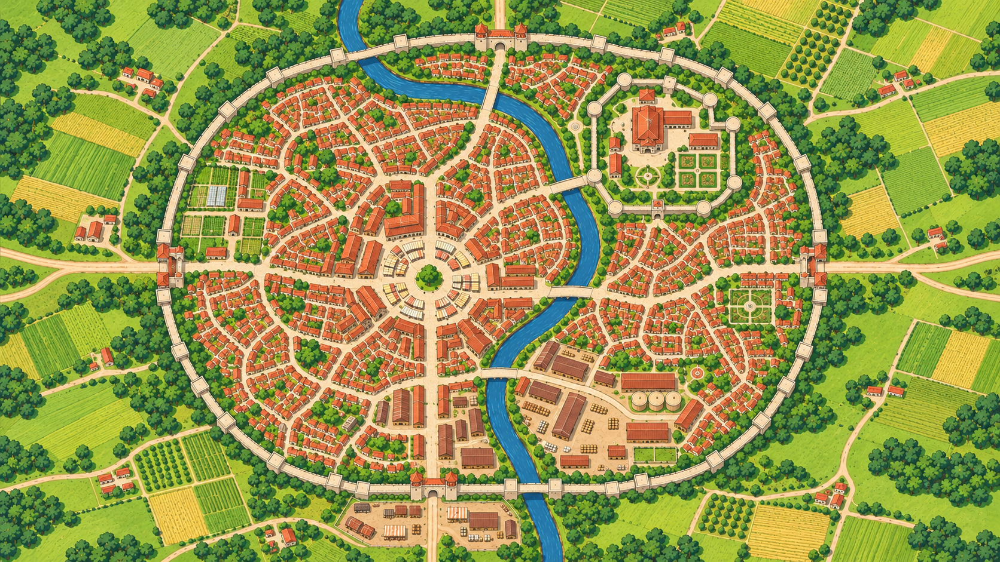
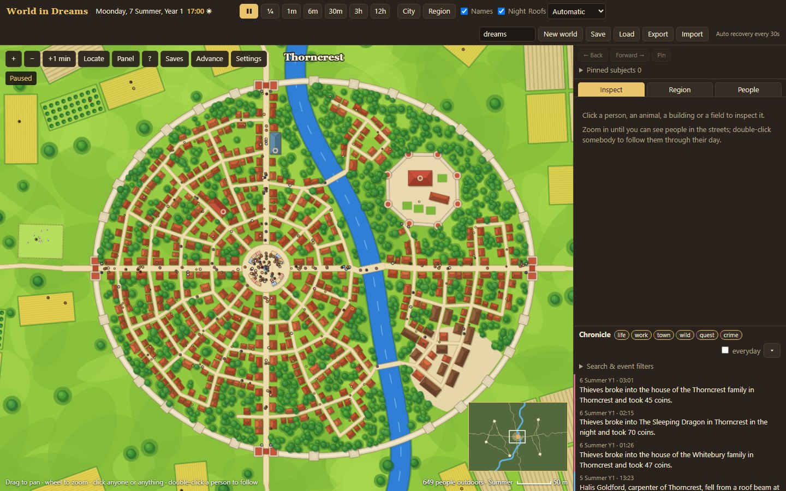
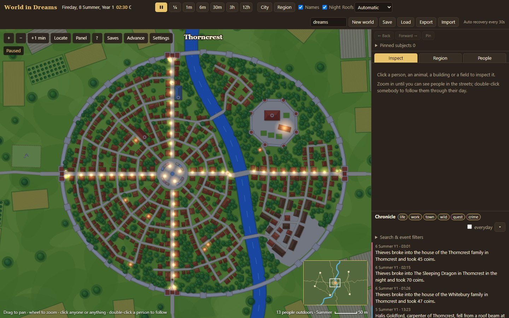

# Art bible

**In short:** a painted, straight-down map of a classic isekai world —
terracotta roofs, pale stone walls, yellow-green fields, round dark-green tree
crowns and a saturated blue river — moderately stylised, with villages and
cities at the centre. The art is split in two sub-tabs: **[Concepts](#/world-in-dreams/6)**,
the images made as the base for the game's look, and
**[References](#/world-in-dreams/7)**, images collected from other works.

## Rules

Confirmed by the owner on 2026-11-11 and kept on 2026-11-18.

| Rule | Meaning |
| --- | --- |
| **Straight down** | The camera looks straight down at every zoom: roof plans, wall tops and tree crowns, never fronts, sides or perspective |
| **North is up** | The same geography reads the same way at every scale |
| **Classic isekai** | Architecture and world references come from KonoSuba, Overlord and Re:Zero |
| **Moderately stylised** | Hand-painted, crisp shapes, rich but restrained detail, soft daylight and short shadows |
| **Settlements first** | Villages and cities carry the detail; the countryside supports them |
| **One world, many zooms** | City, region and continent should look like the same game zooming out |

For settlement-scale views the owner chose **Isekai 01 (KonoSuba, Axel)**; for
distant regional views, **Isekai 04 (Re:Zero)** with **Isekai 05 (Overlord)**.

## Palette in the game

The game paints everything in code (`projects/world-in-dreams/src/ui/render.js`).

| Element | Colour |
| --- | --- |
| Roofs | Terracotta `#d2603a`, `#c8532f`, `#db6f42`, shaded `#a94a2d`; the keep and town hall `#c9503a`; warehouses brown `#96643f`; a few blue roofs `#5f8fb0` |
| Stone and roads | Wall stone `#e4d8b8`, edge `#93835f`; roads `#ecdcae`, edge `#b59a66` |
| Water | River and ponds `#2f7fd6`, edge `#1e5aa6`, highlight `#7bbaf0` |
| Grass by season | Spring `#9bd046`, summer `#93c93f`, autumn `#a9c248`, winter snow `#dfe9e6` |
| Trees by season | Summer greens `#2c7a2d`–`#33802b`; spring blossom `#f0a9c0`; autumn `#c9772a`, `#c9a02c`, `#a94f2a` |
| Market awnings | Cream `#f4efe2` striped with red `#d9634a`, gold `#e7c355` or blue `#5f9ad0` |
| Outlines | Dark ink `#5a2a1c` |

Seasons change grass, trees and roofs (blossom in spring, red and gold in
autumn, snow in winter). At night the map darkens with the real sunset, and
windows and street lamps light up.

## In the game today

Close up, the roofs lift off and the interiors are drawn: floors, walls, doors,
furniture and people at their spots (see the street capture in **Overview**).

## What the roadmap asks of the art

| Milestone | New art needed |
| --- | --- |
| M1 Living land | Relief with hill shading, coasts, lakes, biomes (desert, snow, marsh, steppe), weather, new animals |
| M3 / M6 Interfaces | Panels and icons that match this palette |
| M7 Society | Clothing that shows class; noble and royal colours |
| M10 Combat and magic | Small, readable hit and spell effects |
| M11 Richer cities | Castles, churches, mansions, slums, several floors |
| M12 Wild places | Ruins, dungeons, caves, goblin lairs |

## Files

| What | Where |
| --- | --- |
| Generated concepts (5) | `media/art-concepts/` — shown in **Concepts** |
| Collected references (12) and their sources | `media/art-references/` and `media/art-references/sources.json` — shown in **References** |
| Game captures | `media/game/` |
