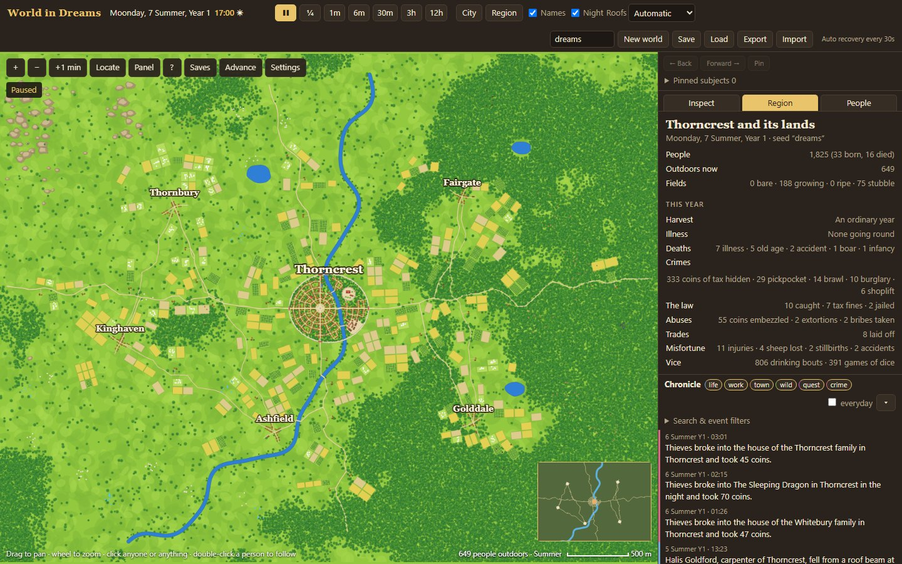
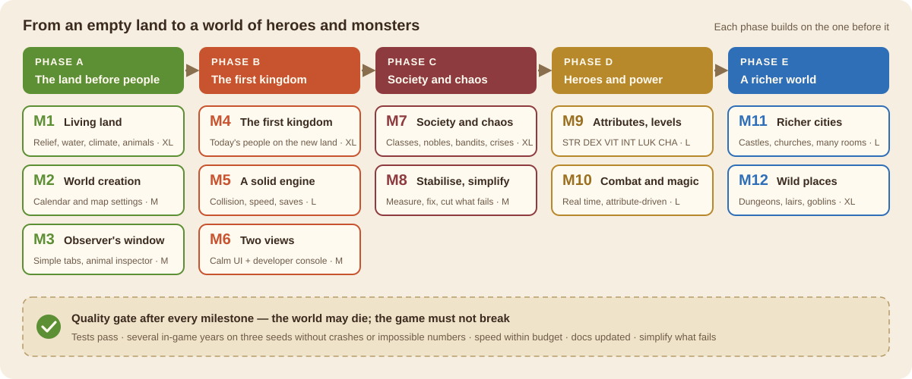
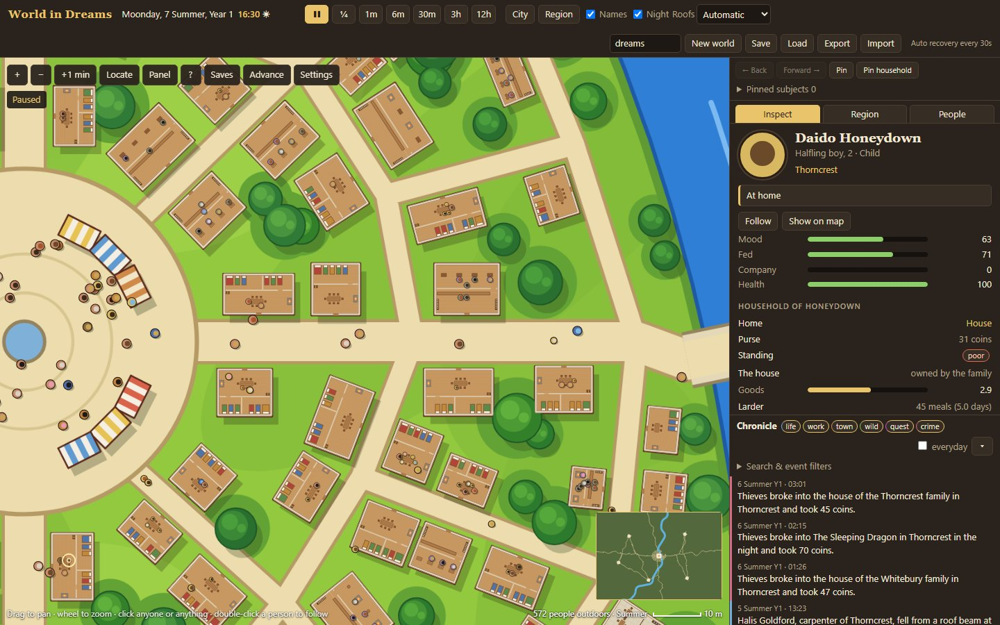
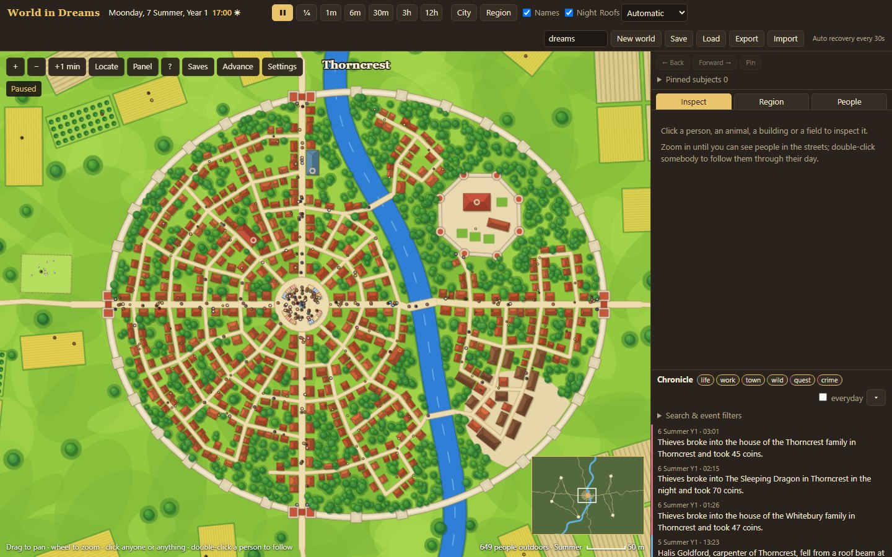
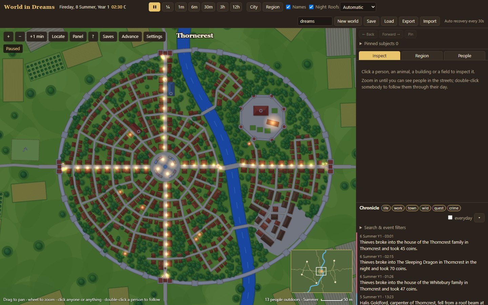
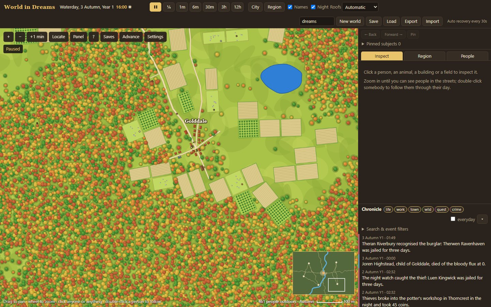

# World in Dreams

**A fantasy world that lives on its own, and you watch it.** A painted,
top-down medieval land where every inhabitant and animal follows its own day:
people wake, work, trade, fall ill, steal, marry and die; fields follow the
seasons; wolves hunt at night. Today it is one walled city and five villages
with about 1,800 people, simulated minute by minute. Personal project; it runs
in the browser on this computer.

## At a glance

| | |
| --- | --- |
| **Version** | 0.3.5 — last worked on 2026-11-11, audited 2026-11-18 |
| **Runs** | In the browser, on this computer. Needs Node.js 22+, nothing else to install |
| **World** | One region of 5.2 × 3.6 km: a walled city, 5 villages, 30 farmsteads, about 300 fields, 700 buildings and 58,000 trees |
| **People** | About 1,800 individuals, each with a home, family, trade, timetable and place inside buildings |
| **Animals** | About 400 in 70 herds: deer, boar, rabbits, a wolf pack, sheep and slimes |
| **Time** | One tick is one minute · 6-day weeks · 12-day seasons · 48-day years |
| **Health** | 31 of 31 automated tests pass · one game year takes about 5 seconds to simulate |

## What already works

| System | State | In one line |
| --- | --- | --- |
| Time and daylight | ✅ | Minutes to years; sunrise and sunset move with the seasons; no months yet |
| Land | 🔶 | Hand-made region around the city: one river, ponds, forest, rocks, meadows. Flat, no relief or biomes |
| Animals | 🔶 | Six kinds in herds that graze, rest, flee, hunt and breed; no hunger, thirst or ages of their own |
| People and their day | ✅ | Timetables by trade, season, age and character; sleep, meals, work, shopping, prayer, tavern |
| Interiors | ✅ | Every building has rooms and furniture; people sleep, sit and work at their own spots |
| Food and farming | ✅ | Sowing and harvest by season, carts to the granary, relief for hungry villages |
| Economy | ✅ | Closed money: employers pay wages; prices, rents, evictions and taxes; every coin accounted for |
| Trades | ✅ | Workshops hire, lay off, close and reopen with demand |
| Lives and death | ✅ | Births, marriages, retirement, funerals; death from age, illness, hunger, cold, accidents, violence |
| Illness and misfortune | 🔶 | Fevers, flux and pox spread; yearly weather, hail, blight, murrain. No fire, flood or daily weather |
| Crime and the law | ✅ | Theft, burglary, brawls, murder, vice; the watch, fines, cells, banishment, gallows; corruption |
| Guild and quests | 🔶 | Ten adventurers answer bounties on wolves and slime culls |
| Movement | 🔶 | Walking along roads; no collision, people jump to their spot indoors |
| Viewer | ✅ | Painted map with seasons and night, inspector, search, chronicle, checkpoints. Dense |
| Society and politics | ⬜ | One lord; no classes, nobles, royal family or factions |
| Attributes, combat, magic | ⬜ | Not started |
| Dungeons and monster peoples | ⬜ | Not started |

Each system is explained in **[Overview → Systems](#/world-in-dreams/1)**.

## Roadmap at a glance

| | Milestone | Progress | Done |
| --- | --- | --- | --- |
| 🔶 | **M1** Living land | ▰▱▱▱▱▱▱▱▱▱ | 7/53 |
| 🔶 | **M2** World creation | ▰▱▱▱▱▱▱▱▱▱ | 1/22 |
| 🔶 | **M3** The observer's window | ▰▰▰▱▱▱▱▱▱▱ | 5/18 |
| 🔶 | **M4** The first kingdom | ▰▰▱▱▱▱▱▱▱▱ | 5/26 |
| 🔶 | **M5** A solid engine | ▰▱▱▱▱▱▱▱▱▱ | 1/21 |
| 🔶 | **M6** Two views: observer and developer | ▰▱▱▱▱▱▱▱▱▱ | 1/17 |
| 🔶 | **M7** Society, factions and chaos | ▰▱▱▱▱▱▱▱▱▱ | 2/34 |
| ⬜ | **M8** Stabilise and simplify | ▱▱▱▱▱▱▱▱▱▱ | 0/12 |
| ⬜ | **M9** Attributes and levels | ▱▱▱▱▱▱▱▱▱▱ | 0/15 |
| ⬜ | **M10** Combat and magic | ▱▱▱▱▱▱▱▱▱▱ | 0/17 |
| 🔶 | **M11** Richer cities and interiors | ▰▱▱▱▱▱▱▱▱▱ | 1/18 |
| ⬜ | **M12** Wild places and monster peoples | ▱▱▱▱▱▱▱▱▱▱ | 0/16 |

**Overall:** 23 of 269 tasks (9%). Ticked tasks already exist in the game. Every task is in the **Roadmap** tab.

## Where it is going

Twelve milestones in five phases. The plan starts again from the ground up —
first the land and its animals, with no people — and moves today's kingdom onto
that land in M4. Everything is subject to change.

## In the game today

## Find your way

| Tab | Read it for |
| --- | --- |
| **Overview** | This page |
| **Overview → [Systems](#/world-in-dreams/1)** | How each part of the world works today, and what it cannot do yet |
| **Overview → [Controls](#/world-in-dreams/2)** | Starting the game, controls, saving |
| **Overview → [Audit](#/world-in-dreams/3)** | The 2026-11-18 review: what was found, what was removed, known problems |
| **[Roadmap](#/world-in-dreams/4)** | Every milestone, sub-goal and task |
| **[Art bible](#/world-in-dreams/5)** | The visual direction, with **Concepts** (images made as the base) and **References** (collected images) |

For an AI or a developer, the technical documentation starts at
`projects/world-in-dreams/AGENTS.md`.

## Run it

Double-click `projects/world-in-dreams/Start World in Dreams.cmd` and the game
opens at <http://localhost:5179>. Zoom into the streets with the mouse wheel,
click anyone to see what they are doing, double-click to follow them.
