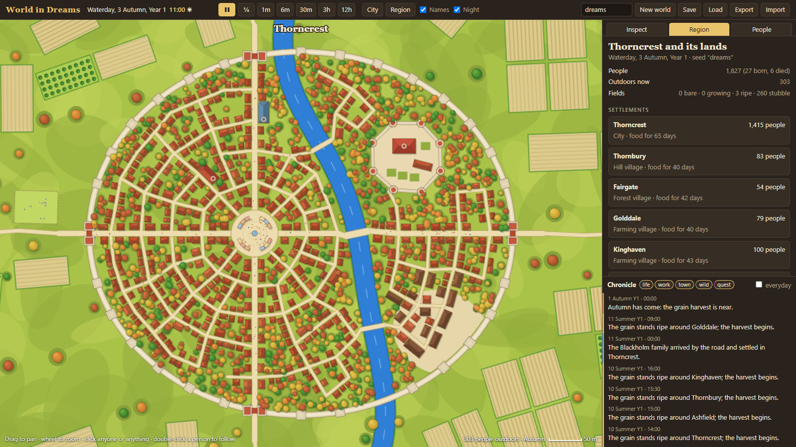
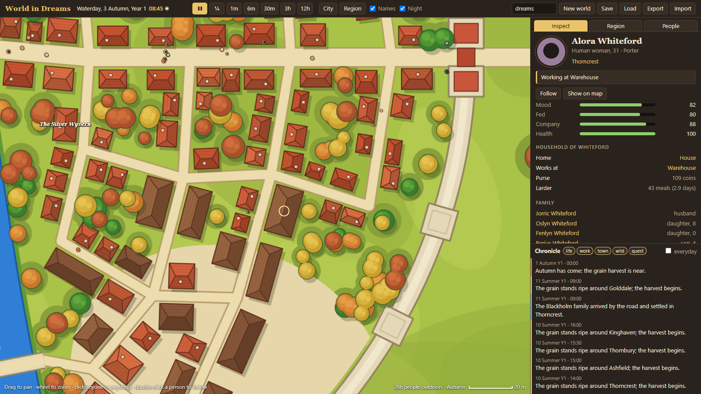
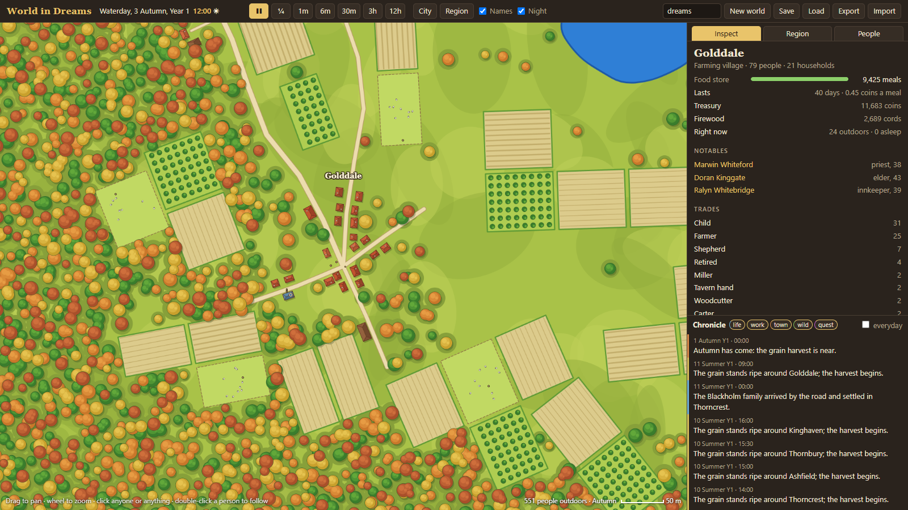
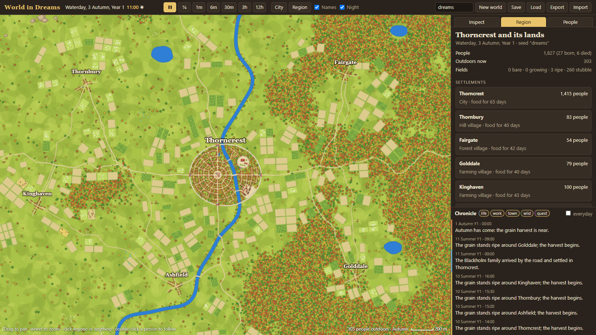
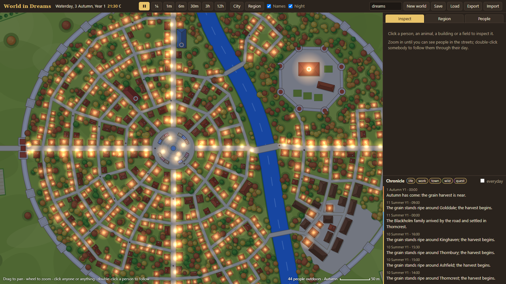
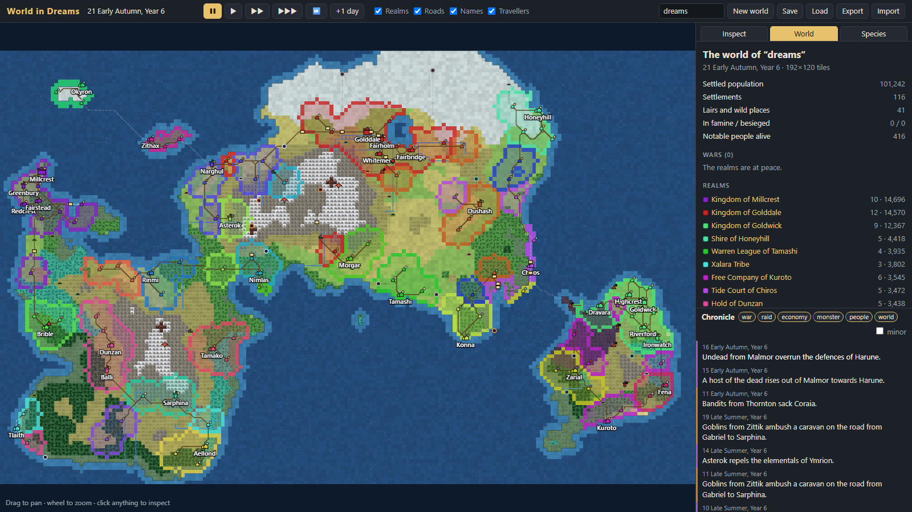

# World in Dreams

**v0.2: the world up close.** One walled city and five villages, simulated
minute by minute with every inhabitant as an individual, and painted top-down in
the style of the art bible's **Zoom 01**. No tile grid. The text RPG and the AI
agents come later, on top of this engine. Personal project; it stays on this
computer.

- Project folder: `projects/world-in-dreams/` — start with its `README.md`.
- Run: double-click `projects/world-in-dreams/Start World in Dreams.cmd`, or
  `npm start` in that folder, then open <http://localhost:5179>.
- Rules, data model and open questions: `projects/world-in-dreams/docs/design.md`.
- The previous continent version (v0.1) is preserved in
  `projects/world-in-dreams/archive/v1-continent/`.
- Source: *World in Dreams — Game Design Document* v0.2 (Google Docs, Spanish).

## Documentation tabs

| Tab | Read it for |
| --- | --- |
| **Getting started** | Running the viewer, controls, speeds, URL shortcuts |
| **Simulation** | The region, daily routines, food and seasons, lives, wildlife |
| **Species** | The six species of this region; the full 33-species table for later |
| **Architecture** | Engine layout, public API, world state, tests |
| **Decisions** | Decisions made, deferred work, open questions, roadmap |
| **Art bible** | Zoom 01–03 concepts that the new look follows; collected references in its References subsection |

## Status (2026-11-11)

Working v0.2. Checked: 8 of 8 engine tests pass (same seed gives the same
history; a loaded save continues identically; one city with villages and no
grid; roads cross the river only on bridges; every building reachable on foot;
people asleep at night and working by day; a full year sown and harvested
without famine; state stays sane). Headless runs of two years on three seeds:
population grows slowly (about 1,800 → 1,920–2,150) with no starvation. Viewer
captures below are taken from the running page. Not yet checked by hand: long
play sessions with mouse and keyboard, and the narrow-screen layout.

## What the region does on its own

- About 1,800–2,000 people wake, eat, walk to work along the streets, shop at
  the market, pray on the rest day, go to the tavern and sleep. Guards keep their
  posts day and night.
- Farmers sow in spring and reap from late spring to autumn; carts carry village
  surpluses to the city granary and relief back to a hungry village.
- Children are born, couples marry, the old retire and die, heirs take over,
  newcomers settle and hungry families leave.
- Deer, boar and rabbits graze and flee; wolves hunt at night and raid sheep
  folds; the guild posts bounties and slime culls and adventurers answer them.
- Everything is written to the chronicle; click an entry to jump to it.

## Deferred by decision

Other cities and realms, the remaining species, the RPG (player, combat, magic,
progression), the AI agents, building interiors and anything commercial.

## Next

1. Watch several seeds through a few seasons and note what feels wrong.
2. Answer the open questions at the end of the design notes.
3. Sprites and portraits on top of the painted style.

## Earlier version

The v0.1 continent viewer, kept for comparison:

