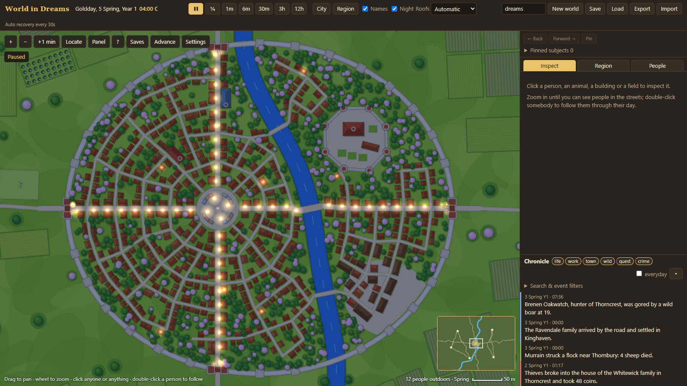
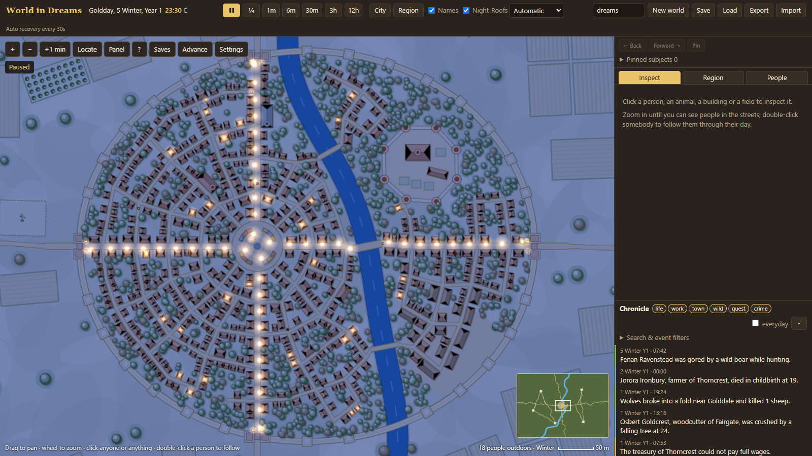
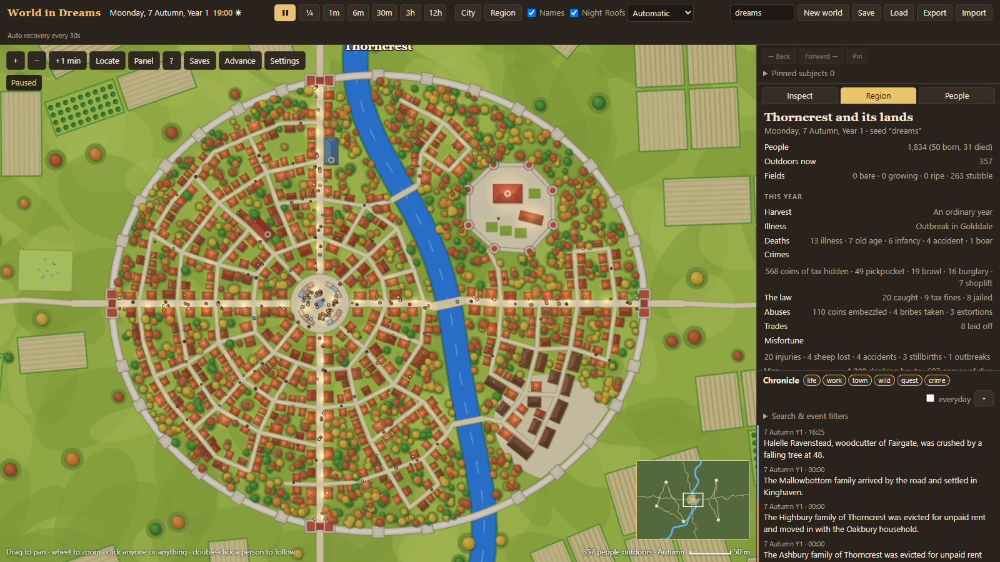
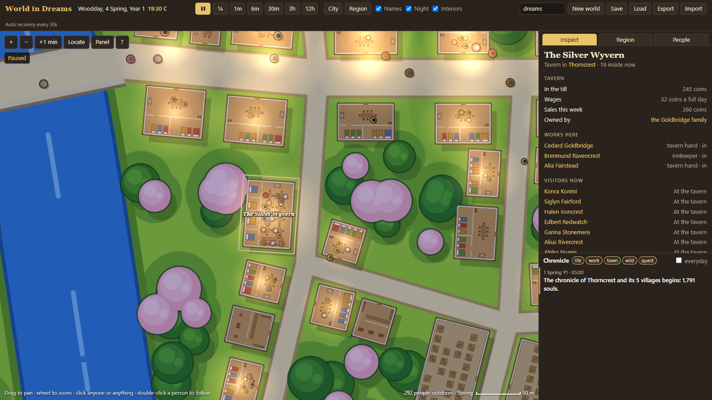
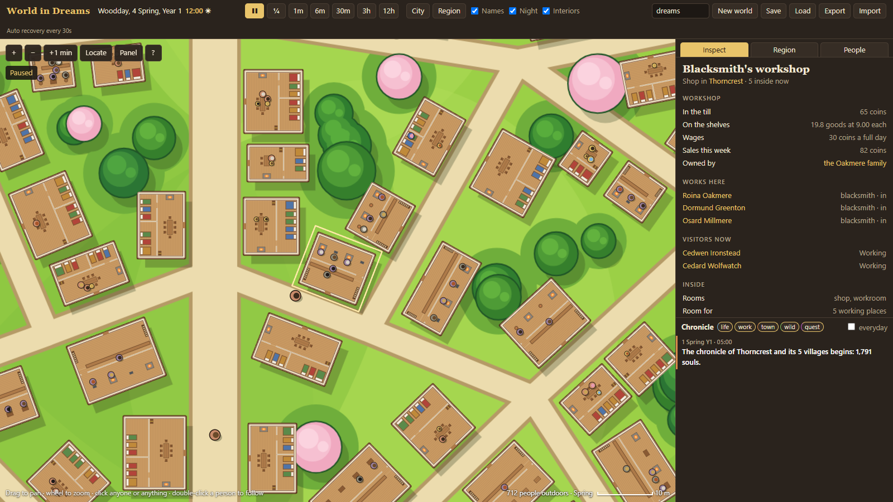
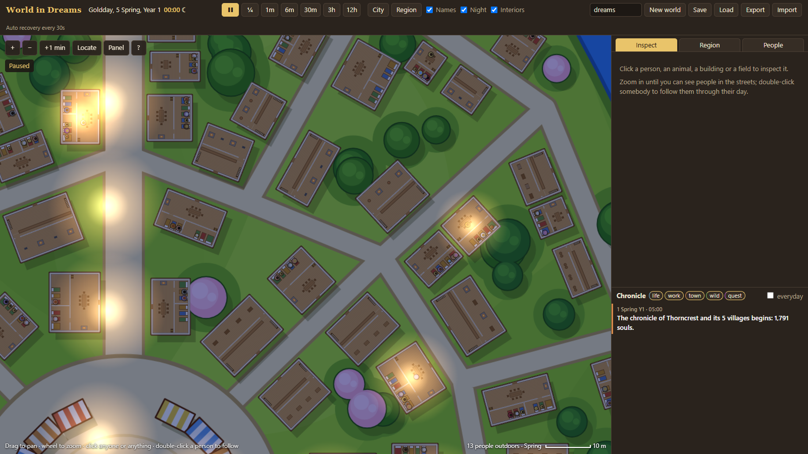

# World in Dreams

**v0.35: real timetables, death, crime and trades that follow demand.** One walled city and five villages,
simulated minute by minute with every inhabitant as an individual, and painted
top-down in the style of the art bible's **Zoom 01**. No tile grid. Close up the
roofs lift off and people sleep, eat, work and pray at their own places inside;
money circulates in a closed economy with employers, rents, taxes and prices.
Everyone keeps the hours of their trade and season; people fall ill, have
accidents and die; some steal, fight and kill, and those in power abuse it. The text RPG and the AI
agents come later, on top of this engine. Personal project; it stays on this
computer.

- Project folder: `projects/world-in-dreams/` — start with its `README.md`.
- Run: double-click `projects/world-in-dreams/Start World in Dreams.cmd`, or
  `npm start` in that folder, then open <http://localhost:5179>.
- Rules, data model and the owner's answers: `projects/world-in-dreams/docs/design.md`.
- The previous continent version (v0.1) is preserved in
  `projects/world-in-dreams/archive/v1-continent/`.
- Source: *World in Dreams — Game Design Document* v0.2 (Google Docs, Spanish).

## Documentation tabs

| Tab | Read it for |
| --- | --- |
| **Getting started** | Running the viewer, controls, speeds, URL shortcuts |
| **Quality of life** | Observer controls, checkpoints, alerts, captures and browser verification |
| **Simulation** | The region, daily routines, interiors, the economy, food and seasons, lives, wildlife |
| **Species** | The six species of this region; the full 33-species table for later |
| **Architecture** | Engine layout, public API, world state, tests |
| **Decisions** | Decisions made, the owner's answers, deferred work, roadmap |
| **Art bible** | Zoom 01–03 concepts that the new look follows; collected references in its References subsection |

## Status (2026-11-11)

**v0.35 (people and their harsher world).** The owner asked to concentrate on
the people: realistic timetables (the night watch awake, farmers early to bed),
trades that follow demand with some workshops failing, letting people die, and
the bad things of a world where not everyone is good. All four are done; see
*Simulation* and `docs/design.md`. Checked: 31 of 31 tests pass (5 new: the
hours people keep, a year and a half of deaths, crime and the law, a failed
harvest and famine prices, trades hiring, laying off and closing, refused v0.3
saves). Four-year headless runs on three seeds: population 1,790–1,810 →
1,816–1,920; 70–80 births and 45–80 deaths a year from many causes; 50–125
purses cut, 15–36 burglaries and 0–2 murders a year; one or two workshops close
a year; every coin still accounted for; about 10 s per two years, saves 2–2.5 MB.
At 23:00 about 20 homes stay lit, against more than 300 in v0.3. Viewer
captures from the page (no page errors besides two missing optional images:
a portrait and the favicon). Not checked: long mouse-driven sessions, and these
card tabs at 768 px and 390 px.

### v0.3 (interiors and economy)

**v0.3 (interiors and economy).** The owner answered the five open questions:
deepen this region, add simple interiors, start a more realistic economy, keep
the 48-day year, leave the protagonist for much later. Checked: 19 of 19 tests
pass (the 8 engine tests below, 6 new tests for the money ledger, bounded money,
rents, interiors, seating across a save and refused old saves, and 5 viewer-tool
tests). Two-year headless runs on three seeds: no hunger, population growing,
every coin accounted for; the poorest tenth of households keep about 25–35
coins, the middle 60–90, the richest tenth 250–350; 60–140 evictions in two
years; about 8.5 s per two years, saves about 1.8 MB. Viewer captures below are
from the running page; old v0.2 saves are refused with a clear message.

### v0.2 (earlier the same day)

Working v0.2. Checked: 8 of 8 engine tests pass (same seed gives the same
history; a loaded save continues identically; one city with villages and no
grid; roads cross the river only on bridges; every building reachable on foot;
people asleep at night and working by day; a full year sown and harvested
without famine; state stays sane). Headless runs of two years on three seeds:
population grows slowly (about 1,800 → 1,920–2,150) with no starvation. Viewer
captures below are taken from the running page. Not yet checked by hand: long
play sessions with mouse and keyboard, and the narrow-screen layout.

## What the region does on its own

- About 1,800–2,000 people wake, eat, walk to work along the streets, shop at
  the market, pray on the rest day, go to the tavern and sleep, each by the hours
  of their trade and the season. Guards keep their posts day and night.
- Farmers sow in spring and reap from late spring to autumn; carts carry village
  surpluses to the city granary and relief back to a hungry village.
- Children are born, couples marry, the old retire, heirs take over, newcomers
  settle and hungry families leave. People die of age, illness, hunger, cold,
  childbirth, accidents, wild animals, violence and the gallows.
- Thieves, brawlers, drunkards, gamblers and tax dodgers; the watch and the
  courts; corrupt officials, watchmen and lords. Workshops hire, lay off, close
  and reopen with demand. Each year's weather, hail and blight shape the harvest.
- Deer, boar and rabbits graze and flee; wolves hunt at night and raid sheep
  folds; the guild posts bounties and slime culls and adventurers answer them.
- Everything is written to the chronicle; click an entry to jump to it.

## Deferred by decision

Other cities and realms, the remaining species, the protagonist and the RPG
(player, combat, magic, progression), the AI agents and anything commercial.

## Next

1. Keep deepening this region: more life inside buildings (cooking, visitors at
   the table), the first-winter dip of the poorest households, the first
   spring's food price peak. People drawn larger at mid zoom belongs to the
   quality-of-life work.
2. Sprites and portraits on top of the painted style.

## Earlier version

The v0.1 continent viewer, kept for comparison:

