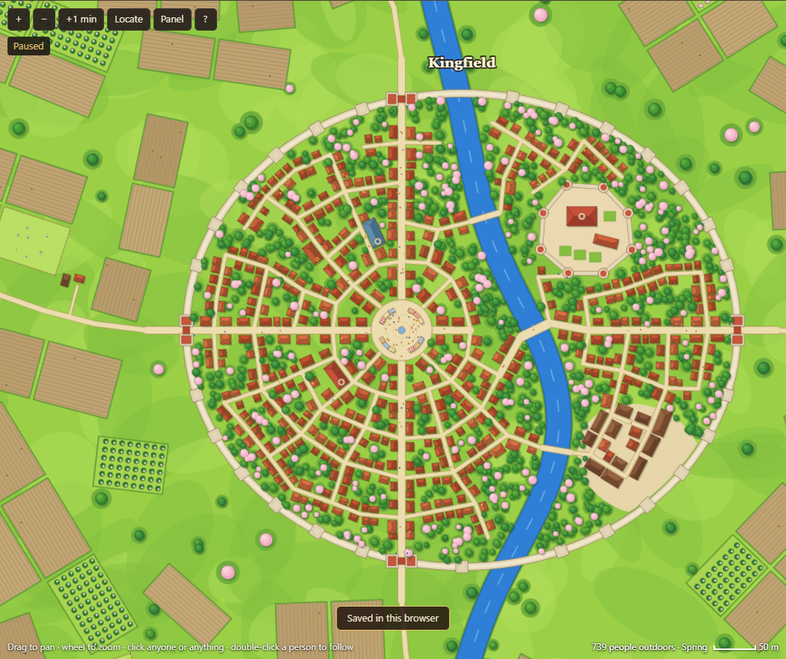
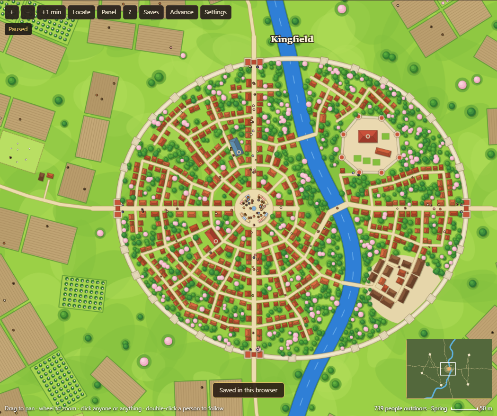
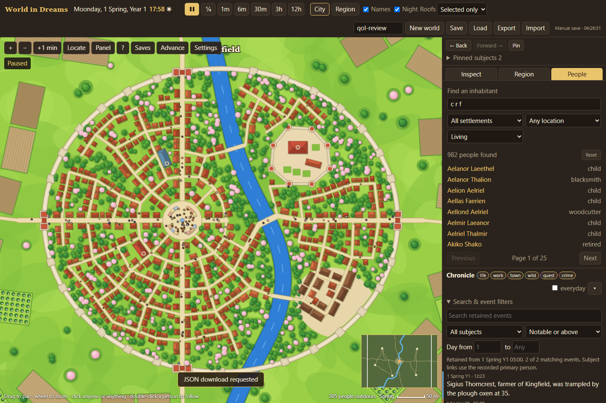
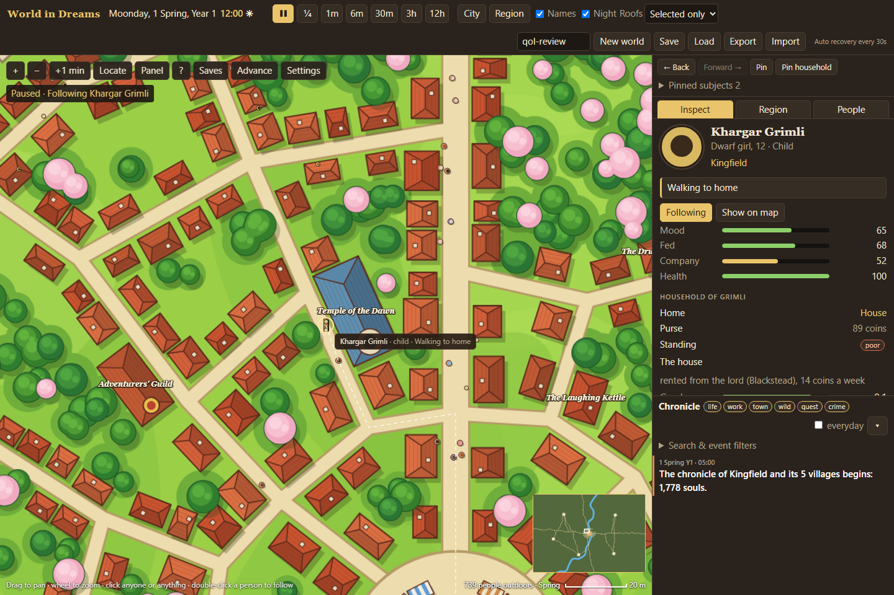
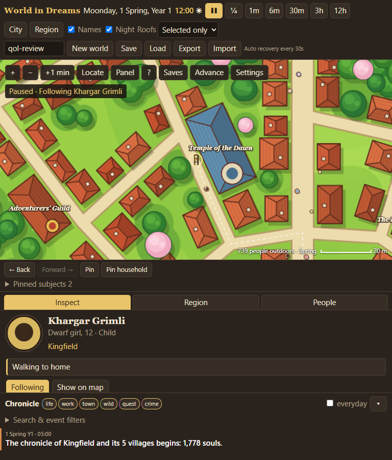
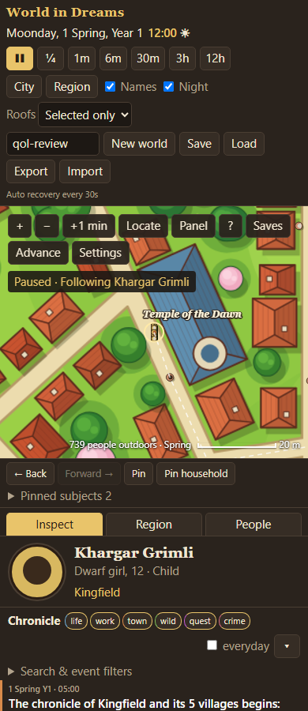

# Quality of life

The approved observation improvements are implemented in the viewer. The
simulation engine is being developed separately by the other agent.

## Current controls

| Control | Behavior |
| --- | --- |
| Settings | Comfortable/large people, text size, sidebar width, inspector/chronicle split, overview, reduced camera motion, pause when hidden and opt-in alerts |
| Back / Forward | Restore the prior inspector or search, including page, scroll position and camera |
| Pin / Pin household | Keep up to 20 subjects per world; deceased/departed people remain labelled and accessible |
| Region / overview map | Fit the complete region, or click the overview to move the camera; overview hides on narrow screens |
| Roofs | Automatic, selected building only, or roofs visible; building inspectors also offer Show inside / Show exterior |
| People | Living, deceased, departed or all recorded people; crowded map clicks offer nearby candidates and double-click still follows |
| Search & event filters | Text, absolute game-day range, importance and selected person/household; Show more pages through retained events |
| Alerts | Appears when enabled alerts occur; opens recent alerts with subject links and game times; pausing is opt-in |
| Saves | Three named checkpoints and the previous recovery, with name, seed/date/version and real save time |
| Advance | Next morning at 07:00, next season, or a custom game day/time; progress, Cancel and a paused finish |
| Chronicle arrow | Collapse chronicle independently of the inspector |

Manual saves, named checkpoints and recovery preserve camera, selection, tab,
search, event filters, pins and roof mode where metadata is available. Loading
keeps playback paused. Automatic recovery now uses IndexedDB when available,
rotates the previous recovery in one transaction, and falls back to the older
browser copy if needed. An old recovery stays protected until a choice is made.
JSON Export remains independent of browser storage; its message says download
requested and does not clear unsaved-progress protection.

Economy charts now include dates, units, ranges, latest values and a table of
recorded values. Explanations distinguish household totals from per-person
standing and daily wage costs from six-day weekly totals. Unrecorded household
transaction histories are not inferred.

## Current verification

- **26/26 Node tests passed**, including seven new checks for camera bounds,
  history, life-status search, chronicle queries, deterministic/cancelable time
  advances, calendar targets and alerts. This is the suite available during
  the pass; the other agent may add more engine tests afterward.
- **12/12 isolated Chromium scenarios passed**: boot/help; search/history/pins;
  interiors/preferences; region framing; deterministic exact-time advance and
  cancellation; named and damaged checkpoints; event filters and comfort;
  overview/crowded-click selection/double-click follow; 768 px; 390 px;
  recovery rotation/reopen; denied storage and high-DPI rendering.
- The before/after people comparison used **identical serialized world state**:
  seed `qol-review`, game minute 720, camera `-80,0,1.15`, 1440 × 960 viewport.
  The baseline uses the UI snapshot taken before this pass with the same engine.
- Syntax and whitespace checks passed. All new simulation behavior remains
  owned by the engine agent; this pass changed UI modules and UI tests.
- The Workspace report was opened at 1440, 768 and 390 px; all six images
  loaded, and enlargement, download and close controls worked. The Workspace
  navigation menu was collapsed at 390 px to give the document its full width.

These are automated captures of the actual canvas game, not generated art or
mockups. The native Computer Use bridge was unavailable. The user's desktop
browser and physical touch gestures were not manually tested. Cross-runtime
bit-identical simulation between Node and Chromium is not claimed: the advance
checks compare within each runtime. Alert tests check recorded primary subjects
and state transitions; complete co-participant histories and retrospective
records require engine support.

## Gameplay captures

People at the same medium zoom, before and after:





Current observer controls and street inspector:





Responsive captures; the inspector and chronicle scroll independently:





## Source and review commands

New modules: `src/ui/observer.js`, `observer-tools.js`, `checkpoint-store.js`
and `observer.css`. Integration: `main.js`, `qol.js` and `viewer-tools.js`.
The new stylesheet is loaded by the observer module; no engine or renderer
rewrite is needed. `render.js` and the base stylesheet were left as supplied
by the preceding work during this pass.

Run inside `projects/world-in-dreams/`:

```text
npm test
npm start
node test/viewer-browser.mjs
```

The optional browser review requires the workspace root's Playwright dev
dependency. It writes disposable test saves and captures under
`.cache/wid-qol-review/`, not into a personal browser profile. No runtime save
JSON or private browser data is included in this report.

## First pass record

Implemented 2026-11-11 in the existing World in Dreams viewer. This pass changes
navigation, discovery and persistence around the simulation. The concurrent
economy/interior work owns the engine changes.

### First pass features

| Area | Behavior |
| --- | --- |
| People | All living inhabitants, alphabetical pages of 40, total counts, multiword search by name/trade/species/settlement, accent-insensitive matching, settlement and indoor/outdoor/away filters, Reset and clear empty states |
| Map | Buttons for zoom, one-minute step, locating selection, showing/hiding the sidebar and help; arrow-key panning and keyboard zoom |
| Playback | Visible paused/following status; stepping pauses before advancing; help pauses temporarily; new/loaded/imported/recovered worlds start paused |
| Follow | Switching selection stops following the old person; F centers on the selected living, present person; dragging stops follow |
| Keyboard | `/` focuses people search, `?`/H opens controls, Ctrl/Cmd+S saves; typing, select menus, composition and browser modifier shortcuts are respected |
| Chronicle | New entries preserve the visible reading anchor; entries are real keyboard buttons; empty filters explain that no events match |
| Browser storage | Manual checkpoint and automatic recovery use separate keys; recovery every 30 seconds and on page hide; an old recovery stays protected until Restore/Keep current is chosen |
| Replace/load | Changed progress offers Cancel, Save & continue, or Continue without saving; read/validation failures keep the current world; blocked storage suggests Export |
| Preferences | Names, night lighting, chronicle filters and sidebar visibility persist in this browser |
| Layout/accessibility | Compact map controls, wrapping toolbar, narrow-screen rules, focus outlines, announced status, disabled pagination and keyboard links |

### First pass source ownership

- `projects/world-in-dreams/src/ui/main.js`: existing viewer integration,
  people panel, input fixes, follow behavior and chronicle anchoring.
- `projects/world-in-dreams/src/ui/qol.js`: controls, help/replace dialogs,
  browser persistence, recovery banner and preferences.
- `projects/world-in-dreams/src/ui/viewer-tools.js`: pure search, key routing,
  storage helpers and validation of the basic references used by the viewer.
- `projects/world-in-dreams/src/ui/style.css`: additions using the current theme.
- `projects/world-in-dreams/test/viewer-tools.test.mjs`: regression coverage.

The engine remains authoritative for simulation and save versions. The existing
manual-save key is retained to keep old checkpoints discoverable; this does not
migrate saves rejected by the current engine. Future engine fields belong in
engine-level save validation, rather than duplicated simulation rules in the UI.

### First pass verification

`npm test`: **13/13 passed** (8 existing engine tests and 5 new viewer tests).
The new checks exercise all 125 results across pages, combined filters and
accents, native editing/modifier/repeat exclusions, separate recovery/manual
storage, blocked storage, damaged saves and deterministic continuation after a
validated save round trip. Validation also passed on a five-day advanced world.
JavaScript syntax checks and whitespace checks passed.

**At the end of that pass, visual verification was pending.** Computer Use could not verify the current
browser URL on Windows and ended the browser interaction. No native capture or
wide/narrow visual acceptance is claimed for this pass. Dialog focus, map
interaction, chronicle anchoring and the responsive layout still need that
browser review; the helper tests do not prove those visual interactions.

Suggested browser review: run the game, press `?` and close help, press `/`,
search `farmer`, move to the last page, filter outdoors, inspect/follow someone,
select a different person, press `.`, save and reload, then reopen after an auto
recovery. Check at desktop width, 768 px and 390 px. Use a disposable browser
profile for storage-failure or malformed-save exercises.
