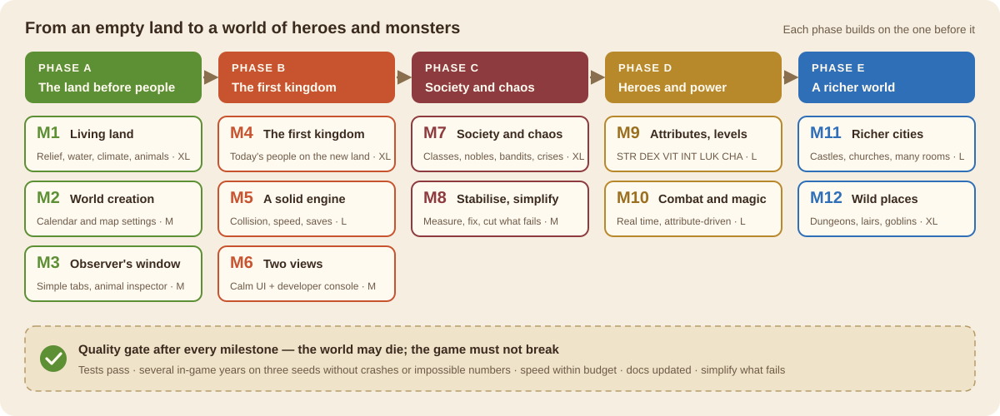

# Roadmap

**In short:** twelve milestones in five phases rebuild World in Dreams from the
ground up: first a living land with animals and no people, then the kingdom on
top of it, then society and chaos, then heroes with attributes, combat and
magic, and finally richer cities, dungeons and monster peoples. Each milestone
has sub-goals, and each sub-goal has small tasks to tick off. Ticked tasks
already exist in the game today. Everything here is subject to change.

## Progress at a glance

| | Milestone | From point | Size | Progress | Done |
| --- | --- | --- | --- | --- | --- |
| 🔶 | **M1** Living land | 1 | XL | ▰▱▱▱▱▱▱▱▱▱ | 7/53 |
| 🔶 | **M2** World creation | 2, 5 | M | ▰▱▱▱▱▱▱▱▱▱ | 1/22 |
| 🔶 | **M3** The observer's window | 3 | M | ▰▰▰▱▱▱▱▱▱▱ | 5/18 |
| 🔶 | **M4** The first kingdom | 4 | XL | ▰▰▱▱▱▱▱▱▱▱ | 5/26 |
| 🔶 | **M5** A solid engine | 5 | L | ▰▱▱▱▱▱▱▱▱▱ | 1/21 |
| 🔶 | **M6** Two views: observer and developer | 6 | M | ▰▱▱▱▱▱▱▱▱▱ | 1/17 |
| 🔶 | **M7** Society, factions and chaos | 7, 12 | XL | ▰▱▱▱▱▱▱▱▱▱ | 2/34 |
| ⬜ | **M8** Stabilise and simplify | 8 | M | ▱▱▱▱▱▱▱▱▱▱ | 0/12 |
| ⬜ | **M9** Attributes and levels | 9 | L | ▱▱▱▱▱▱▱▱▱▱ | 0/15 |
| ⬜ | **M10** Combat and magic | 10 | L | ▱▱▱▱▱▱▱▱▱▱ | 0/17 |
| 🔶 | **M11** Richer cities and interiors | 11 | L | ▰▱▱▱▱▱▱▱▱▱ | 1/18 |
| ⬜ | **M12** Wild places and monster peoples | 13 | XL | ▱▱▱▱▱▱▱▱▱▱ | 0/16 |

**Overall:** 23 of 269 tasks (9%).

## How to read this page

| Mark | Meaning |
| --- | --- |
| ✅ | Milestone or sub-goal complete |
| 🔶 | Started, or part of it already exists |
| ⬜ | Not started |
| ☑ / ☐ | A task done / to do. Done tasks describe something already in the game |
| S · M · L · XL | Relative size of a milestone, from a few sessions to a long project |

Tasks are numbered **milestone.sub-goal.task** (for example **1.6.4**), so a
task can be named in a request. Every milestone states what it **starts from**
and when it is **done**. The progress table is recounted from the checkboxes by
`npm run roadmap` in `projects/world-in-dreams/`.

## How we build it

1. **Everything is a system.** Land, climate, plants, animals, people, economy,
   crime, factions, combat and magic are separate systems. Each owns its data,
   runs on its own clock (every minute, hour, day or season), and talks to the
   others through the shared world state and through events.
2. **Layers, from the ground up.** Land → climate → plants → animals → people →
   society → heroes. A higher layer reads the layers below and changes them
   only through clear actions: fell a tree, sow a field, hunt a deer.
3. **The engine rules, the viewer watches.** Only the engine changes the world.
   The same seed and settings always give the same history.
4. **Content is data.** Animals, species, trades, buildings, spells and
   calendars live in tables, so adding one does not mean writing a new system.
5. **Detail where it matters.** Individuals are simulated in full detail near
   settlements and activity, and in summary elsewhere. The world decides where,
   never the camera, so watching does not change history.
6. **The world may die; the game must not break.** *(Your point 8.)* Every
   milestone ends with a quality gate: all tests pass; a soak run of several
   in-game years on three seeds has no crashes, stuck entities or impossible
   numbers; speed stays within budget; the documentation is updated. A system
   too complex to work reliably is simplified before moving on.
7. **Keep what works running.** New foundations are built next to the current
   game. Today's city region keeps working until the new kingdom replaces it in
   M4.

## Where your thirteen points went

| Your point | Where it is now |
| --- | --- |
| 1 · Continent, fauna, calendar | **M1** Living land |
| 2 · World generator | **M2** World creation |
| 3 · Simple UI and animal inspector | **M3** The observer's window |
| 4 · A small human kingdom | **M4** The first kingdom |
| 5 · Engine, colliders, calendar | **M5** A solid engine. Making systems follow the chosen calendar starts in **M2.4**, because the generator needs it |
| 6 · Simpler UI and a developer console | **M6** Two views |
| 7 · Society, factions, chaos | **M7** Society, factions and chaos |
| 8 · Quality control | Rule 6 above, applied after every milestone, plus **M8** right after the most complex milestone |
| 9 · Attributes and levels | **M9** Attributes and levels |
| 10 · Combat and magic | **M10** Combat and magic |
| 11 · Detailed cities and interiors | **M11** Richer cities and interiors |
| 12 · Monarchy as the political system | A design rule inside **M7.2**, valid for every future kingdom |
| 13 · Dungeons, lairs, goblins and other peoples | **M12** Wild places and monster peoples |

## Biggest risks

| Risk | Why it matters | Answer | Milestone |
| --- | --- | --- | --- |
| Scale against detail | A continent with every creature simulated minute by minute can become too slow in a browser | Levels of detail chosen by the world; the engine in a background worker; a speed budget in every quality gate | M1, M5 |
| The land is built around the city | Today the river, roads and villages are placed around a fixed city at the centre. A generated continent needs the opposite: land first, city later | Build the new land generator as a separate layer, then move the kingdom onto it | M1, M4 |
| The calendar touches every rule | Growth, births, deaths and prices are tuned to a 48-day year | Express every rate per day or per fraction of a year | M2, M5 |
| Real-time fights for many people | Detailed combat for thousands of people at once is expensive | Full combat where people are watching or few are involved; the same odds resolved quickly elsewhere | M10 |
| Complexity creep | Each new system multiplies the ways the world can break | Rule 6 after every milestone; M8 dedicated to simplifying | All |

---

## Phase A · The land before people

### M1 · Living land 🔶

**Size:** XL · **From your points:** 1

> A small continent with its own relief, water, climate, plants and animals,
> living through hours, days, weeks, months, seasons and years, with no people
> in it.

**Starts from:** the current region (5.2 × 3.6 km) already has days of 1,440
minutes, sunrise and sunset that follow the seasons, a 6-day week, 12-day
seasons and a 48-day year. It has one river, ponds, forest, rocks and meadows,
and about 400 animals of six kinds in 70 herds that graze, rest, flee, hunt and
breed in spring. The land is flat, there are no months and no daily weather,
animals have no needs or ages of their own, and the land is shaped around the
city rather than the city around the land.

**Done when:** a new seed produces a continent with mountains, hills,
plateaus, plains, valleys, rivers that flow downhill into lakes and the sea,
coasts, forests and a desert. Animals live in the biomes that suit them; they
eat, drink, breed, hunt and die; their numbers rise and fall over several years
without dying out or exploding. All of it can be watched with a full calendar.

#### 1.1 Foundations ⬜

- [ ] **1.1.1** Split world creation into layers (land → climate → plants → animals → later people), each its own generator module.
- [ ] **1.1.2** Add a "nature only" world type that creates no people. The current city region stays the default until M4.
- [ ] **1.1.3** Write the system contract: module, owned state, clock, what it reads, what it changes, events in and out, data tables, tests.
- [ ] **1.1.4** Move wildlife to the contract as the first example system.
- [ ] **1.1.5** Choose the continent size (proposal: start at 20–30 km across) and record the decision.

#### 1.2 Time and calendar 🔶

- [x] **1.2.1** One tick is one game minute; a day has 1,440 minutes.
- [x] **1.2.2** Day and night, with sunrise and sunset that follow the seasons (about 16 hours of daylight at midsummer, 8½ at midwinter).
- [x] **1.2.3** Named 6-day weeks, four 12-day seasons and a 48-day year.
- [ ] **1.2.4** Add months between weeks and seasons: minute → hour → day → week → month → season → year.
- [ ] **1.2.5** Keep every calendar length in one calendar object stored with the world, instead of constants spread over ten modules.
- [ ] **1.2.6** Calendar events that systems can listen to: new day, week, month, season and year.
- [ ] **1.2.7** Make animals follow the real sunrise and sunset (today they use fixed hours, 19:00 or 20:00 to 05:00).

#### 1.3 Relief ⬜

- [ ] **1.3.1** Height map for the whole continent; things that move keep free positions in metres (no tile grid for movement).
- [ ] **1.3.2** Landmass from the seed: coastline, sea, bays, capes and a few islands.
- [ ] **1.3.3** Mountain ranges and hills.
- [ ] **1.3.4** Plateaus (high flat ground with steep edges), plains and valleys.
- [ ] **1.3.5** A simple erosion pass so ridges and valleys look natural.
- [ ] **1.3.6** Height and slope available to every system (walking, grazing, later farming and building).

#### 1.4 Water ⬜

- [ ] **1.4.1** Rivers that rise in high ground and flow downhill, joining into larger rivers on the way to a lake or the sea.
- [ ] **1.4.2** Lakes where water gathers; ponds and marshes in low wet ground.
- [ ] **1.4.3** Rivers widen downstream; fords and narrow points are marked for later roads and bridges.
- [ ] **1.4.4** Coasts: beaches, cliffs and river mouths.
- [ ] **1.4.5** Fresh water that animals can find and drink.

#### 1.5 Climate and weather ⬜

- [ ] **1.5.1** Temperature from latitude, height and season.
- [ ] **1.5.2** Rainfall from the prevailing wind and the mountains, with dry land behind ranges where deserts form.
- [ ] **1.5.3** Biomes from temperature, rainfall and height: grassland, forest, deep forest, hills, mountains, snowy peaks, marsh, steppe, desert, beach.
- [ ] **1.5.4** Daily weather for each area: clear, cloudy, rain, storm, snow, fog, following season and biome.
- [ ] **1.5.5** Seasons change the land: snow on high and cold ground in winter, a dry season in the desert, high water in spring.

#### 1.6 Plants 🔶

- [x] **1.6.1** The painter already changes the land by season: spring blossom, autumn colours, winter snow.
- [ ] **1.6.2** Vegetation placed by biome: broadleaf and conifer woods, scrub, grass, reeds, cactus and dry bush.
- [ ] **1.6.3** Food for animals: the grazing value of each area, eaten down and regrowing with the season.
- [ ] **1.6.4** Forests regrow slowly where trees are lost (prepares woodcutting in M4).

#### 1.7 Animals 🔶

- [x] **1.7.1** Six kinds living in herds: deer, boar, rabbits, a wolf pack, sheep and slimes.
- [x] **1.7.2** Basic behaviour: graze by day, rest at night, bolt from people; wolves hunt deer at night.
- [x] **1.7.3** Herds breed in spring.
- [ ] **1.7.4** Animal table (data): biome, diet, herd size, speed, senses, active hours, lifespan, young per birth.
- [ ] **1.7.5** Choose 10–14 wild species by biome (for example deer, boar, hares, wolves, foxes, bears, mountain goats, wild horses, fish, birds of prey, desert lizards).
- [ ] **1.7.6** Each animal is an individual with age, sex, health and a home herd.
- [ ] **1.7.7** Needs: hunger, thirst, rest and safety; animals walk to food and water.
- [ ] **1.7.8** Life cycle: birth, growth, old age and death by hunger, cold, illness or predators.
- [ ] **1.7.9** Predators and prey: hunting when hungry, fleeing in herds, carcasses left for scavengers.
- [ ] **1.7.10** Home ranges, territories and seasonal movement (down from the mountains in winter, towards water in the dry season).
- [ ] **1.7.11** Animals respect the land: they do not walk on water unless they swim, slow down on slopes and cannot climb cliffs.
- [ ] **1.7.12** Populations balanced over years: numbers rise and fall without dying out or exploding (tuned and tested).

#### 1.8 Detail where it matters ⬜

- [ ] **1.8.1** Define the levels: every animal each minute near activity; herds as one unit each hour farther away; numbers per area each day for remote land.
- [ ] **1.8.2** Switching level keeps the same totals: no animals appear or vanish.
- [ ] **1.8.3** The level is decided by the world, never by the camera, so a seed always gives the same history (test).
- [ ] **1.8.4** Speed budget: measure one year of the empty continent headless and set a target (proposal: under a minute).

#### 1.9 Seeing the land ⬜

- [ ] **1.9.1** Paint relief with hill shading, plus water, coasts and biomes, in the current painted top-down style.
- [ ] **1.9.2** Zoom from the whole continent down to a single animal, reusing the tile painter.
- [ ] **1.9.3** Paint the daily weather: rain, snow, fog and cloud shadows.
- [ ] **1.9.4** Developer layers: height, temperature, rainfall, biome and animal density.

#### 1.10 Quality gate ⬜

- [ ] **1.10.1** Pass the quality gate (rule 6).

### M2 · World creation 🔶

**Size:** M · **From your points:** 2, 5

> A creation screen where you choose the rules of time and the kind of land
> before the simulation starts.

**Starts from:** a seed box and a **New world** button. Calendar lengths are
fixed in code. The speed buttons (¼ game minute to 12 game hours per second)
exist in the viewer.

**Done when:** you can create a world with your own calendar and map type;
every nature system behaves correctly under that calendar; the settings are
saved with the world and shown in it.

#### 2.1 Creation screen 🔶

- [x] **2.1.1** A seed and a **New world** button; the same seed always gives the same world.
- [ ] **2.1.2** New-world dialog with three sections (World, Time, Land) and **Random** and **Defaults** buttons.
- [ ] **2.1.3** A small preview map of the land before confirming.
- [ ] **2.1.4** Presets, for example "Like today" (48-day year), "Earth-like" (365 days) and "Quick seasons".
- [ ] **2.1.5** Settings stored in the save and shown in the World tab.

#### 2.2 Time settings ⬜

- [ ] **2.2.1** Hours in a day.
- [ ] **2.2.2** Days in a week and their names.
- [ ] **2.2.3** Weeks in a month, months in a year, and month names.
- [ ] **2.2.4** Which months belong to each season.
- [ ] **2.2.5** Time scale: game time per real second at normal speed, from real time (1:1) to fast. This is separate from the playback speed buttons.
- [ ] **2.2.6** Validation: refuse impossible calendars and warn about very long years, which take long to watch.

#### 2.3 Land settings ⬜

- [ ] **2.3.1** Size: small, medium or large continent.
- [ ] **2.3.2** Shape: one landmass, a landmass with islands, or a peninsula.
- [ ] **2.3.3** Relief: flat, hilly or mountainous.
- [ ] **2.3.4** Climate: cold, temperate or warm; dry, normal or wet.
- [ ] **2.3.5** Wildlife: scarce, normal or abundant.

#### 2.4 Systems follow the calendar ⬜

- [ ] **2.4.1** Express every rate per day or per fraction of a year, never per 48-day year (today crop growth divides by a fixed 48).
- [ ] **2.4.2** Seasonal curves (daylight, temperature, plant growth, breeding) read the fraction of the year.
- [ ] **2.4.3** Ages and lifespans are counted in years and daily needs in hours, whatever the calendar.
- [ ] **2.4.4** Day-length changes keep sleep, activity and hunting hours sensible.
- [ ] **2.4.5** Test: the same seed under a short, the default and a long calendar keeps plants, animals and seasons balanced.

#### 2.5 Quality gate ⬜

- [ ] **2.5.1** Pass the quality gate (rule 6).

### M3 · The observer's window 🔶

**Size:** M · **From your points:** 3

> A simple, practical interface for the natural world: tabs with the world's
> data and an inspector for any animal you click.

**Starts from:** the viewer has Inspect, Region and People tabs, a chronicle
with filters, search, pins, checkpoints, an overview map, and click-to-inspect
for people, animals, buildings and fields. It is built around the city, and
animals show little because they are simulated in herds.

**Done when:** in a nature-only world you can read the date, season and
weather at a glance, browse the land and its animals in tabs, and click any
animal to see what it is doing and why, then follow it.

#### 3.1 Top bar 🔶

- [x] **3.1.1** Date and time, pause and speed buttons.
- [ ] **3.1.2** Add the month, the season and an icon for today's weather.

#### 3.2 Tabs 🔶

- [x] **3.2.1** A tab bar and a chronicle with type filters and text search.
- [ ] **3.2.2** **World** tab: calendar, season, weather, daylight and the world's settings.
- [ ] **3.2.3** **Land** tab: biomes and their share, rivers and lakes, and the place under the cursor.
- [ ] **3.2.4** **Fauna** tab: each species with its count, a trend chart and where it lives.
- [ ] **3.2.5** Nature events in the chronicle: births, hunts, deaths, migrations and storms.

#### 3.3 Animal inspector 🔶

- [x] **3.3.1** Clicking an animal selects it.
- [ ] **3.3.2** Show species, age, sex, health, hunger, thirst, current action and goal ("walking to the lake to drink").
- [ ] **3.3.3** Show its herd or pack: members, leader and home range on the map.
- [ ] **3.3.4** A short life log: born, fled from wolves, gave birth.
- [ ] **3.3.5** Follow an animal with the camera, as already possible for people.

#### 3.4 Map 🔶

- [x] **3.4.1** Pan, zoom, framing buttons and an overview map with click-to-jump.
- [x] **3.4.2** Place names that can be shown or hidden.
- [ ] **3.4.3** Clicking empty ground shows the place: biome, height, temperature and plants.
- [ ] **3.4.4** Map layers that can be switched on: weather, animal ranges, water.
- [ ] **3.4.5** Hovering shows a short tooltip; clicking opens the full card.

#### 3.5 Quality gate ⬜

- [ ] **3.5.1** Pass the quality gate (rule 6).

---

## Phase B · The first kingdom

### M4 · The first kingdom 🔶

**Size:** XL · **From your points:** 4

> A small human kingdom placed on the natural world — a walled city and
> villages like today's — running the current people simulation.

**Starts from:** nearly all of the people simulation exists in today's
hand-made region: about 1,800 individuals with homes, families, trades, daily
timetables and places inside buildings; a closed economy; illness, accidents
and death; crime, the law and abuse of power; a lord and an adventurers' guild.
It depends on that one fixed layout, and five non-human species live among the
humans.

**Done when:** a new world places the kingdom on suitable land of the
generated continent; people live there as they do today; the land shapes the
kingdom (farms on fertile ground, the city by its river, roads around the
mountains); only humans live there; the hand-made region generator is retired.

#### 4.1 Where people live ⬜

- [ ] **4.1.1** Score the land for settling: fresh water, flat fertile ground, wood, stone, safety and coast.
- [ ] **4.1.2** Put the walled capital on the best site by a river, and 4–6 villages on good farmland within a day's walk.
- [ ] **4.1.3** Place farmsteads, fields, pastures, woodlots and fishing spots by soil and terrain.
- [ ] **4.1.4** Mark the kingdom's land: the area it farms, hunts and patrols.

#### 4.2 Settlements on real terrain 🔶

- [x] **4.2.1** Every building has a simple interior with beds, seats, work places and pews.
- [ ] **4.2.2** Make the city generator (walls, gates, market, streets, citadel, quarters) fit any site, with or without a river.
- [ ] **4.2.3** Village generator on terrain: green, chapel, barn, tavern and houses.
- [ ] **4.2.4** Roads that follow the land: around steep slopes, over rivers by bridges or fords, joining the villages and the city.
- [ ] **4.2.5** Keep today's guarantees on every seed: every building reachable on foot, water crossed only by bridges or fords (tests).

#### 4.3 Bringing the people over 🔶

- [x] **4.3.1** Households, families, trades and daily timetables by trade, season and age.
- [x] **4.3.2** A closed economy: employers pay wages; prices, rents and taxes move money between purses.
- [x] **4.3.3** Lives: births, marriages, illness, accidents, deaths and funerals.
- [x] **4.3.4** Crime, the watch and the courts, corruption and abuse of power.
- [ ] **4.3.5** Make each system read the generated layout: no fixed positions, settlement counts or building lists.
- [ ] **4.3.6** Humans only: take catfolk, elves, dwarves, halflings and foxfolk out of the starting population and keep their data for later.
- [ ] **4.3.7** Sheep and other livestock become part of the farms instead of wildlife.
- [ ] **4.3.8** Timetables, crops, ages and yearly rates follow the M2 calendar.

#### 4.4 People meet nature ⬜

- [ ] **4.4.1** Hunters hunt the M1 animals, and too much hunting thins them out.
- [ ] **4.4.2** Woodcutters fell real trees; woods shrink near settlements and regrow slowly.
- [ ] **4.4.3** Fields replace wild plants; fishers use the rivers and lakes.
- [ ] **4.4.4** Predators threaten flocks and lone travellers (today only the wolf pack does).
- [ ] **4.4.5** Weather affects work and harvests: rain stops field work; storms and droughts damage crops.

#### 4.5 Retiring the old region ⬜

- [ ] **4.5.1** Kingdom worlds become the default and the hand-made region generator is removed.
- [ ] **4.5.2** A new save version, with a clear message for older saves.
- [ ] **4.5.3** Existing tests rewritten to run on generated kingdoms with several seeds.

#### 4.6 Quality gate ⬜

- [ ] **4.6.1** Pass the quality gate (rule 6).

### M5 · A solid engine 🔶

**Size:** L · **From your points:** 5

> Fix what you do not see: movement that respects walls and terrain, a
> simulation that keeps up, safe saves, and every system on the chosen calendar.

**Starts from:** people walk along a road network. In a one-day sample, about
0.6% of walking positions were inside a building the walker was not entering
(straight stretches to and from places off the road). Indoors, people jump from
the door to their spot. Nobody steps aside for anyone. Animals only check that
the herd's next centre is open ground. One 48-day year of today's region takes
about 5 seconds headless, and the engine runs on the browser's main thread.

**Done when:** in a year-long check no person or animal passes through a wall,
a building, water or a cliff; people walk through doors to their spot inside;
the kingdom runs at the chosen speeds without skipping minutes; the M2 calendar
test passes for the whole simulation.

#### 5.1 Movement and collision ⬜

- [ ] **5.1.1** Walkable areas: streets, open ground, bridges, and rooms joined by doors. Blocked: walls, water and cliffs.
- [ ] **5.1.2** Paths that use them: the road network for long trips, local paths across open ground and inside buildings.
- [ ] **5.1.3** People enter by the door and walk to their bed, seat or work place instead of jumping.
- [ ] **5.1.4** Simple avoidance, so people and animals do not pile up in streets and doorways.
- [ ] **5.1.5** Terrain cost: slopes, mud and snow slow walkers; rivers need bridges or fords.
- [ ] **5.1.6** Test: over a day, nobody stands inside a wall, water, or a building they are not in.

#### 5.2 Time everywhere ⬜

- [ ] **5.2.1** Find every hard-coded time in the code (fixed night hours, the 48 in crop growth, per-year chances).
- [ ] **5.2.2** Timetables and working hours scale with the length of the day.
- [ ] **5.2.3** The M2 calendar test passes for the full simulation.

#### 5.3 Speed ⬜

- [ ] **5.3.1** Measure the time each system takes per tick and set a budget for each.
- [ ] **5.3.2** Run the engine in a background worker so the viewer stays smooth.
- [ ] **5.3.3** Summary simulation for people far from anything interesting, without breaking determinism.
- [ ] **5.3.4** A speed test in the suite that fails if a simulated year becomes much slower.

#### 5.4 Saves 🔶

- [x] **5.4.1** Saves that continue exactly where they left off; named checkpoints and automatic recovery.
- [ ] **5.4.2** Upgrade old saves to the new version instead of refusing them.
- [ ] **5.4.3** Smaller saves (compact data, compression) as the world grows.
- [ ] **5.4.4** The same seed gives the same history in Node and in the browser (test).

#### 5.5 Code health ⬜

- [ ] **5.5.1** Split the large tick (`sim.js`) and region (`layout.js`) files into system modules following the contract.
- [ ] **5.5.2** An event bus: systems publish events (death, theft, birth) and others subscribe; the chronicle is one subscriber.
- [ ] **5.5.3** Development checks during play: no negative stores, no broken references, no stuck people.

#### 5.6 Quality gate ⬜

- [ ] **5.6.1** Pass the quality gate (rule 6).

### M6 · Two views: observer and developer 🔶

**Size:** M · **From your points:** 6

> A calm observer interface that shows only what matters, and a separate
> full-screen developer console with everything.

**Starts from:** one dense screen: two toolbar rows, eight map buttons, three
tabs, pins, chronicle filters, charts and settings, all visible together.

**Done when:** someone seeing the game for the first time understands the
screen without help; essentials are a glance away and details one click away;
the developer console shows the state, graphs and logs of any system and can
pause, step and inspect, without cluttering the observer's view.

#### 6.1 Observer view ⬜

- [ ] **6.1.1** List every control and panel and decide: keep, move to the developer console, or remove.
- [ ] **6.1.2** A minimal top bar: date, weather, play and speed. Everything else lives in menus.
- [ ] **6.1.3** Short cards: clicking something shows who or what it is, what it is doing and why in one line, with **More** for details.
- [ ] **6.1.4** Notifications only for notable events, grouped and unobtrusive.
- [ ] **6.1.5** A readable chronicle: a "today in the kingdom" summary instead of an endless list.
- [ ] **6.1.6** Restyle the panels to match the art bible.

#### 6.2 Developer console ⬜

- [ ] **6.2.1** Opened with one key; a full-screen layout of its own.
- [ ] **6.2.2** One panel per system with its state, counters and recent events.
- [ ] **6.2.3** Entity browser: search any person, animal, building, household or business and see its raw data.
- [ ] **6.2.4** Graphs over time: population, food, money, prices, crime, animals.
- [ ] **6.2.5** Map overlays: paths, collisions, detail levels, needs.
- [ ] **6.2.6** Tools: step a minute or an hour, run to a time, switch a system off for testing (such runs are marked as test runs).
- [ ] **6.2.7** Speed panel: time used by each system per tick.
- [ ] **6.2.8** Developer information never appears in the observer view unless asked for.

#### 6.3 Settings 🔶

- [x] **6.3.1** Comfort settings exist: text size, sidebar width, larger people, reduced camera motion.
- [ ] **6.3.2** Gather all settings in one menu.

#### 6.4 Quality gate ⬜

- [ ] **6.4.1** Pass the quality gate (rule 6).

---

## Phase C · Society and chaos

### M7 · Society, factions and chaos 🔶

**Size:** XL · **From your points:** 7, 12

> Social classes, a monarchy with its nobles, factions with their own aims,
> bandits, adventurers, crises and disasters — and a simulation free to decide
> whether the kingdom thrives or falls.

**Starts from:** crime and corruption, a lord who taxes and pays a levy to an
unseen king, an adventurers' guild with bounties, spreading illness, failed
harvests and famine prices already exist. There are no social classes as a
system, no royal family, no nobles besides the one lord, no factions, no
bandits, and no disasters besides hail, blight, murrain and outbreaks.

**Done when:** over ten years on several seeds, some kingdoms prosper, some
decline and some collapse, for reasons you can follow in the chronicle; classes,
nobles, factions, bandits and adventurers act on their own.

#### 7.1 Social classes ⬜

- [ ] **7.1.1** Classes: royalty, nobility, clergy, burghers (merchants and masters), commoners (craftsmen and farmers), the poor, outcasts.
- [ ] **7.1.2** Class comes from birth, wealth and office; people rise (marriage, fortune, service) and fall (ruin, crime).
- [ ] **7.1.3** Class shapes home, clothing, food, rights, taxes and how the law treats you.
- [ ] **7.1.4** Inequality figures in the developer console.

#### 7.2 Monarchy and nobility ⬜

- [ ] **7.2.1** Design rule: every kingdom is a monarchy, with a king and/or queen, princes and princesses, and nobles holding fiefs.
- [ ] **7.2.2** A royal family with succession: heir, regent for a child heir, disputes when there is none.
- [ ] **7.2.3** Fiefs: the kingdom divided into the city, the villages and their land, each held by a noble who taxes it and owes the crown.
- [ ] **7.2.4** Titles (duke, count, baron, knight) and loyalty to the crown.
- [ ] **7.2.5** The court: council, decrees on taxes and laws, favour and intrigue.
- [ ] **7.2.6** Today's lord becomes the holder of the city fief, and the royal levy goes to a real crown.

#### 7.3 Factions ⬜

- [ ] **7.3.1** Faction system: members, leader, goals, resources and relations with other factions.
- [ ] **7.3.2** First factions: the crown, the noble houses, the temple, the merchants, the adventurers' guild, the thieves and bandits, the common folk.
- [ ] **7.3.3** Faction actions: press for taxes or relief, plot, protect, rob, rebel.
- [ ] **7.3.4** Personal ambitions: a scheming duke who wants the throne, a kind priestess who feeds the poor.

#### 7.4 The adventurers' guild 🔶

- [x] **7.4.1** A guild with clerks and ten adventurers who answer bounties on wolves and slime culls.
- [ ] **7.4.2** Ranks, registration and reputation.
- [ ] **7.4.3** A quest board fed by real needs: beasts, bandits, escorts, missing people, herbs.
- [ ] **7.4.4** Parties that form, travel, succeed, fail and die.
- [ ] **7.4.5** Rewards and fame; famous adventurers people talk about.

#### 7.5 Bandits and roads ⬜

- [ ] **7.5.1** Bandit bands formed by outlaws, the banished, deserters and the desperate.
- [ ] **7.5.2** Hideouts in woods and hills; ambushes on travellers and carts.
- [ ] **7.5.3** Travel and trade become risky, and prices react.
- [ ] **7.5.4** The watch, the nobles' soldiers and adventurers hunt them.
- [ ] **7.5.5** Fights resolved by a simple chance roll until M10 brings real combat.

#### 7.6 Crises and disasters 🔶

- [x] **7.6.1** Illness outbreaks, failed harvests, hail, blight, murrain and famine prices.
- [ ] **7.6.2** Fires that spread through crowded streets; floods; droughts; harsh winters.
- [ ] **7.6.3** Epidemics that can empty a village; famines that kill and drive people away.
- [ ] **7.6.4** Unrest: riots and peasant revolts when hunger and taxes are high.
- [ ] **7.6.5** Succession crises and feuds between noble houses.
- [ ] **7.6.6** Collapse is allowed: villages can be abandoned, the city can fall, the kingdom can die. Nothing rescues it on purpose.
- [ ] **7.6.7** Recovery: abandoned places can be settled again.

#### 7.7 Readable chaos ⬜

- [ ] **7.7.1** Story lines in the chronicle: "the rise and fall of a noble house", "the winter of hunger".
- [ ] **7.7.2** A history summary for each year and decade.

#### 7.8 Quality gate ⬜

- [ ] **7.8.1** Pass the quality gate (rule 6).

### M8 · Stabilise and simplify ⬜

**Size:** M · **From your points:** 8

> Step back after the most complex milestone: measure, find what is broken,
> wrong or too costly, and simplify it until the game is solid again.

**Starts from:** 31 automated tests (determinism, saves, economy, lives, crime
and the viewer's helpers), all passing today.

**Done when:** every system passes its checks over long runs on many seeds;
each system can be explained in a paragraph; whatever did not work was
simplified or removed.

#### 8.1 Measure ⬜

- [ ] **8.1.1** Soak runs: 20 or more in-game years on 10 or more seeds, with recorded figures.
- [ ] **8.1.2** Stability: crashes, invalid numbers, stuck people, empty stores, runaway values.
- [ ] **8.1.3** Believability: births, deaths, crime, prices and class shares within sensible ranges.
- [ ] **8.1.4** Speed against the budgets.

#### 8.2 Review every system ⬜

- [ ] **8.2.1** For each system: does it work, is it correct, is it worth its cost, can a viewer notice it?
- [ ] **8.2.2** A list of systems to simplify, merge or remove, with the reason for each.

#### 8.3 Simplify ⬜

- [ ] **8.3.1** Apply the list: keep the behaviour that matters, drop detail nobody sees.
- [ ] **8.3.2** Update the Systems tab and the technical documentation.

#### 8.4 Safety net ⬜

- [ ] **8.4.1** A regression test for every bug found.
- [ ] **8.4.2** A health-report script that runs the soak test and prints a summary.
- [ ] **8.4.3** The health report becomes part of every later quality gate.

#### 8.5 Quality gate ⬜

- [ ] **8.5.1** Pass the quality gate (rule 6).

---

## Phase D · Heroes and power

### M9 · Attributes and levels ⬜

**Size:** L · **From your points:** 9

> RPG attributes and a level for every person: they define what someone can do,
> grow with what they do, and steer — with exceptions — what they become.

**Starts from:** each person has three of 24 personality traits (diligent,
sly, hot-tempered…); honesty and temper are worked out from them; diligent and
practical workers earn more, lazy and clumsy ones less. There are no
attributes, skills or levels.

**Done when:** everyone has attributes and a level; scholars tend to be clever
and weak, politicians charming; most people suit their work but some do not,
and the reason is visible (luck, family, corruption); attributes grow with
practice and change with age.

#### 9.1 Attributes ⬜

- [ ] **9.1.1** Six attributes: Strength, Dexterity, Vitality, Intelligence, Luck and Charisma, on a simple scale with an average of 10.
- [ ] **9.1.2** Starting values from parents and chance; children grow into theirs and the old lose some.
- [ ] **9.1.3** What each does outside combat: strength to carry and build, intelligence to learn and craft, charisma to trade and rise, luck to tip small chances, vitality against illness, dexterity for fine work and theft.
- [ ] **9.1.4** Personality traits and attributes nudge each other; the 24 traits stay as personality.

#### 9.2 Level and experience ⬜

- [ ] **9.2.1** A general level from experience earned by working, fighting, studying and adventuring.
- [ ] **9.2.2** Attributes improve with the activities that use them: a smith grows stronger, a scribe cleverer.
- [ ] **9.2.3** Decide whether attributes alone are enough or a few trade skills are needed too.
- [ ] **9.2.4** Typical levels: most commoners low, veteran soldiers higher, famous adventurers highest (to tune).

#### 9.3 Attributes and work ⬜

- [ ] **9.3.1** What each job prefers: scholars intelligence, guards strength and vitality, merchants charisma and intelligence, officials charisma.
- [ ] **9.3.2** Choosing a job weighs attributes with chance, family, class and opportunity.
- [ ] **9.3.3** Misfits with a cause: inherited office, bribery, favouritism (linked to corruption from M7).
- [ ] **9.3.4** Performance at work follows attributes: earnings, quality and accidents.

#### 9.4 Showing it ⬜

- [ ] **9.4.1** The person card shows attributes and level as simple bars.
- [ ] **9.4.2** The developer console shows how attributes spread across jobs and classes.

#### 9.5 Quality gate ⬜

- [ ] **9.5.1** Pass the quality gate (rule 6).

### M10 · Combat and magic ⬜

**Size:** L · **From your points:** 10

> Simple real-time fighting and spellcasting, driven by attributes.

**Starts from:** fights are single chance rolls: tavern brawls, wolf attacks,
boar hunts and bounties. There are no hit points, weapons, armour or magic.

**Done when:** people and creatures fight in real time, with hits, misses,
damage, wounds and deaths; spellcasters use mana for a handful of spells;
outcomes follow attributes and gear; the M7 chance rolls are replaced.

#### 10.1 Combat ⬜

- [ ] **10.1.1** Health from Vitality, melee damage from Strength, ranged damage and evasion from Dexterity, lucky blows from Luck.
- [ ] **10.1.2** Real-time loop: close in, attack with a pause between blows, hit or miss, flee when hurt or outmatched, surrender.
- [ ] **10.1.3** Wounds and recovery reuse the existing wounds and deaths.
- [ ] **10.1.4** Group fights: brawls, ambushes, patrols against bandits, hunts.
- [ ] **10.1.5** Fights far from activity are resolved quickly with the same odds.

#### 10.2 Gear ⬜

- [ ] **10.2.1** Weapons: fists, dagger, sword, spear, axe, bow (damage, reach, speed).
- [ ] **10.2.2** Armour: cloth, leather, mail, plate (protection against weight).
- [ ] **10.2.3** Bows: range and accuracy by Dexterity.
- [ ] **10.2.4** Smiths make and sell gear through the economy.

#### 10.3 Magic ⬜

- [ ] **10.3.1** Mana from Intelligence, recovering over time.
- [ ] **10.3.2** Who can use magic: a rare talent, trained at the temple or the guild.
- [ ] **10.3.3** Four to six starting spells, for example firebolt, heal, ward and light.
- [ ] **10.3.4** Magic outside combat: healers treat the sick, light at night.

#### 10.4 Creatures and effects ⬜

- [ ] **10.4.1** Animals fight with the same rules (wolves, boar, bears).
- [ ] **10.4.2** Simple, readable effects on the map: hit flashes and spell effects.

#### 10.5 Balance ⬜

- [ ] **10.5.1** A test arena that runs thousands of fights headless to check the odds.

#### 10.6 Quality gate ⬜

- [ ] **10.6.1** Pass the quality gate (rule 6).

---

## Phase E · A richer world

### M11 · Richer cities and interiors 🔶

**Size:** L · **From your points:** 11

> Bigger, more varied buildings with many rooms and more for people to do
> inside them.

**Starts from:** every building has a simple interior built from its size and
kind: houses with a hall and bedrooms, taverns with a taproom and guest rooms,
workshops, a temple, the town hall, the guild, the keep, the barracks and
stores, each with spots to sleep, sit, work or pray.

**Done when:** the city has a real castle, churches, varied taverns and inns,
and multi-room buildings where people move between rooms for different
activities.

#### 11.1 Bigger buildings ⬜

- [ ] **11.1.1** A castle: walls, courtyard, great hall, throne room, chambers, kitchens, chapel, dungeon, stables.
- [ ] **11.1.2** Churches: a cathedral, parish churches, chapels, a monastery.
- [ ] **11.1.3** Taverns and inns of different sizes and standing; a gambling den.
- [ ] **11.1.4** A guild hall with offices, a training yard and the quest board.
- [ ] **11.1.5** Mansions for nobles and rich merchants; slums for the poor.
- [ ] **11.1.6** Mills, smithies, bakeries and warehouses with real work areas.
- [ ] **11.1.7** Courthouse, jail, barracks and watchtowers.

#### 11.2 Interiors 🔶

- [x] **11.2.1** Simple rooms and furniture fitted to every building's size and kind.
- [ ] **11.2.2** A room-based generator: rooms with purposes joined by doors and corridors; buildings with several floors, shown one floor at a time.
- [ ] **11.2.3** Furniture by room purpose and by the owner's wealth and class.
- [ ] **11.2.4** People move between rooms by activity: kitchen, table, bedroom.

#### 11.3 Life inside ⬜

- [ ] **11.3.1** Cooking, serving and cleaning; customers ordering at the bar.
- [ ] **11.3.2** Visitors at the table, conversation and gossip.
- [ ] **11.3.3** Services: rites at the temple, healers, scribes, money-changers.
- [ ] **11.3.4** Servants at work in noble houses and the castle.

#### 11.4 The city as a whole ⬜

- [ ] **11.4.1** Districts by class and trade: noble quarter, craft streets, slums, docks.
- [ ] **11.4.2** Growth and decline: new houses when people arrive, ruins when they leave.

#### 11.5 Quality gate ⬜

- [ ] **11.5.1** Pass the quality gate (rule 6).

### M12 · Wild places and monster peoples ⬜

**Size:** XL · **From your points:** 13

> Dungeons, ruins and lairs in the wild, and peoples outside the kingdom —
> starting with goblins — living in small societies that change the regions
> around them.

**Starts from:** a wolf pack that raids sheep folds and attacks lone
travellers, slimes that multiply, and guild bounties for both. There are no
dungeons, ruins or monster peoples.

**Done when:** the land has several kinds of wild place; goblins live in lairs
with a small society of their own, raid villages and roads, and the region
suffers until soldiers or adventurers deal with them — or it does not.

#### 12.1 Wild places ⬜

- [ ] **12.1.1** Kinds of place: dungeon, abandoned castle, ruins, cabin in the woods, bandit base (from M7), monster lair, cave.
- [ ] **12.1.2** Placement by terrain and history: a castle abandoned after a war, a hermit's cabin.
- [ ] **12.1.3** Simple interiors for each: rooms, corridors, treasure and traps.
- [ ] **12.1.4** Places change: occupied, cleared, taken again, collapsed.

#### 12.2 Peoples outside the kingdom ⬜

- [ ] **12.2.1** A species table for them: habitat, society, diet, attitude to humans, attributes.
- [ ] **12.2.2** Ways of life as data: raiders, territorial, solitary, wandering.

#### 12.3 Goblins ⬜

- [ ] **12.3.1** Lairs in caves and woods with a small society: chief, warriors, young, shaman.
- [ ] **12.3.2** Their own behaviour: they steal food, ambush travellers, raid villages at night and take captives.
- [ ] **12.3.3** Lairs grow after successful raids and split into new lairs.
- [ ] **12.3.4** The region suffers: fear, abandoned farms, dearer food, empty roads.
- [ ] **12.3.5** Answers: guild quests, the nobles' soldiers, village militias, rescue of captives.

#### 12.4 More peoples ⬜

- [ ] **12.4.1** A shortlist to define, for example kobolds in mines, orc war bands, trolls under bridges and in marshes, ogres, giant spiders, undead in ruins, harpies, lizardfolk in marshes.
- [ ] **12.4.2** Choose the next two and specify them as fully as goblins.

#### 12.5 Expeditions ⬜

- [ ] **12.5.1** Adventurer parties explore dungeons room by room: fights, loot, retreat, death.
- [ ] **12.5.2** Treasure enters the economy.

#### 12.6 Quality gate ⬜

- [ ] **12.6.1** Pass the quality gate (rule 6).

---

## Beyond this roadmap

Other kingdoms (all monarchies, by the M7.2 rule) and other civilised species
come after these milestones.

## Open questions for the owner

| # | Question | Proposal until decided |
| --- | --- | --- |
| 1 | How big should the continent be? | Start at 20–30 km across and grow if speed allows (1.1.5) |
| 2 | Do slimes stay as the one fantasy animal in M1, or move to the monster peoples of M12? | Keep them as wildlife |
| 3 | Which calendar should be the default preset? | Keep today's 48-day year as "Like today" |
