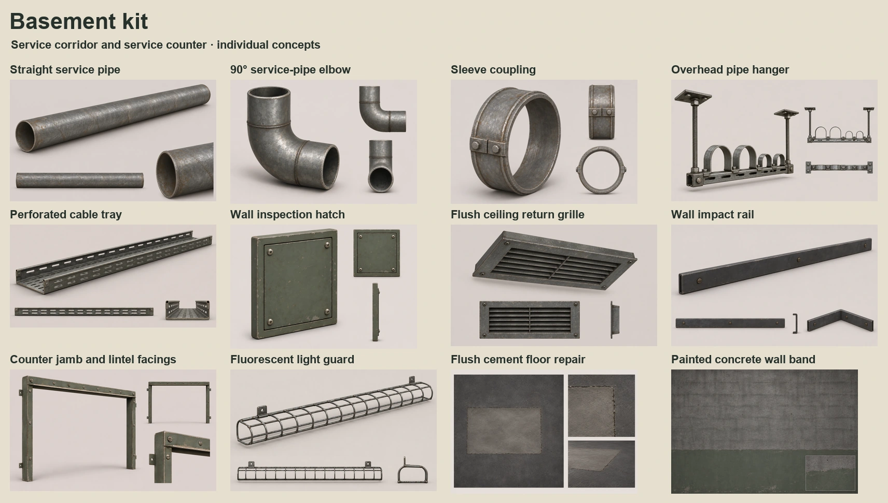
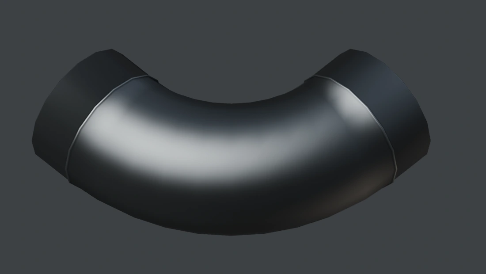
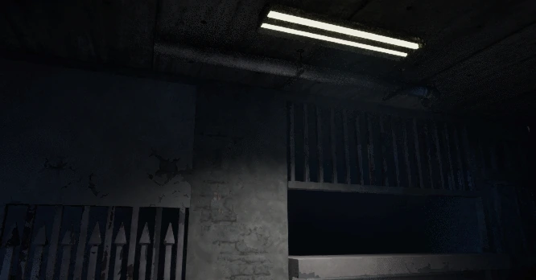
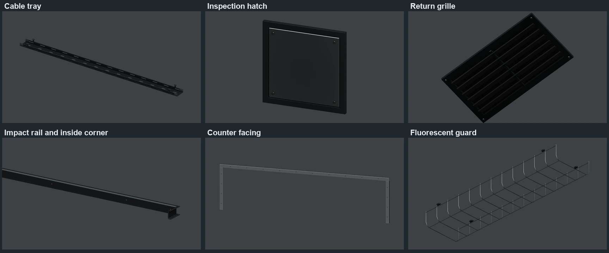
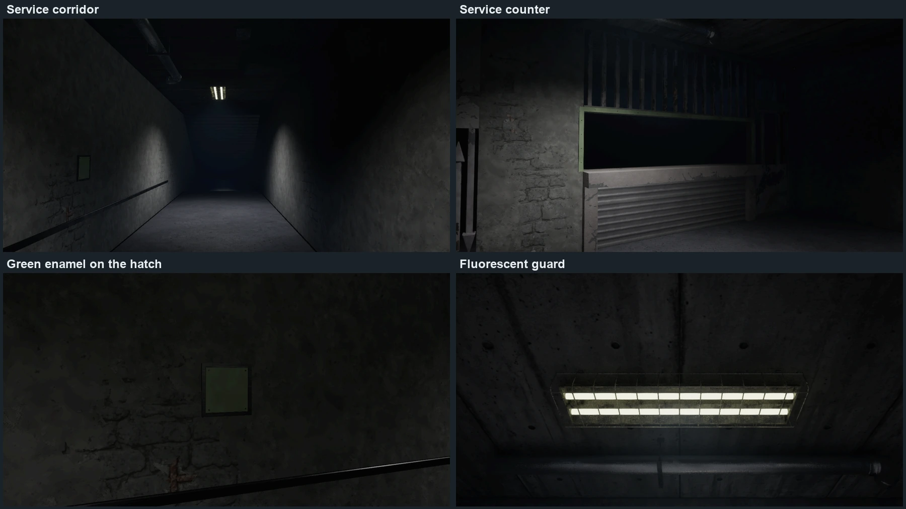
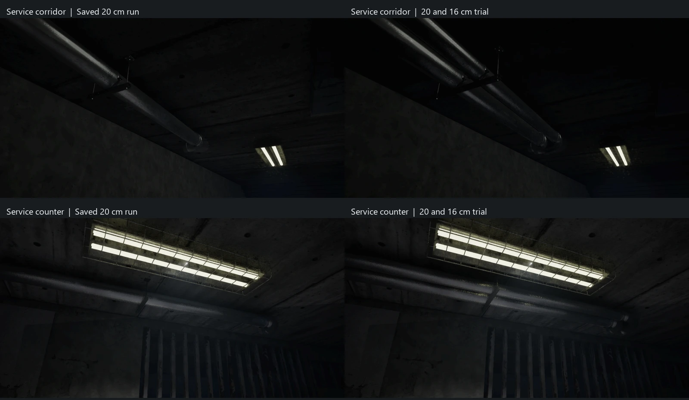

# Basement asset concepts · Stage 7

The owner selected the service corridor and service counter for Stage 7. This pass isolates the components from those concepts for review. Use the sheets to decide silhouette, construction and material breakup. Fit dimensions come from the saved Unreal kit and the actual shop opening. [Selected environment concepts](BUILDING_STRUCTURE_CONCEPTS_STAGE6.md).

The gallery has ten mesh concepts, the production kit, two surface studies and the approved A Clean Start print. [Concept catalog](sources/basement-stage7-assets.json) · [Imported meshes and package paths](sources/basement-stage7-meshes.json).

## Pieces and production destinations

| Concept | Planned use | Start with |
| --- | --- | --- |
| [Straight service pipe](media/basement-stage7/pipe-straight.png) | 400 cm run in several diameters | Metal Classic 01 for the larger shell, Directional Metal 06 for small dark runs |
| [90° service-pipe elbow](media/basement-stage7/pipe-elbow.png) | Matched inlet and outlet for the counter and corridor turns | Same MI and continuous UV direction as the straight |
| [Sleeve coupling](media/basement-stage7/pipe-coupling.png) | One reusable join across straight and bent ends | Same metal finish, with darker steel closure hardware |
| [Overhead pipe hanger](media/basement-stage7/pipe-hanger.png) | Common crossbar, straps and ceiling mounts for the four-run and two-run banks | Directional Metal 06 and Simple Metallic 01 fasteners |
| [Perforated cable tray](media/basement-stage7/cable-tray.png) | Shallow U-channel following the ceiling edge | Directional Metal 06 |
| [Wall inspection hatch](media/basement-stage7/inspection-hatch.png) | One shallow plate shared by corridor and counter wall | Shared gray-green enamel over Metal Classic 01 or Directional Metal 06 |
| [Flush ceiling return grille](media/basement-stage7/return-grille.png) | Compact louvered plate beside the overhead runs | Directional Metal 06 |
| [Wall impact rail](media/basement-stage7/wall-bumper.png) | Shallow bolted strip with a straight and corner form | Directional Metal 06. Keep the current base trim on its separate trim sheet. |
| [Counter jamb and lintel facings](media/basement-stage7/counter-facing.png) | Fit separate sleeves and head strip to the existing shop aperture | Shared gray-green enamel. Keep Metal Blinds 01 on the existing corrugated apron. |
| [Fluorescent light guard](media/basement-stage7/light-guard.png) | Protective cage fitted around the existing counter fluorescent | Dark galvanized steel or Directional Metal 06. Keep the native light settings. |
| [Cement repair](media/basement-stage7/cement-repair.png) | Flush surface breakup on current floor blocks | Concrete 01/02 dry fill plus chipped saw-cut mask |
| [Painted concrete band](media/basement-stage7/painted-concrete.png) | Low muted finish beneath the impact rail | Existing concrete with a local paint mask |
| [A Clean Start print](sources/signage-stage5-svg/clean-start-poster.svg) | Thin paper card on the solid wall above the gate | Approved SVG exported to the paper instance of Signage Atlas |

Use `Assets/Building/Interior_Building.blend`. Pipes, fittings, hangers, tray and grille belong in `Modular_Blocks/Roof_Decorations`. Hatch, impact rail and the poster plane go in `Modular_Blocks/Wall_Decorations`, and the cage in `Modular_Blocks/Lights`. Export these through `Assets/Building/Delivery/Modular_Blocks/` to their matching `/Game/Art/Assets/Building/Modular_Blocks/` branches. The counter's fitted sleeves and head belong in `Floors/Basement/Shop`, with its current Delivery and Unreal paths. Material treatments use the current floor and wall modules. [File contract](FILE_PLACEMENT.md) · [400 cm grid and corner rule](../../projects/total-insanitation/MODULE_CONTRACT.md).

### Geometry already available

Keep the concrete wall variants, `Floor_Decorations_Concrete_01` and its corner counterpart, concrete floor and roof blocks, `Fluorescent_Light_Basement_01` and the existing shop/gate assembly. The three Blender objects called `Pipes_01–03` are in Props' `Pipes and Cigar` collection and measure only 46–70 cm along their longest dimension. Their legacy atlas slots and dimensions make them a different reuse case from the new 400 cm ceiling runs. [UV and source audit](SIGNAGE_ATLAS_STAGE7.md).

## Materials to make or validate

| Required treatment | Reuse first | What is missing and how to implement it |
| --- | --- | --- |
| Used galvanized pipe | [Metal Classic 01](media/unreal-2026-11-17/material-039.webp) and [Directional Metal 06](media/unreal-2026-11-17/material-033.webp) | **Conditional variant.** Compare both on a curved, axially mapped test under the corridor light. Add a compatible utility MI only if the existing contrast is too dark. Use the existing parent and adjust the materials through parameters where exposed. If zinc breakup is still needed, add a subtle tiling roughness/normal layer and an edge oxidation mask. |
| Worn gray-green steel enamel | [Metal Classic 01](media/unreal-2026-11-17/material-039.webp) and [Directional Metal 06](media/unreal-2026-11-17/material-033.webp) | **Shared layered finish.** Add a gray-green dielectric paint layer on the hatch and jambs. Use an edge-wear or authored mask to lerp to metallic steel where the paint chips. Test color and roughness on both small flat and wrapped parts. |
| Painted concrete band | [Brutalist Concrete](media/unreal-2026-11-17/material-001.webp) and [Concrete 01](media/unreal-2026-11-17/material-004.webp) | **Mask plus paint finish.** Preserve original material and vertex-paint behavior. Use a confirmed free mask channel, a dedicated local mask or an overlay decal on the affected variants. Fade the chipped edge into the same base concrete across straight and corner pieces. |
| Flush cement repair | [Concrete 01](media/unreal-2026-11-17/material-004.webp) and [Concrete 02](media/unreal-2026-11-17/material-005.webp) | **Local edge mask and dry fill.** Reuse existing concrete maps for fill first, with an irregular saw-cut mask and a small roughness/normal difference. Start with a DBuffer decal or an embedded floor material layer where the receiver requires it. Verify floor contrast at grazing angles and keep the original collision. [Epic decal documentation](https://dev.epicgames.com/documentation/en-us/unreal-engine/decal-materials-in-unreal-engine). |
| Paper and enamel signage | The twelve [approved SVGs](BASEMENT_SIGNAGE_STAGE5.md) and existing utility metal references | **Atlas texture and material instances.** Use common color artwork with separate substrate settings for paper and enamel. Make coverage and weathering masks only as needed. The clean vector wording remains the source for each language. [Atlas specification](SIGNAGE_ATLAS_STAGE7.md). |

The render sheets are finish references. Build linear roughness, normal and masks from the chosen utility assets and authored wear or repair data. Keep the source's color maps in sRGB. Retain the current 256/512 px/m references and the intentional tileable exceptions.

## 400 cm Blender pilot

Review the **20 cm outside-diameter** pipe family first. Its larger silhouette shows the joint, cradle and metal response from the corridor camera. The four concept sheets show a plain tube, a swept elbow, a narrow bolted sleeve and a crossbar hanger. Use those details together for the first fit check.

| Piece | Proposed pilot interface |
| --- | --- |
| Straight | 400 cm end to end. Pivot at the first end center with the pipe axis along local X. |
| 90° elbow | Match the straight's outer diameter, bore and tangent at the inlet pivot. Start with a 25 cm centerline radius and tangent ends. Check the perpendicular outlet at the counter. |
| Sleeve coupling | Center its pivot on the joint plane and overlap both pipes equally. Align the closure bolts for access from below. |
| Hanger | Use the concept's crossbar and straps with shorter drops. Set the mount pivot on the underside of the slab and keep the first cradle on the pipe centerline. |

Start with **Metal Classic 01** on the tube, elbow and sleeve and **Directional Metal 06** on the crossbar and sleeve closure. Use continuous axial UV scale through the tangent joint. A saved Basement audit identifies `BP_Roof_Concrete_Lights_6` as a corridor fit reference, and the saved Blender audit measures the fluorescent housing at about 194 × 47 × 20 cm before placement. Confirm its transformed bounds and the floor-to-pipe clearance in Unreal. Use the existing corridor, reverse and counter cameras to compare fixture visibility and finish under their current lighting. [Native camera record](BUILDING_STRUCTURE_CONCEPTS_STAGE6.md#native-route-and-camera-record).

The editable `SM_Basement_Pipe_` models are in `Modular_Blocks/Roof_Decorations` inside `Assets/Building/Interior_Building.blend`. Their FBXs are under `Assets/Building/Delivery/Modular_Blocks`.

The owner approved the 16-sided pipe cross-section and asked to simplify the elbow along the bend. The 90° sweep now uses **10 divisions**, down from 20, and keeps its 16-sided cross-section. The four meshes total **5,388 triangles**, down from **8,780** in the first pilot.

| Piece | Before | Revised |
| --- | ---: | ---: |
| Straight | 512 | 256 |
| Elbow | 3,712 | 1,216 |
| Sleeve coupling | 1,768 | 1,320 |
| Hanger | 2,788 | 2,596 |

The reopened source and FBX round-trip verified two UV channels, pivots and matching joints. Unreal confirmed all four triangle counts and measured the straight at **400 × 20 × 20 cm**. The existing slots resolve to Metal Classic 01, Directional Metal 06 and Simple Metallic 01. The elbow outlet runs toward local −Y and its center is at (32.5, −32.5, 0) cm. The hanger places the cradle 18 cm below its mounting face and extends 33.4 cm below that face.

## Lit Basement fit

The isolated Unreal editor used `Inteior_Lobby` with the saved Basement and Main_Lights levels. The corridor run starts in the bay at `BP_Roof_Concrete_Lights_6`. Two straight pieces snap at the 400 cm interval, with sleeves centered on the straight and elbow joints. The counter trial turns the same four parts 90 degrees along the shop opening. Both placements leave **366.6 cm** from the floor to the lowest hanger point. The pipe assembly bounds sit at least **52.88 cm** to the side of the corridor fluorescent and **42.88 cm** from the counter fluorescent. Both fixtures are visible in the lit review.

Metal Classic 01 catches a narrow highlight near the elbow. The sleeve and dark hanger hardware lose definition at the route cameras under the current lighting. The close view shows the joint and 16-sided silhouette. The initial captures use Unreal editor Game View at the Stage 6 cameras and two raised detail angles. [Corridor](media/basement-stage7/pipe-pilot-unreal-corridor.webp) · [Reverse](media/basement-stage7/pipe-pilot-unreal-reverse.webp) · [Counter](media/basement-stage7/pipe-pilot-unreal-counter.webp) · [Elbow and sleeve close-up](media/basement-stage7/pipe-pilot-unreal-corridor-joint.webp).

## Imported production kit

Four pipe parts and ten new meshes are available in Unreal as `SM_Basement_*` under `/Game/Art/Assets/Building`. Each has its editable mesh in `Interior_Building.blend` and its own FBX exported with the installed `Unreal_Only_FBX` settings. Unreal verified package names, bounds, triangle counts, two UV channels, material slots and linked delivery paths. Use NoCollision on placed decoration components and retain collision on the original receiver. [Exact collections, FBXs and Unreal packages](sources/basement-stage7-meshes.json).

| New meshes | Blender collection and Unreal branch | Fit |
| --- | --- | --- |
| Cable tray and return grille | `Modular_Blocks/Roof_Decorations` | 400 cm tray connection pitch. The grille mounts flush over a 45 × 25 cm footprint. |
| Hatch, 400 cm rail, 385 cm rail and inside return | `Modular_Blocks/Wall_Decorations` | 40 × 40 cm hatch. The 15 cm inside return completes the 385 cm rail bay. |
| Left jamb, right jamb and lintel | `Floors/Basement/Shop` | Match the `Basement_Shop` origin and rotation. Native fit keeps the existing 408.09 × 103.15 cm serving aperture open. |
| Fluorescent guard | `Modular_Blocks/Lights` | Attach to the `Fluorescent_Light_Basement_01` mesh component. The revised guard extends 5.35 cm below the fixture envelope. |

The hatch and three counter facings share `MI_Basement_Green_Enamel`, an instance under `/Game/Art/MI/Utility_Materials/Metallic/Metal_Classic_01`. It inherits the Metal Classic 01 texture set and tiling. The instance tints the base color gray-green, lowers metallic response and raises roughness for painted steel. The frame edges and fasteners keep Directional Metal 06 and Simple Metallic 01. Concrete paint and cement repair still need placement masks and material review.

## Production kit in Unreal

The production level `/Game/Levels/Streaming_Levels/Basement` contains **25 mesh components on ten existing Blueprint actors**. Roof instances carry the pipes, couplings, hangers, cable trays and ceiling grille. Wall instances carry the hatch and impact rail, including the 385 cm rail and return grouped on their supporting wall. The three facing pieces attach to `Basement_Shop`. The guard is a child of the fluorescent mesh component. The fittings are instance components scoped to Basement. This lets the shared Blueprint classes serve other levels with their existing defaults.

The guard's crosswires increased from **6.4 to 8 mm** and its longitudinal bars from **8 to 9.6 mm**. It still has 1,660 triangles and two UV channels. Both fluorescent tubes are visible. The counter retains its 408.09 × 103.15 cm serving aperture. The fitted components use NoCollision, with the walls, ceiling and counter providing their existing collision. Unreal reopened a verified copy of the production packages and confirmed each component's host, parent, mesh and transform.

The 1600 × 836 captures show the saved fitting in `Inteior_Lobby` with Basement and Main_Lights loaded.

[Service corridor](media/basement-stage7/integrated-unreal-corridor.webp) · [Service counter](media/basement-stage7/integrated-unreal-counter.webp) · [Hatch close-up](media/basement-stage7/integrated-unreal-hatch.webp) · [Counter overhead](media/basement-stage7/integrated-unreal-counter-overhead.webp) · [Fluorescent guard](media/basement-stage7/integrated-unreal-guard.webp) · [Exact hosts and material settings](sources/basement-stage7-meshes.json).

To edit the installed pieces, open `Basement` and select the placed actor in the World Outliner. The first corridor bay uses `BP_Roof_Concrete_Lights_6`, the counter guard uses `BP_Roof_Concrete_Lights_17`, and the three counter facings use `Basement_Shop`. Their `Basement_*` entries appear in the actor's Details component tree. The owner confirmed that this is where the fittings should live. The Blueprint asset editor shows the class components shared by its instances. [Exact hosts and component names](sources/basement-stage7-meshes.json).

## 20 and 16 cm pipe bank trial

The 16 cm companion follows the original 20 cm run at 27 cm on center, with 9 cm between straight pipe surfaces. It uses a 400 cm straight, a 9 cm sleeve and a 90° elbow with a 52 cm centerline radius. That radius follows the outside of the installed 25 cm bend. Both runs keep their 7.5 cm tangent leads, 16-sided profiles and 10 sweep divisions. One two-cradle crossbar replaces the single hanger at each trial mount.

| Fit | Ceiling supports tested | Floor to lowest point | Lateral clearance to light or guard |
| --- | ---: | ---: | ---: |
| Service corridor | 2 | 366.60 cm | 25.88 cm |
| Service counter | 1 | 366.60 cm | 12.08 cm |

Both mounting plates seat flush with the slab at each support. The two pipes separate in the detail angles, and both counter tubes remain visible through the guard. Dark hardware is harder to read in the wider route views. The test uses Metal Classic 01 and the existing Directional Metal 06 and Simple Metallic 01 hardware finishes under the same Basement and Main_Lights lighting. Captures use matching 75° cameras for the saved and trial views.

The four trial meshes reopened in Blender under `Modular_Blocks/Roof_Decorations` and imported into an isolated Unreal editor with two UV channels, matching pivots and bounds, and existing material slots. The trial ran with transient actors and production Basement retains its verified save. [FBXs](sources/basement-stage7-pipe-bank-fbx.zip) · [Dimensions, transforms and capture metadata](sources/basement-stage7-pipe-bank-fit.json) · [Corridor](media/basement-stage7/pipe-bank-corridor.webp) · [Corridor detail](media/basement-stage7/pipe-bank-corridor-detail.webp) · [Counter](media/basement-stage7/pipe-bank-counter.webp) · [Counter detail](media/basement-stage7/pipe-bank-counter-detail.webp).

## How to proceed

1. **Review the paired run.** Use the 20 and 16 cm fit to develop the 7.5 and 5 cm runs and the four-cradle corridor support. Check those fits before extending the layout.
2. **Test existing tileables on the wall and floor treatments.** The owner wants the current Unreal tileables first. Bring any gap to the owner before authoring a new material based on the existing library.
3. **Test the owner's signage export with the poster and a wide sign.** Use A Clean Start and Low Clearance with the final atlas and layout to confirm UVs and mips under Basement lighting. [Atlas specification and layout](SIGNAGE_ATLAS_STAGE7.md).
4. **Continue concept revisions against the fitted kit.** Use the native bay and shop capture as the next concept references when a joint, clearance or material needs another pass.
