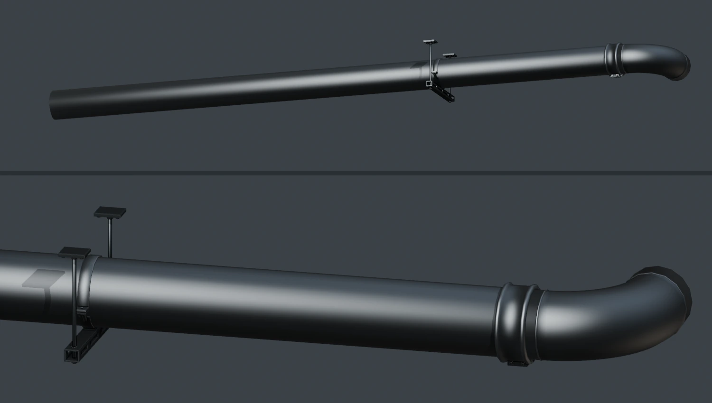

# Basement asset concepts · Stage 7

The owner selected the service corridor and service counter for Stage 7. This pass isolates the components from those concepts for review. Use the sheets to decide silhouette, construction and material breakup. Fit dimensions come from the saved Unreal kit and the actual shop opening. [Selected environment concepts](BUILDING_STRUCTURE_CONCEPTS_STAGE6.md).

The gallery has ten new mesh concepts, two surface studies and the approved A Clean Start print. Each entry links its isolated sheet, the source scene and the native material swatches. [Asset catalog with exact MI package paths, proposed dimensions and prompts](sources/basement-stage7-assets.json).

## Pieces and production destinations

| Concept | Planned use | Start with |
| --- | --- | --- |
| [Straight service pipe](media/basement-stage7/pipe-straight.png) | 400 cm run in several diameters | Metal Classic 01 for the larger shell, Directional Metal 06 for small dark runs |
| [90° service-pipe elbow](media/basement-stage7/pipe-elbow.png) | Matched inlet and outlet for the counter and corridor turns | Same MI and continuous UV direction as the straight |
| [Sleeve coupling](media/basement-stage7/pipe-coupling.png) | One reusable join across straight and bent ends | Same metal finish, with darker steel closure hardware |
| [Overhead pipe hanger](media/basement-stage7/pipe-hanger.png) | Common crossbar, straps and ceiling mounts for the four-run and two-run banks | Directional Metal 06 and Simple Metallic 01 fasteners |
| [Perforated cable tray](media/basement-stage7/cable-tray.png) | Shallow U-channel following the ceiling edge | Directional Metal 06 |
| [Wall inspection hatch](media/basement-stage7/inspection-hatch.png) | One shallow plate shared by corridor and counter wall | Shared gray-green enamel over Metal Classic 01 or Directional Metal 06 |
| [Flush ceiling return grille](media/basement-stage7/return-grille.png) | Compact louvered plate beside the overhead runs | Directional Metal 06 |
| [Wall impact rail](media/basement-stage7/wall-bumper.png) | Shallow bolted strip with a straight and corner form | Directional Metal 06. Keep the current base trim on its separate trim sheet. |
| [Counter jamb and lintel facings](media/basement-stage7/counter-facing.png) | Fit separate sleeves and head strip to the existing shop aperture | Shared gray-green enamel. Keep Metal Blinds 01 on the existing corrugated apron. |
| [Fluorescent light guard](media/basement-stage7/light-guard.png) | Protective cage fitted around the existing counter fluorescent | Dark galvanized steel or Directional Metal 06. Keep the native light settings. |
| [Cement repair](media/basement-stage7/cement-repair.png) | Flush surface breakup on current floor blocks | Concrete 01/02 dry fill plus chipped saw-cut mask |
| [Painted concrete band](media/basement-stage7/painted-concrete.png) | Low muted finish beneath the impact rail | Existing concrete with a local paint mask |
| [A Clean Start print](sources/signage-stage5-svg/clean-start-poster.svg) | Thin paper card on the solid wall above the gate | Approved SVG exported to the paper instance of Signage Atlas |

Use `Assets/Building/Interior_Building.blend`. Pipes, fittings, hangers, tray and grille belong in `Modular_Blocks/Roof_Decorations`. Hatch, impact rail and the poster plane go in `Modular_Blocks/Wall_Decorations`, and the cage in `Modular_Blocks/Lights`. Export these through `Assets/Building/Delivery/Modular_Blocks/` to their matching `/Game/Art/Assets/Building/Modular_Blocks/` branches. The counter's fitted sleeves and head belong in `Floors/Basement/Shop`, with its current Delivery and Unreal paths. Material treatments use the current floor and wall modules. [File contract](FILE_PLACEMENT.md) · [400 cm grid and corner rule](../../projects/total-insanitation/MODULE_CONTRACT.md).

### Geometry already available

Keep the concrete wall variants, `Floor_Decorations_Concrete_01` and its corner counterpart, concrete floor and roof blocks, `Fluorescent_Light_Basement_01` and the existing shop/gate assembly. The three Blender objects called `Pipes_01–03` are in Props' `Pipes and Cigar` collection and measure only 46–70 cm along their longest dimension. Their legacy atlas slots and dimensions make them a different reuse case from the new 400 cm ceiling runs. [UV and source audit](SIGNAGE_ATLAS_STAGE7.md).

## Materials to make or validate

| Required treatment | Reuse first | What is missing and how to implement it |
| --- | --- | --- |
| Used galvanized pipe | [Metal Classic 01](media/unreal-2026-11-17/material-039.webp) and [Directional Metal 06](media/unreal-2026-11-17/material-033.webp) | **Conditional variant.** Compare both on a curved, axially mapped test under the corridor light. Add a compatible utility MI only if the existing contrast is too dark. Use the existing parent and adjust the materials through parameters where exposed. If zinc breakup is still needed, add a subtle tiling roughness/normal layer and an edge oxidation mask. |
| Worn gray-green steel enamel | [Metal Classic 01](media/unreal-2026-11-17/material-039.webp) and [Directional Metal 06](media/unreal-2026-11-17/material-033.webp) | **Shared layered finish.** Add a gray-green dielectric paint layer on the hatch and jambs. Use an edge-wear or authored mask to lerp to metallic steel where the paint chips. Test color and roughness on both small flat and wrapped parts. |
| Painted concrete band | [Brutalist Concrete](media/unreal-2026-11-17/material-001.webp) and [Concrete 01](media/unreal-2026-11-17/material-004.webp) | **Mask plus paint finish.** Preserve original material and vertex-paint behavior. Use a confirmed free mask channel, a dedicated local mask or an overlay decal on the affected variants. Fade the chipped edge into the same base concrete across straight and corner pieces. |
| Flush cement repair | [Concrete 01](media/unreal-2026-11-17/material-004.webp) and [Concrete 02](media/unreal-2026-11-17/material-005.webp) | **Local edge mask and dry fill.** Reuse existing concrete maps for fill first, with an irregular saw-cut mask and a small roughness/normal difference. Start with a DBuffer decal or an embedded floor material layer where the receiver requires it. Verify floor contrast at grazing angles and keep the original collision. [Epic decal documentation](https://dev.epicgames.com/documentation/en-us/unreal-engine/decal-materials-in-unreal-engine). |
| Paper and enamel signage | The twelve [approved SVGs](BASEMENT_SIGNAGE_STAGE5.md) and existing utility metal references | **Atlas texture and material instances.** Use common color artwork with separate substrate settings for paper and enamel. Make coverage and weathering masks only as needed. The clean vector wording remains the source for each language. [Atlas specification](SIGNAGE_ATLAS_STAGE7.md). |

The render sheets are finish references. Build linear roughness, normal and masks from the chosen utility assets and authored wear or repair data. Keep the source's color maps in sRGB. Retain the current 256/512 px/m references and the intentional tileable exceptions.

## 400 cm Blender pilot

Review the **20 cm outside-diameter** pipe family first. Its larger silhouette shows the joint, cradle and metal response from the corridor camera. The four concept sheets show a plain tube, a swept elbow, a narrow bolted sleeve and a crossbar hanger. Use those details together for the first fit check.

| Piece | Proposed pilot interface |
| --- | --- |
| Straight | 400 cm end to end. Pivot at the first end center with the pipe axis along local X. |
| 90° elbow | Match the straight's outer diameter, bore and tangent at the inlet pivot. Start with a 25 cm centerline radius and tangent ends. Check the perpendicular outlet at the counter. |
| Sleeve coupling | Center its pivot on the joint plane and overlap both pipes equally. Align the closure bolts for access from below. |
| Hanger | Use the concept's crossbar and straps with shorter drops. Set the mount pivot on the underside of the slab and keep the first cradle on the pipe centerline. |

Start with **Metal Classic 01** on the tube, elbow and sleeve and **Directional Metal 06** on the crossbar and sleeve closure. Use continuous axial UV scale through the tangent joint. A saved Basement audit identifies `BP_Roof_Concrete_Lights_6` as a corridor fit reference, and the saved Blender audit measures the fluorescent housing at about 194 × 47 × 20 cm before placement. Confirm its transformed bounds and the floor-to-pipe clearance in Unreal. Use the existing corridor, reverse and counter cameras to compare fixture visibility and finish under their current lighting. [Native camera record](BUILDING_STRUCTURE_CONCEPTS_STAGE6.md#native-route-and-camera-record).

The owner approved the pieces. The editable models are in `Modular_Blocks/Roof_Decorations` inside `Assets/Building/Interior_Building.blend`. Their FBXs are under `Assets/Building/Delivery/Modular_Blocks`. The objects start hidden in the saved viewport to preserve the library view. Unhide the four `SM_Basement_Pipe_` objects in the Roof_Decorations collection to edit them.

The reopened source and FBX round-trip verified two UV channels, pivots and matching joints. An isolated Unreal import measured the straight at **400 × 20 × 20 cm**, confirmed the slot names and assigned the existing Metal Classic 01, Directional Metal 06 and Simple Metallic 01 instances. The Unreal elbow outlet runs toward local −Y and its center is at (32.5, −32.5, 0) cm. The hanger places the cradle 18 cm below its mounting face and extends 33.4 cm below that face. The import assertion passed while the commandlet returned a nonzero status for the project's deprecated `r.Mobile.VirtualTextures` setting. Material appearance, fluorescent visibility and placement still need a lit Basement preview. [Atlas source and checks](SIGNAGE_ATLAS_STAGE7.md).

## How to proceed

1. **Place the four pilot FBXs in a Basement lighting review.** Check light visibility, lower clearance and repetition in the corridor and at the counter before building other diameters and support variants. Reuse the existing concrete roof and fixture.
2. **Test existing tileables on the wall and floor treatments.** The owner wants the current Unreal tileables first. Bring any gap to the owner before authoring a new material based on the existing library.
3. **Test the new signage page with the poster and a wide sign.** Use A Clean Start and Low Clearance from the new Designer graph to confirm atlas UVs and mips under Basement lighting. [Atlas specification and layout](SIGNAGE_ATLAS_STAGE7.md).
4. **Continue concept revisions against the fitted kit.** Use the native bay and shop capture as the next concept references when a joint, clearance or material needs another pass.
