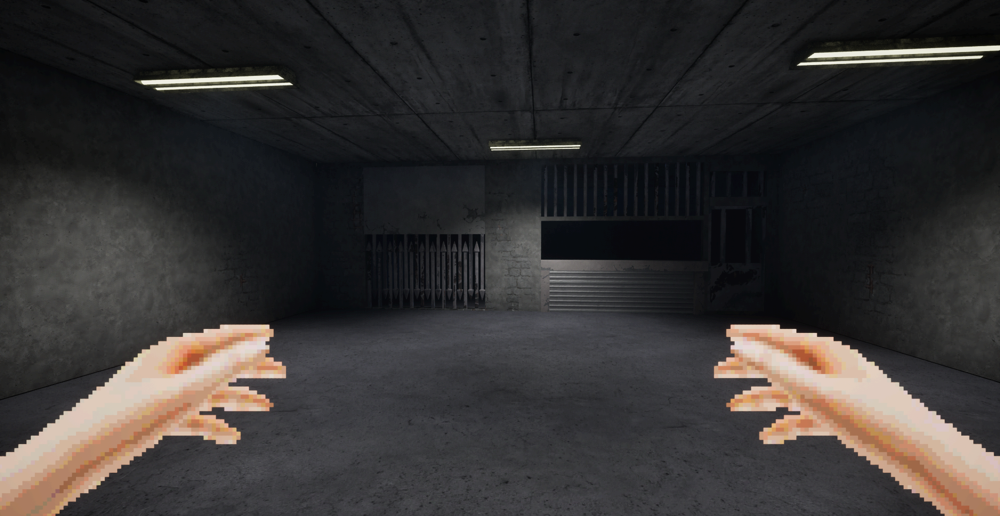
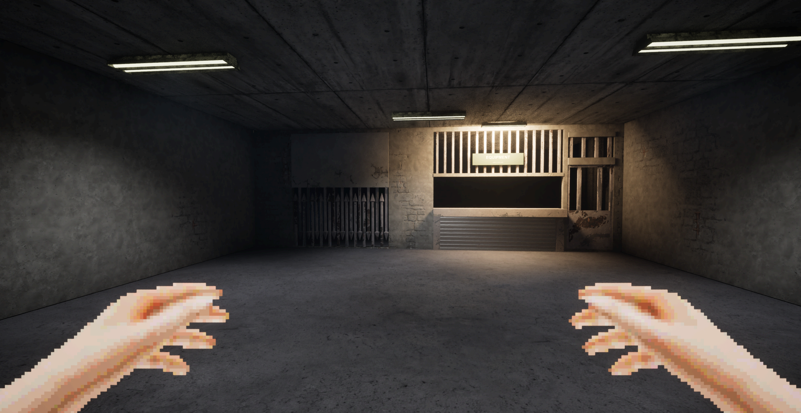
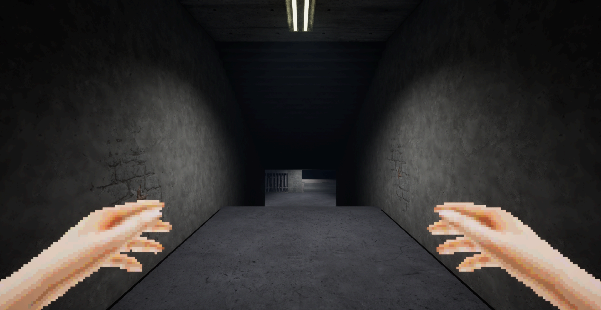
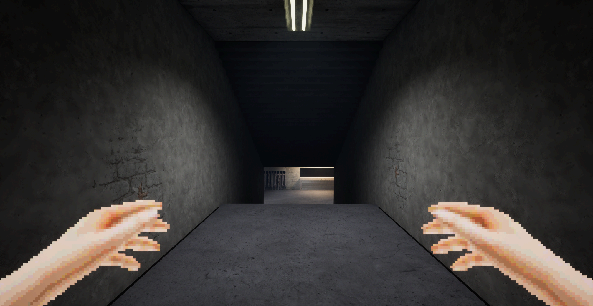
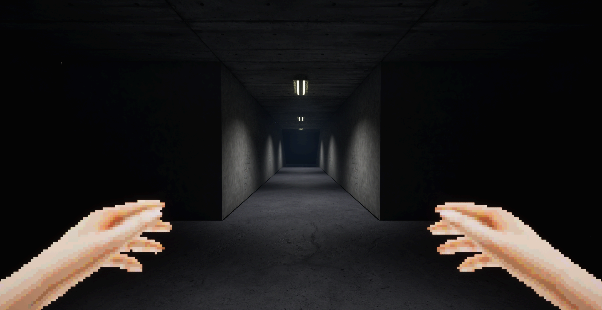
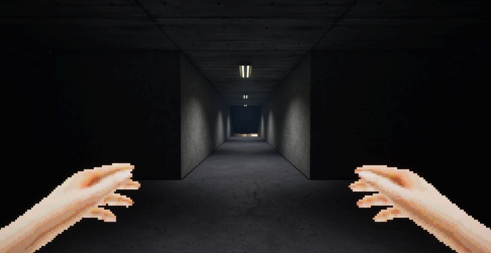
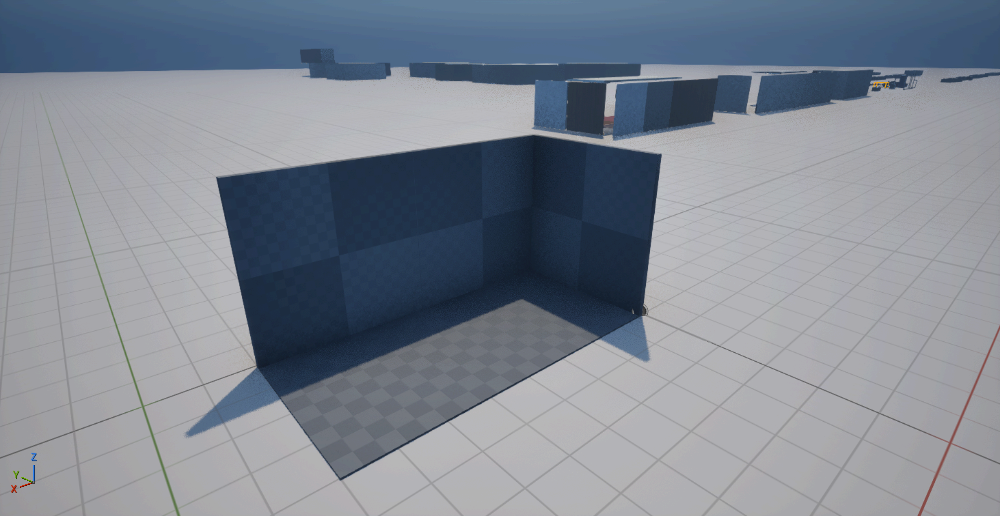

# Basement / pass 01

**12 November 2026 · Implemented and agent-verified · Owner visual review pending.**

The Overview sequence is complete: review the assembled route, verify a representative modular group, and apply a compact 1970s service-area treatment. The counter now has an equipment sign and a warm local task light. The existing bars/spikes remain the fantasy accent. One packed material texture was corrected.

## Matched actual gameplay

These are native Unreal PIE captures with Main_Lights loaded and the actual game camera at **95° FOV**. Each pair uses the same spawn pose and camera; source captures are **2013 × 1040**. Images retain their original pixels and are clickable/downloadable. They are stationary appearance checks, not a continuous traversal.

### Shop / before

### Shop / after

The cold corridor remains dominant. The sign and counter create a specific destination without changing the existing shop mesh, moving the bars or filling the future NPC area. The sign reads **EQUIPMENT / JANITOR SERVICE**; it is editable environmental lettering. The owner described separate service and equipment-release openings, which this pass preserves.

### Stair descent / before

### Stair descent / after

### Crossing and approach / before

### Crossing and approach / after

| Review station | Spawn position, cm | Pitch / yaw | Observed camera position, cm |
| --- | --- | --- | --- |
| Shop | 4988, 6900, -1504 | -1.875 / 84.475 | 4987.037, 6890.046, -1422.850 |
| Stair descent | 5000, 5400, -1104 | -4 / 90 | 5000, 5390, -1022.850 |
| Crossing | 5000, 3371, -1104 | -1 / 90 | 5000, 3361, -1022.850 |

## Kit verification

**Review actor:** `ART_REVIEW_Basement_Kit_Validation`, in LaCarlota at `(12000, -2400, 0)` cm, folder `Art Review/Basement 2026-11-12`. It uses four copied types and a checker material for geometry/UV inspection, independently of the finished environment.

| Type | Measured dimensions | Pivot / placement |
| --- | --- | --- |
| Wall_01 | 400 × 15 × 400 cm | Edge pivot; local X 0–400, Y -15–0, Z 0–400 |
| Wall_Corner_01 | 385 × 15 × 400 cm | Same edge convention; shortened by the 15 cm wall thickness |
| Floor_01 | 400 × 400 × 15 cm | Top surface at local Z 0; thickness below the walking surface |
| Wall_VertexColor_01 | 400 × 15 × 400 cm | Same wall convention; painted alpha retained in the verified copy |

Unit object scale, dimensions, pivots, triangle count and UV channels survived copied import/reimport. Exporting the native meshes back to Blender independently confirmed the UV scale. The vertex-painted wall retained its varying alpha, approximately 0.63–1 after 8-bit conversion. No original modular mesh was overwritten.

**Historical copied-export trial:** the trial first exposed a **100× unit mismatch** and an import default that ignored vertex colors. The validated Blender export uses `global_scale=1`, `apply_unit_scale=True`, `FBX_SCALE_NONE`, forward `-Y`, up `Z`. The isolated legacy FBX trial explicitly imports vertex colors with Replace on the fresh copy; reimports may preserve existing paint. The session’s Interchange FBX flag was restored after the trial. This tested copy workflow predates the owner’s production-export instruction. Future delivery uses Super Duper Batch Exporter with `Unreal_Only_FBX` (`-Z / Y` axes), as recorded in Tools and `projects/total-insanitation/BLENDER_WORKFLOW.md`.

Four native collision probes hit at expected distances: floor **100 cm**, wall **185 cm**, corner **85 cm** and the straight-wall seam **185 cm**. Copies use the existing Complex As Simple structural convention. The L-corner joins at local Y 385 where the wall placed at Y 400 begins; no overlapping wall surfaces were needed.

The sampled wall is approximately **256 px/m** with a 512 px texture. The current concrete floor is approximately **128 px/m** (0.24975 UV units/m × 512 px, 1× tiling). The owner confirmed that such floor and ceiling exceptions intentionally match their specific tileables. Preserve the UVs and tiling; this is not a pending density correction. Original modules have one authored UV channel; no baked-lightmap pass was performed.

## Exact changes to existing Unreal packages

The owner explicitly allowed overwriting existing art assets provided the changes were marked. File hashes before and after identify **four changed existing packages**:

| Package | Change |
| --- | --- |
| `/Game/Art/Assets/Building/Floors/Shop/Basement_Shop` | Added only ArtPass_EquipmentSign, ArtPass_ServiceFluorescent and ArtPass_ServiceTaskLight; original mesh components retained. |
| `/Game/Art/MI/Utility_Materials/Concrete/CobbleStone_02/CobbleStone_02_occlusionRoughnessMetallic` | sRGB off; Masks compression for packed AO/roughness/metallic data. |
| `/Game/Levels/LaCarlota` | Saved the existing Main_Lights inclusion, refreshed new shop components and added the isolated kit review actor. |
| `/Game/Levels/Streaming_Levels/Basement` | Saved/refreshed only the shop’s new component defaults; existing actor layout retained. |

The shop adds **one movable rectangular light**, 80 lumens, 3900 K, 550 cm radius, 120 × 16 cm source, shadows enabled. The fixture reuses the existing mesh and materials. No shared light Blueprint or Main_Lights asset was changed. Original shop mesh components and existing actor placements remain intact.

The ORM correction affects the existing material references in Basement and LaCarlota. Texture pixels, parent materials and Designer sources were preserved. R = AO, G = roughness, B = metallic.

## New Unreal packages

All nine additions are under `/Game/Art`:

- `/Game/Art/Assets/Building/Floors/Shop/Signage/MI_ShopSign_Enamel`
- `/Game/Art/Assets/Building/Floors/Shop/Signage/MI_ShopSign_Fasteners`
- `/Game/Art/Assets/Building/Floors/Shop/Signage/MI_ShopSign_Lettering`
- `/Game/Art/Assets/Building/Floors/Shop/Signage/SM_Shop_Equipment_Sign`
- `/Game/Art/Assets/Building/Modular_Blocks/Validation/Basement_20261112/BP_Basement_Kit_Validation`
- `/Game/Art/Assets/Building/Modular_Blocks/Validation/Basement_20261112/Trial_Floor_01`
- `/Game/Art/Assets/Building/Modular_Blocks/Validation/Basement_20261112/Trial_VertexPaint_Verified`
- `/Game/Art/Assets/Building/Modular_Blocks/Validation/Basement_20261112/Trial_Wall_01`
- `/Game/Art/Assets/Building/Modular_Blocks/Validation/Basement_20261112/Trial_Wall_Corner_01`

Materials remain assigned in the shop Blueprint, following the owner’s workflow. The copied validation assets are separate from production meshes. The failed superseded vertex-color probe was removed after its references were cleared.

## Sources and recovery

- Historical Pass 01 sign source (created before the existing-source authoring rule): `projects/total-insanitation/sources/shop-service-pass/Shop_Equipment_Sign.blend`; matching FBX alongside it. Text, panel bevel and fixings remain editable.
- The original `Interior_Building.blend` matches its before-work SHA-256. Existing source blends, SBS graphs and texture exports were not overwritten.
- Temp’s original 12 PNGs and notes are retained. Art bible → References contains image copies and English production notes.
- Local recovery copies, native receipts, camera metadata, failed probes and the copied module source are under `.mrmak/total-insanitation/basement-review/`, outside Git. Backups contain the original shop Blueprint, ORM texture and both map versions before the relevant saves.
- Both review maps were saved and reloaded. The final Basement audit reports no dirty content packages or maps.
- Workspace verification passed all nine tabs at 1440, 768 and 390 px, in dark and light themes: 54 combinations, zero browser errors; images, enlargement, downloads, Close controls and overflow checks passed. Five editable cards pass schema validation.

## What remains

**Owner review:** sign wording, warm/cold light balance and whether the next art pass should prioritize service props or the doorway Blueprint. The doorway mesh exists but its modular Blueprint is still a kit gap. Wear repetition remains a candidate for a deliberate second pass.

**Next delivery check:** use the owner’s Super Duper Batch Exporter preset for future exports and verify its first asset delivery in Unreal. Create new structural/shop assets inside `Interior_Building.blend` and individual props inside `Enviroment_Assets.blend`; retain this pass’s separate source as historical evidence.

**Deferred:** NPC selection, shop interactions, the bars’ behavior, characters, weapons, UI and unrelated maps. No paid generation or application restart was used.
