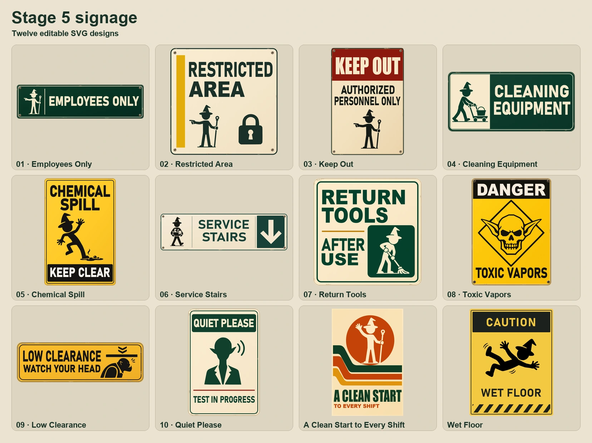

# Stage 5 signage · Editable artwork

The owner selected all ten Basement signs, Wet Floor and A Clean Start to Every Shift. This record contains the original Stage 5 vectors and raster proposals. Art bible → **Signage & UI** shows the current atlas revision. [Current artwork and palette](MASCOT_SIGNAGE_REVISION.md) · [Download the Stage 5 SVGs](sources/signage-stage5-svg.zip) · [Original Basement PNGs](sources/basement-signs-stage5.zip).

| ID | Design | Pictogram | Original |
| --- | --- | --- | --- |
| 01 | [Employees Only SVG](sources/signage-stage5-svg/01-employees-only.svg) | Wizard pointing left | [PNG](media/basement-signs-stage5/01-employees-only.png) |
| 02 | [Restricted Area SVG](sources/signage-stage5-svg/02-restricted-area.svg) | Wizard pointing left and padlock | [PNG](media/basement-signs-stage5/02-restricted-area.png) |
| 03 | [Keep Out / Authorized Personnel Only SVG](sources/signage-stage5-svg/03-keep-out.svg) | Wizard pointing left | [PNG](media/basement-signs-stage5/03-keep-out.png) |
| 04 | [Cleaning Equipment SVG](sources/signage-stage5-svg/04-cleaning-equipment.svg) | Wizard pushing equipment | [PNG](media/basement-signs-stage5/04-cleaning-equipment.png) |
| 05 | [Chemical Spill / Keep Clear SVG](sources/signage-stage5-svg/05-chemical-spill.svg) | Wizard stepping in acid | [PNG](media/basement-signs-stage5/05-chemical-spill.png) |
| 06 | [Service Stairs SVG](sources/signage-stage5-svg/06-service-stairs.svg) | Wizard carrying supplies and downward arrow | [PNG](media/basement-signs-stage5/06-service-stairs.png) |
| 07 | [Return Tools / After Use SVG](sources/signage-stage5-svg/07-return-tools.svg) | Wizard mopping | [PNG](media/basement-signs-stage5/07-return-tools.png) |
| 08 | [Danger / Toxic Vapors SVG](sources/signage-stage5-svg/08-toxic-vapors-goblin.svg) | Goblin skull | [PNG](media/basement-signs-stage5/08-toxic-vapors-goblin.png) |
| 09 | [Low Clearance / Watch Your Head SVG](sources/signage-stage5-svg/09-low-clearance-orc.svg) | Orc below a beam | [PNG](media/basement-signs-stage5/09-low-clearance-orc.png) |
| 10 | [Quiet Please / Test in Progress SVG](sources/signage-stage5-svg/10-quiet-testing-elf.svg) | Elf with listening arcs | [PNG](media/basement-signs-stage5/10-quiet-testing-elf.png) |
|  | [Wet Floor SVG](sources/signage-stage5-svg/wet-floor.svg) | Wizard slipping | [PNG](media/signage-ui-stage5-raster-review/wet-floor.png) |
|  | [A Clean Start to Every Shift SVG](sources/signage-stage5-svg/clean-start-poster.svg) | Wizard greeting | [PNG](media/signage-ui-stage5-raster-review/clean-start-02.png) |

The vector pass uses the exact approved mascot contours, with ink colors matched to each layout. It rebuilds the lettering as SVG text and simplifies rim wear into editable shapes. Wet Floor uses the existing vector artwork. [Fonts and editing notes](sources/signage-stage5-svg/README.md) · [Source and checksum catalog](sources/signage-stage5-svg/catalog.json).

## What the Basement informed

The concrete, steel and worn finishes in the current Basement inspired the high-contrast enamel and screen-printed graphics. Green and cream carry staff notices and direction, oxide red emphasizes the strongest access warning, and yellow and ink carry physical hazards. [Concrete corridor](media/unreal-2026-11-17/basement-corridor.webp) · [Descent](media/unreal-2026-11-17/basement-crossing.webp) · [Shop counter and steel gate](media/unreal-2026-11-17/basement-shop.webp) · [Janitor stairs](media/unreal-2026-11-17/janitor-service.webp).

The goblin skull follows the owner’s danger-pictogram example. The low-clearance sign shows a tusked orc ducking below the beam. The elf’s pointed ears carry the quiet-room message. These are graphic interpretations of the current provisional species references. [NPC references](NPC_REFERENCE.md).

## Original review material

All ten Basement proposal PNGs retain their original ChatGPT output bytes. The owner selected the layouts and specified the approved poses for Chemical Spill and Cleaning Equipment before vector work. The archived review includes the original numbered sheet, prompts, input references and hashes. [Original numbered sheet](media/basement-signs-stage5/basement-signs-overview.webp) · [Generation record](sources/basement-signs-stage5.json).
