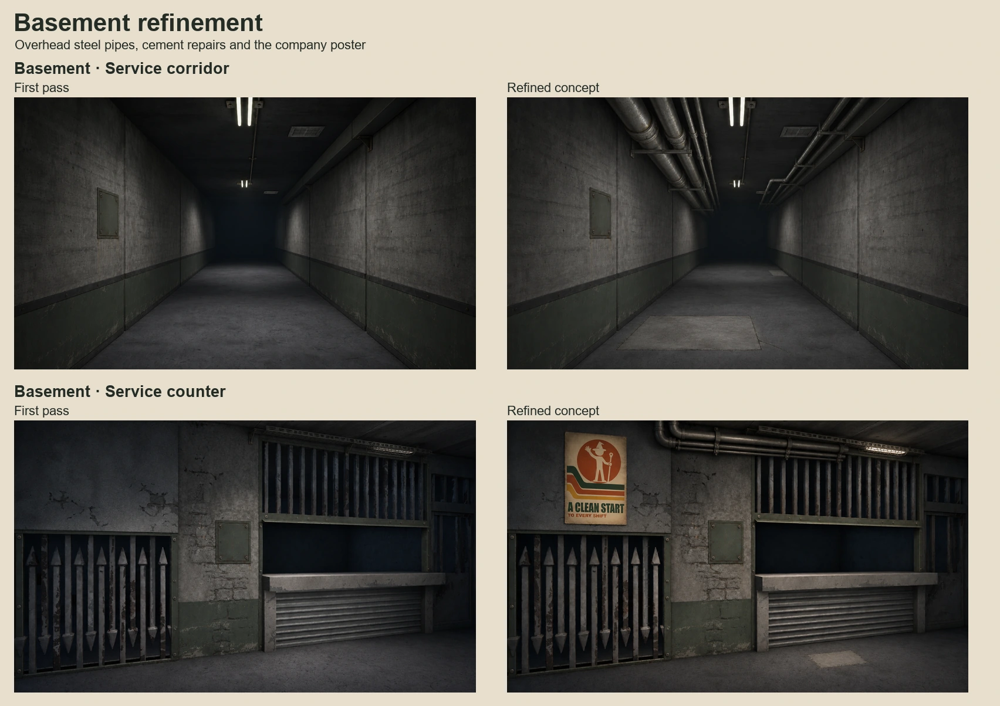

# Building concepts · Stage 6

These structural studies use the current Basement and the early Level_01 office blockout. The latest Basement pass builds on the first corridor and service-counter concepts with denser steel pipe runs, flush floor repairs and an in-world placement of the approved A Clean Start poster. [First-pass comparison with Unreal](media/building-stage6/comparison.webp).

| View | Native Unreal | Concept | Design to review |
| --- | --- | --- | --- |
| Level_01 · Shared offices | [Capture](media/building-stage6/office-peek-native.webp) | [Concept PNG](media/building-stage6/office-primary-concept.png) | Shallow walnut caps and dark skirting, one high wall grille, prismatic fluorescent lenses, flush ceiling return and access tile |
| Level_01 · Executive room | [Capture](media/building-stage6/office-executive-native.webp) | [Concept PNG](media/building-stage6/office-secondary-concept.png) | Full-height woven inserts inside the wood bays, continuation of the same base and cap, a high grille and the same ceiling family |
| Basement · Service corridor | [Capture](media/building-stage6/basement-corridor-native.webp) | [Refined concept](media/building-stage6/basement-corridor-concept-v2.png) · [First pass](media/building-stage6/basement-primary-concept.png) | Six overhead pipe runs grouped 4 + 2 around the fluorescents. A broad foreground repair and a smaller repair farther along break up the old slab. |
| Basement · Service counter | [Capture](media/building-stage6/basement-counter-native.webp) | [Refined concept](media/building-stage6/basement-counter-concept-v2.png) · [First pass](media/building-stage6/basement-secondary-concept.png) | A shorter pipe group above the counter, a flush floor repair and one A Clean Start poster on the solid wall above the gate. |

The owner's corridor reference informed pipe quantity and placement. The first-pass concepts provided the edit targets and architectural framing. A Clean Start adds a small point of corporate color beside the service counter. Use the approved SVG for the print in Unreal. [Approved poster SVG](sources/signage-stage5-svg/clean-start-poster.svg) · [Source record and prompts](sources/building-concepts-stage6.json).

## Building pieces to review

| Assembly | Reuse from the current kit | Proposed Building additions |
| --- | --- | --- |
| Office wall | `Wall_01`, `Wall_Corner_01`, `Roof_Decorations_01` and `Floor_Decorations_01` with their corner counterparts. `BP_Wall_Wood_01`, `BP_Wall_Wood_02` and `BP_Wall_Wallpaper_01` place the current panel families. | A cap and dark rubber base using the same straight and corner profiles. A shallow flush grille and optional narrow or full-height acoustic panel can share the existing wall plane. Evaluate the executive insert as a material-slot variant on the existing face first. |
| Office ceiling | `Roof_01` and `Roof_02` through `BP_Roof_01` and `BP_Roof_Lights_01`. Retain the T-bar spacing and fixture positions in Unreal. | Return and access plates aligned to a ceiling cell. The visible face of the lit variant can use a prismatic diffuser finish while keeping the existing lighting logic. |
| Basement corridor wall | `Wall_VertexColor_03` and the existing vertex-color concrete wall and corner families. Concrete trim uses `Floor_Decorations_Concrete_01` and its corner version. | A painted lower band within the existing concrete treatment. Use shallow profiles for the protective rail, clean joins at corners, and a reusable flush hatch with simple fasteners. The reveal joints can be a material detail if the existing wall silhouette is sufficient. |
| Basement ceiling | `BP_Roof_Concrete_01`, `BP_Roof_Concrete_Lights_01` and `Fluorescent_Light_Basement_01` supply the concrete plane and fixture positions. | Group several pipe diameters in straight runs along the ceiling edges. Share hangers, couplings and shallow elbows across bays. Keep the center clear for fixtures and check native headroom at turns and stairs. |
| Basement floor | Existing concrete floor modules provide the slab and collision. | Use a flush cement repair treatment with an irregular cut edge, a small value difference and trowel variation. Vary the repair placement across floor modules. |
| Basement counter | The existing counter, corrugated apron and spear-tip gate are in `Building → Floors/Basement/Shop`. Adjacent walls and ceilings use the modular concrete families. | Fit the jamb sleeves and lintel skin to the existing opening and keep the compact pipe group above it. The solid wall above the gate provides a poster mounting location. |

Building means `D:/GameJam/Total (in)Sanitation/Assets/Building/Interior_Building.blend`. Store reusable parts in its existing `Modular_Blocks` wall, roof, light and decoration collections. The corresponding Unreal assets live under `/Game/Art/Assets/Building/Modular_Blocks/`. The shop's fixed custom geometry remains under `Floors/Basement/Shop`. Follow the 400 cm grid, 400 cm regular wall, 385 cm corner wall and 15 cm thickness conventions. Equipment, carpets, gate and circulation in the comparisons are scale references. Dimensions for fit and collision should come from native geometry when a part is selected. [Module contract](../../projects/total-insanitation/MODULE_CONTRACT.md) · [File placement](FILE_PLACEMENT.md).

## Existing material references

| Surface | Utility_Materials references |
| --- | --- |
| Office wall and trim | [Wood Wall 02](media/unreal-2026-11-17/material-087.webp), [Wood Wall 03](media/unreal-2026-11-17/material-088.webp), [WallPaper 01](media/unreal-2026-11-17/material-079.webp), [Worn Plastic 01](media/unreal-2026-11-17/material-059.webp) |
| Office ceiling and grille | [Tiled Ceiling](media/unreal-2026-11-17/material-016.webp), [Ceiling Lights](media/unreal-2026-11-17/material-017.webp), [Metal Classic 01](media/unreal-2026-11-17/material-039.webp) |
| Basement concrete and trim | [Brutalist Concrete](media/unreal-2026-11-17/material-001.webp), [Concrete 01](media/unreal-2026-11-17/material-004.webp), [Trimsheet Wall 02](media/unreal-2026-11-17/material-078.webp) |
| Basement metal and counter | [Directional Metal 06](media/unreal-2026-11-17/material-033.webp), [Metal Blinds](media/unreal-2026-11-17/material-038.webp) |

The concept images introduce brighter bounce and finish variations to make the proposals readable. Use the native materials and light positions when validating the kit. The woven insert, dark paint band and diffuser finish still need material and exposure tests. Exact material paths and nearby Blueprint inventory are in the source record. [Native Unreal reference index](REFERENCE_INDEX.json) · [Source record and generation prompts](sources/building-concepts-stage6.json).

## Native route and camera record

Level_01 was captured directly at 90° FOV with `Main_Lights` loaded. Basement was captured at 75° FOV in `/Game/Levels/Inteior_Lobby` with the saved `Basement` and `Main_Lights` levels loaded. These are lit editor viewport views. Unreal camera positions are in centimetres and rotations are in degrees.

| Native view | Camera location XYZ | Pitch / yaw | Use |
| --- | --- | --- | --- |
| [Level_01 shared offices](media/building-stage6/office-peek-native.webp) | −1081.08, 577.94, 184.10 | −6.8° / 139.8° | Openings, panels and ceiling rhythm |
| [Level_01 executive room](media/building-stage6/office-executive-native.webp) | 620, 3270, 171 | 0° / 28° | Room corner, the red carpet baseline and the paired lights |
| [Basement entry and stair](media/building-stage6/basement-entry-native.webp) | −100, −1900, 160 | −20° / −90° | Stair-edge and wall transition reference |
| [Basement corridor](media/building-stage6/basement-corridor-native.webp) | 0, −2900, −230 | 0° / 0° | Base, rail and overhead kit |
| [Basement approach to descent](media/building-stage6/basement-descent-native.webp) | 2800, −4500, −1030 | −5° / −90° | Overhead clearance and continuity down the route |
| [Basement service counter](media/building-stage6/basement-counter-native.webp) | 7000, −7900, −1830 | 0° / 20° | Gate opening, pier, counter and ceiling edge |
| [Basement reverse](media/building-stage6/basement-return-native.webp) | 1530, −2900, −230 | 0° / 180° | Reverse-end joints and repeatability of the corridor kit |

The images are paintover proposals for owner selection. The first native capture session returned the editor to Level_01 with its starting camera and field of view. The Basement refinement uses those existing views and first-pass concepts as reference.
