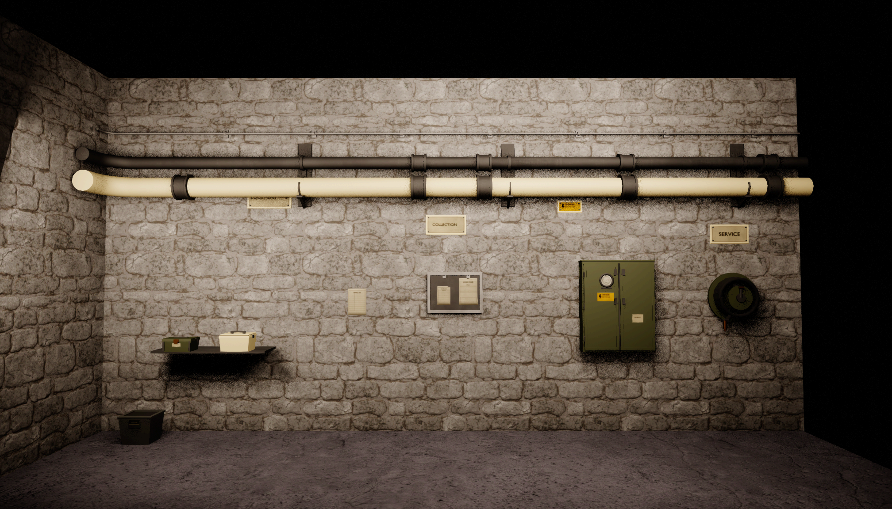
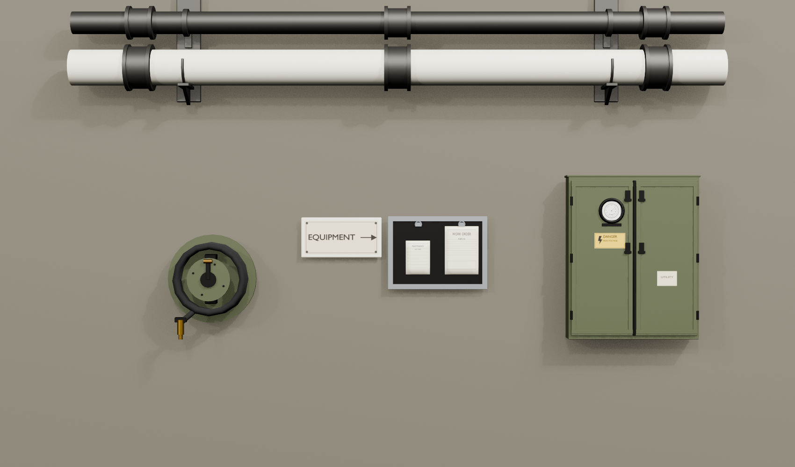

# Corridor models / delivery and independent review

**12 November 2026 · Model/export set verified by the orchestrator. Owner aesthetic review pending.**

Open **Basement → Models** for native Blender previews and isolated Unreal renders. The OpenCode worker delivered **25 meshes across N01–N07, 25 FBX files and one 1024 × 1024 graphics atlas**. Total geometry is **13,694 triangles**. The models remain editable inside the owner's two existing Blender sources.

[Download FBX, atlas and authoring scripts](media/corridor-models/corridor-models-fbx-atlas-sources.zip). [Open the asset manifest](CORRIDOR_MODEL_MANIFEST.json).

## Delivered families

| Family | Meshes | Triangles | Result |
| --- | ---: | ---: | --- |
| N01 / utility pipes and fittings | 8 | 5,508 | 400 cm straight pair, shortened-corner assembly, 100 cm infill, elbow, two couplers, bracket and valve branch. |
| N02 / electrical conduit | 6 | 1,560 | Straight/corner/infill, elbow, clamp and shallow box. |
| N03 / analog cabinet | 1 | 1,602 | Two doors, meter and readable plates; 82 × **17.6** × 101 cm. |
| N04 / enamel plaques | 4 | 632 | EQUIPMENT, SERVICE, COLLECTION and caution graphics. |
| N05 / maintenance papers | 2 | 1,056 | Framed panel with clips/papers and one separate sheet. |
| N06 / manual hose reel | 1 | 2,404 | Coiled hose, clipped nozzle and crank; **24.5 cm** wall projection. |
| N07 / supply containers | 3 | 932 | Cream handled container, olive case and gray open bin. |

The existing Janitor_Cart and SM_LabShelf were preserved. The neutral shelf in the Unreal review assembly is a display fixture, not another new production asset.

## What was checked independently

- Read the actual final saved blends in separate factory Blender processes with auto-execution disabled. All **282 original building objects and 191 original prop objects** retained their recorded geometry, transforms, UVs, parenting, collection membership and material assignments. No existing floor/ceiling UV scale was normalized.
- Checked all 25 new meshes: unit source scale, finite vertices, valid material assignments, UV channels and zero collapsed UV triangles. Final sources have **zero missing unpacked image references**.
- Reimported every delivered FBX in a fresh Blender process. All 25 have zero library-layout translation, and the intended local pivots/spans are retained. The owner's actual Super Duper Batch Exporter / Unreal_Only_FBX recipe was used.
- Imported all 25 into native Unreal **5.8.4**. Native mesh counts total exactly **13,694 triangles**, with one UV channel each. The two initial probes established the 400 cm pipe span and 17.6 cm cabinet depth before the full import.
- Assigned finishes in a dedicated review Blueprint. The nine finish instances reuse existing simple plastic/metal and Metal_Classic parents. T01 supplies the new graphic content; no new general-purpose master material or concrete/metal texture set was introduced.
- Visually inspected native Blender EEVEE views and isolated Unreal SceneCapture2D renders for silhouette, material/atlas readability, scale and the straight/shortened-corner assembly. The corner is a **385 cm wall footprint** with a documented return stub; follow-on pipe positioning uses that return convention rather than assuming it is a complete two-wall prefab.

## Corrections returned to the same worker

The orchestrator found and the worker corrected collapsed UVs caused by stale face normals, two image paths incorrectly rebased to recovery, excessive cabinet/reel projection, unrelated objects in preview frames and FBX layout offsets reaching 200 m. Later checks passed on the saved results. Native session/model evidence remained **OpenCode Go / DeepSeek V4.1 Flash 1017 / max** throughout.

The initial kickoff was sent manually by the owner because desktop control was unavailable. Once the native session existed, the orchestrator verified its exact model/folder and sent scoped native follow-ups without starting a second execution. Review revisions and final acceptance stayed in that same conversation; runtime IDs and receipts remain outside Git.

## Where to find the work

| Deliverable | Location |
| --- | --- |
| Building kit and signs | `D:/GameJam/Total (in)Sanitation/Assets/Building/Interior_Building.blend` → `Corridor_Production_20261112` |
| Props and editable atlas text | `D:/GameJam/Total (in)Sanitation/Assets/Enviroment_Assets/Enviroment_Assets.blend` → `Corridor_Production_20261112` |
| FBX and T01 PNG | `D:/GameJam/Total (in)Sanitation/Delivery/Basement/Corridor/` |
| Durable authoring code | `projects/total-insanitation/corridor-production/source/` |
| Worker report / manifest | `projects/total-insanitation/CORRIDOR_IMPLEMENTATION.md`, `corridor-assets.json` |
| Unreal building meshes | `/Game/Art/Assets/Building/Modular_Blocks/Corridor_Kit` |
| Unreal prop meshes | `/Game/Art/Assets/Enviroment_Assets/Corridor_Props` |
| Unreal finish instances / T01 texture | `/Game/Art/MI/Corridor_20261112` |
| Material-assigned review Blueprint | `/Game/Art/Assets/Building/Modular_Blocks/Corridor_Kit/Review/BP_Corridor_Review` |

**Change boundary:** the two existing production blends were updated; Blender saves also rotate their adjacent `.blend1` backups. Local recovery snapshots were retained. Unreal gained **36 new art packages**: 25 meshes, nine material instances, one texture and one review Blueprint. No existing Unreal art package or level was deliberately overwritten by this pass. The full new-package list and per-mesh data are in the linked manifest.

Another agent was working on the Office Level Builder in Unreal. Its existing LaCarlota edits were preserved. Review used four transient capture/lighting actors, removed afterward, without moving the main viewport camera, starting PIE, reloading the map or saving LaCarlota. All captures are isolated **native review renders**, not final Basement placement or gameplay captures. The review uses local lighting/exposure; it does not establish final game lighting or performance.

## Remaining production decisions

The **model/export task is complete**. Final Basement placement, production modular Blueprints, deliberate wear distribution, gameplay collision/physics and owner aesthetic acceptance are separate next steps. The review Blueprint uses NoCollision for inspection; the worker did not author UCX collision meshes, LODs or a baked-lightmap channel. Graphic faces intentionally use their T01 atlas density while the tileable slots retain the nominal structure/prop density references.

The images below are preserved native evidence, with no generative retouching:

**Workspace QA:** all registered paths and editable-card schemas validate. The six changed tabs passed 36 desktop/tablet/phone and dark/light combinations (1440, 768 and 390 px), with zero browser errors. Images loaded, enlarged and downloaded; Close controls and page overflow checks passed. The bundle passed ZIP integrity and 25-FBX content checks. All 25 Unreal mesh bounds agree with the delivered FBXs within 0.05 cm, accounting for the engine's Y-axis conversion; source hashes still match the imported files.

