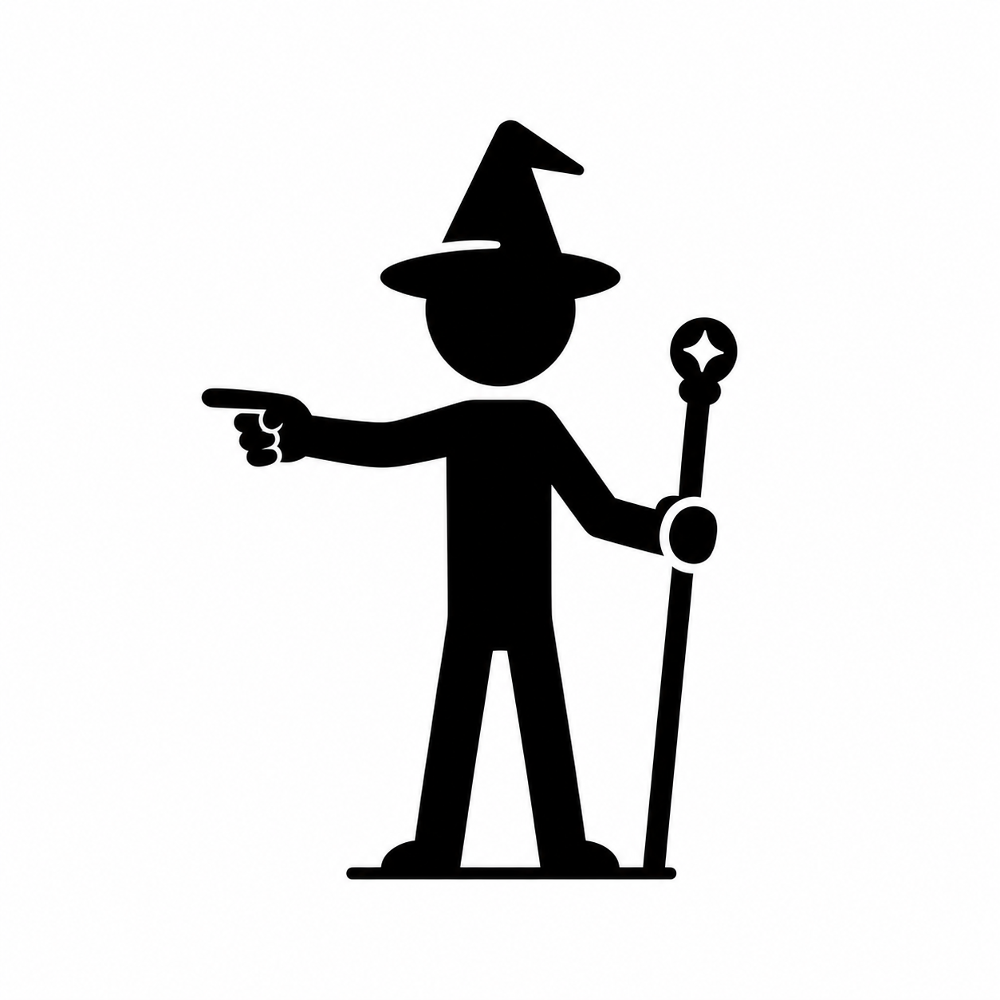
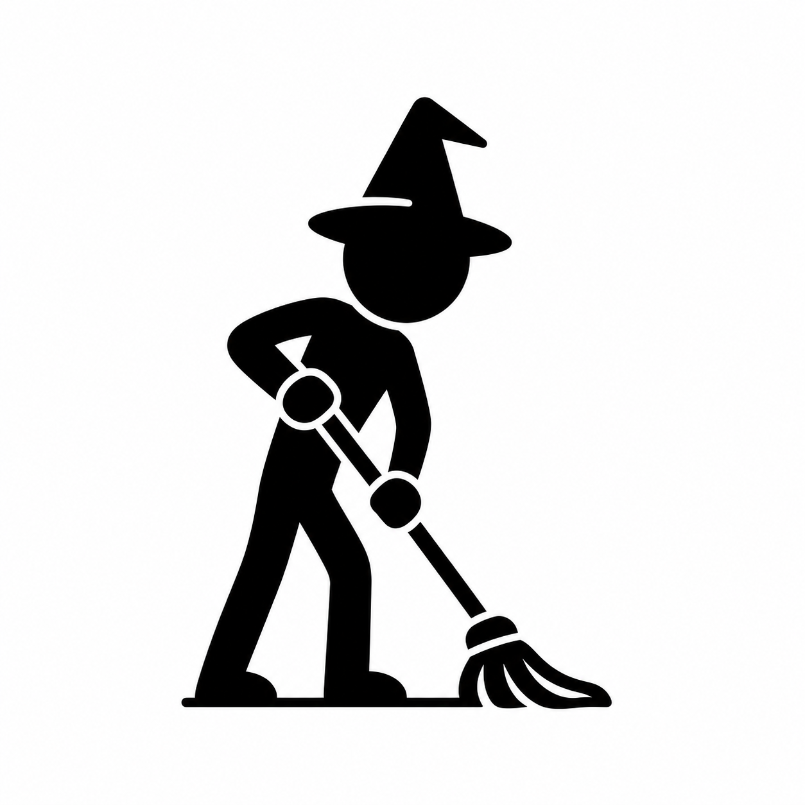

# Wizard mascot / ChatGPT action review

**Both raster action images are approved by the owner.** Their faithful [SVG traces and background/size presentation](MASCOT_TRACES_V02.md) are now delivered. Stages 1–3 remain completed; stage 4's remaining pose set is pending. The hand-built v01 remains rejected history.

The revised order was followed: **generate with ChatGPT using the original → owner selects the images → faithfully trace those selected images into SVG → show background and size variants.** The material below preserves the approved raster source review. Use the v02 trace delivery for current SVGs.

## 01 / Pointing left

The free hand points left; the original orb staff remains in the screen-right hand. The round faceless head, bent pointed hat, broad brim and white sparkle/grip details follow the original greeting JPG. The complete figure and staff are visible.

## 02 / Mopping

A forward working lean, two hands on one mop and a simple mop head distinguish the action. The staff is omitted in this two-hand task. The hat, featureless head and black silhouette remain the identity cues. This accessory choice is part of the proposal, not an approved global rule.

## Reference, method and review

The sole supplied reference was `Stick_figure_mascot_waving_33412cac_2K.jpg` in the original `Resources/Pet` folder. The rejected SVG and its PNGs were not generator inputs. Both outputs are preserved byte-for-byte at their returned 1254 × 1254 resolution, in black on white, without contour edits, recoloring or retouching.

**Generator:** ChatGPT built-in `image_gen`, two separate calls for two different actions. The tool does not expose a selectable underlying model/version, seed or quoted per-call price; no exact model or cost was invented. No alternate provider or external API was used. [Exact prompts](MASCOT_IMAGE_PROMPTS.md) and [image paths/hashes](MASCOT_IMAGE_MANIFEST.json) are recorded. Runtime receipts remain in ignored project state.

The agent checked framing, limb count, action, identity cues and contours. The owner subsequently accepted both raster actions. Their v02 SVGs follow those selected shapes rather than normalizing their proportions or rebuilding the hands. This raster approval does not complete the remaining pose set or full graphic system.

The original JPG, earlier rejected v01 SVGs and completed native reference library are preserved. Canonical generated images are in:

`D:/GameJam/Total (in)Sanitation/Utility_Materials/TrimSheet&Atlas/General_Atlas/Resources/Pet/Development/Stage4_ChatGPT_Round_01/`

## Next decision

The owner selected both images. The corresponding v02 SVGs preserve their poses, proportions, negative spaces and ground strokes; no primitive-based reconstruction was used. The remaining pose batch, full signage/UI system and Unreal implementation remain pending. See the current trace delivery for the completed comparison and background/size checks.
