# Wizard mascot / remaining pose review

**Pointing-left and mopping SVG traces v02 are owner-approved.** This round supplies ten new raster proposals for the remaining poses in the twelve-pose plan. The owner selected 01–06 and requested revisions to 07–10. See the [six SVG traces](MASCOT_TRACES_V03.md) and the [four revised hazard proposals](MASCOT_ROUND_03_REVIEW.md). The entries below record the initial presentation. Stage 4 remains in progress.

## Review the set

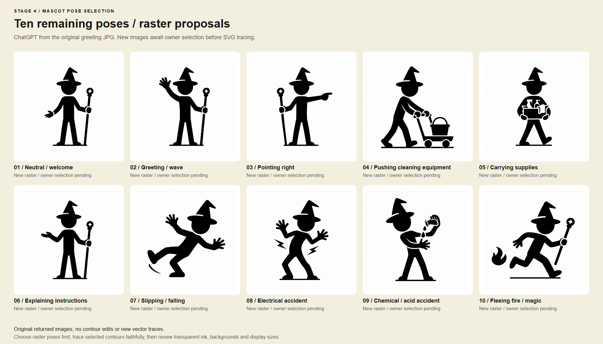

[Open the ten-pose sheet](media/mascot-chatgpt-round-02/contact-sheet-02.png) · [Twelve-pose overview with the two approved SVGs](media/mascot-chatgpt-round-02/library-overview-02.png) · [Download this raster-review package](sources/mascot-round-02-review.zip). The first two new poses deliberately separate a low welcoming hand from a raised greeting.

The generated figures share the original identity cues and clean black silhouette. Head/hat scale and action framing have natural variation; these have not been silently normalized. The chemical-spill hand/drop relationship deserves particular owner review. These are the original black-on-white proposals as first presented.

## Individual proposals

### 01 / Neutral / welcome

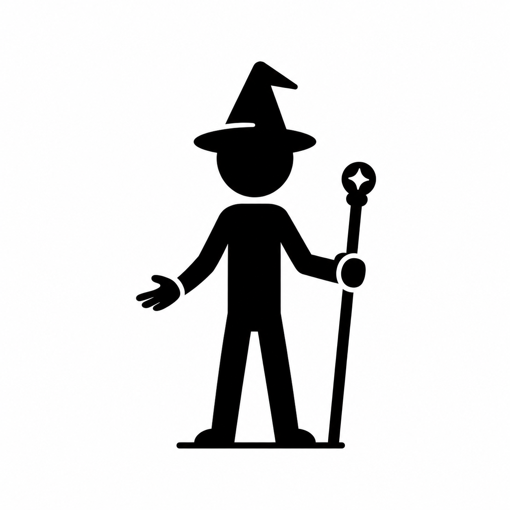

Low open hand and staff; deliberately distinct from the raised greeting.

Stable ID: `neutral-welcome-02`. [Original PNG](media/mascot-chatgpt-round-02/neutral-welcome-02.png). **Owner selected this raster.**

### 02 / Greeting / wave

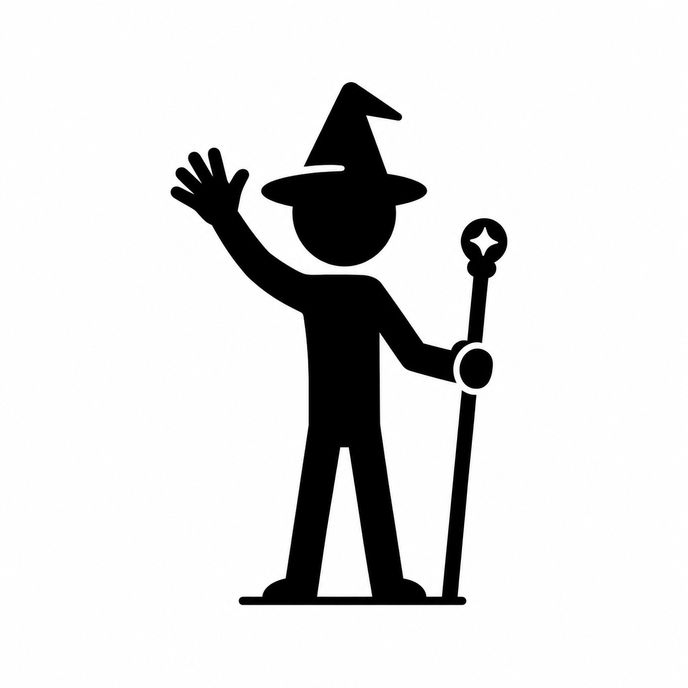

Raised open-hand wave; staff stays in the other hand. Compare the hand and shoulder curve with the original.

Stable ID: `greeting-02`. [Original PNG](media/mascot-chatgpt-round-02/greeting-02.png). **Owner selected this raster.**

### 03 / Pointing right

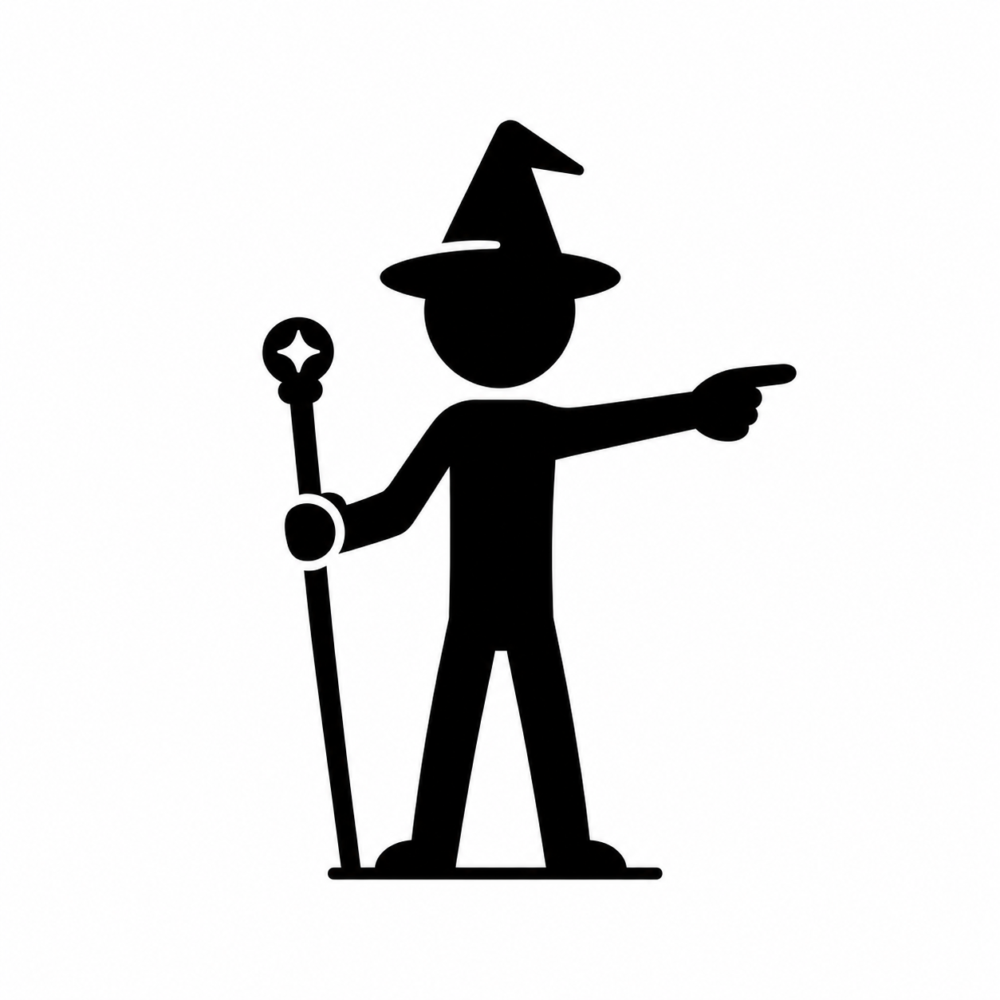

Arm points right; staff changes to the left side while the hat tip still bends right.

Stable ID: `point-right-02`. [Original PNG](media/mascot-chatgpt-round-02/point-right-02.png). **Owner selected this raster.**

### 04 / Pushing cleaning equipment

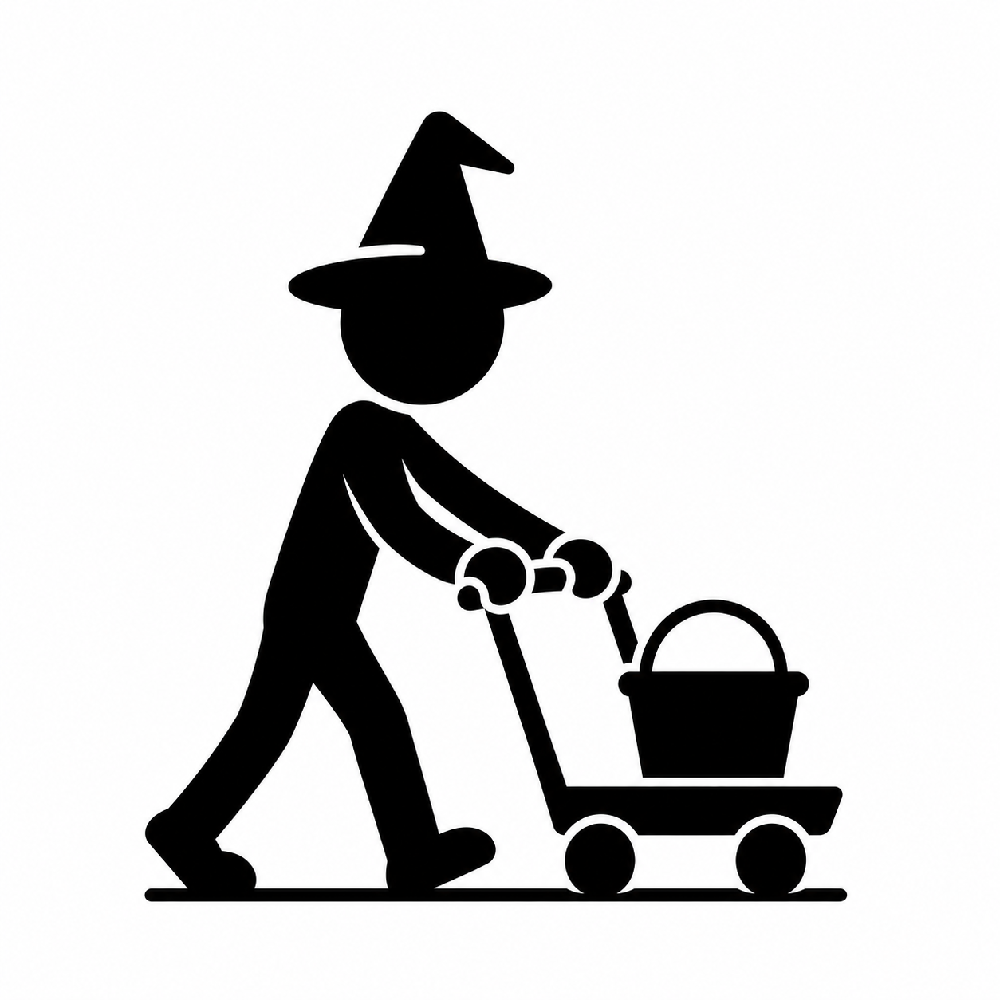

Two hands on the push bar, two visible wheels and one bucket; staff omitted for the task.

Stable ID: `pushing-equipment-02`. [Original PNG](media/mascot-chatgpt-round-02/pushing-equipment-02.png). **Owner selected this raster.**

### 05 / Carrying supplies

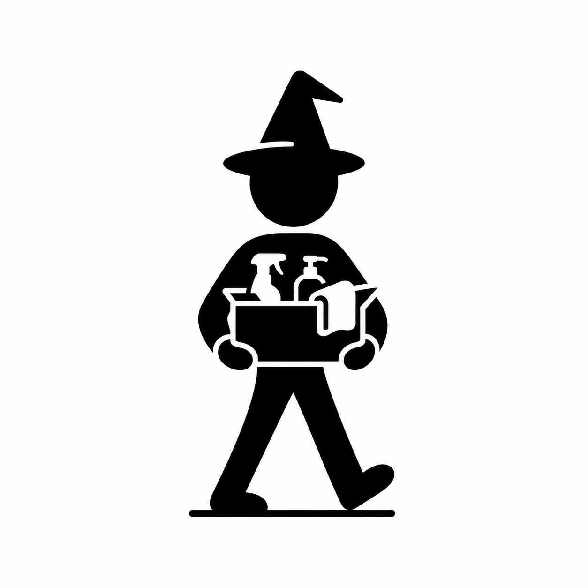

Two hands support one box containing two bottles and a cloth; staff omitted. The bottles and cloth use white cutouts against the torso.

Stable ID: `carrying-supplies-02`. [Original PNG](media/mascot-chatgpt-round-02/carrying-supplies-02.png). **Owner selected this raster.**

### 06 / Explaining instructions

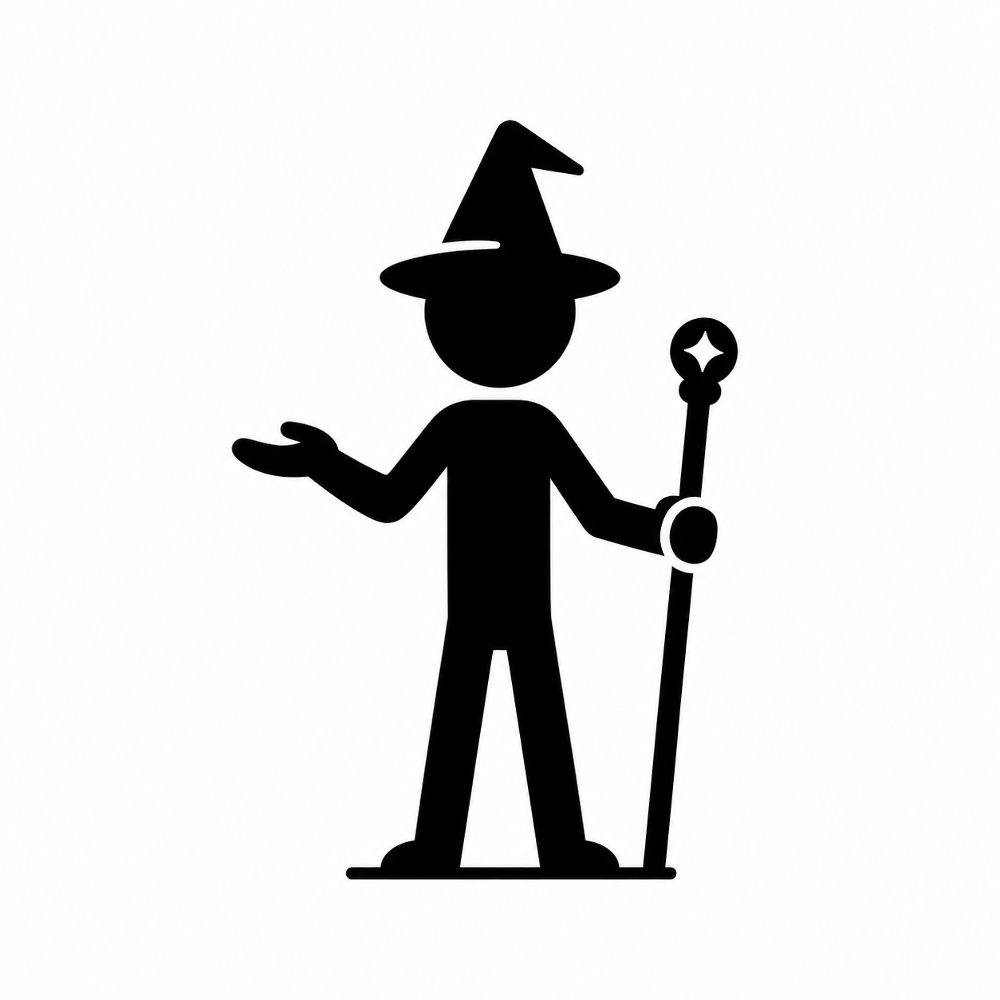

Open palm at chest height presents information without pointing or waving; staff retained.

Stable ID: `explaining-instructions-02`. [Original PNG](media/mascot-chatgpt-round-02/explaining-instructions-02.png). **Owner selected this raster.**

### 07 / Slipping / falling

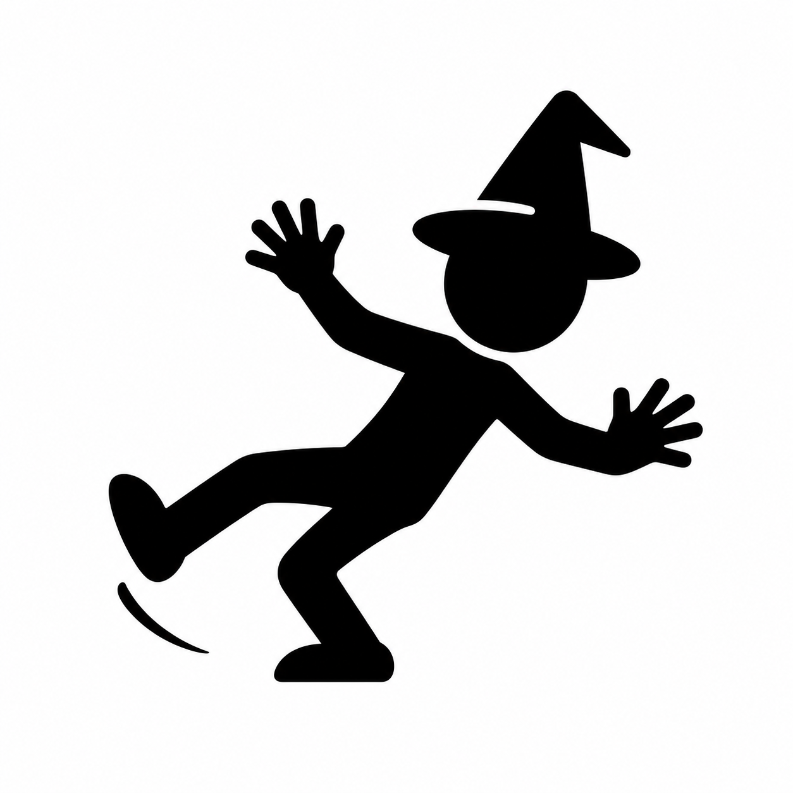

Backward diagonal slip, one extended and one bent leg, two outstretched arms. Staff omitted; hat stays worn.

Stable ID: `slipping-falling-02`. [Original PNG](media/mascot-chatgpt-round-02/slipping-falling-02.png). **Revision requested.**

### 08 / Electrical accident

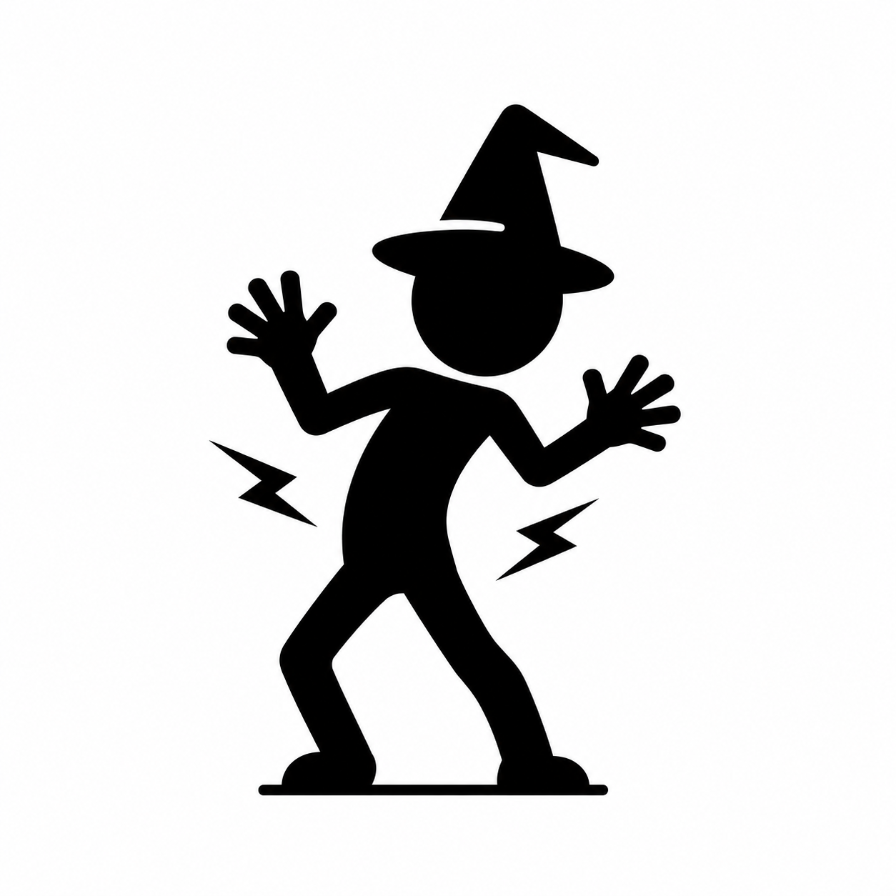

Recoiling figure with two isolated lightning bolts. Solid pictogram body, with no skeleton or extra apparatus.

Stable ID: `electrical-accident-02`. [Original PNG](media/mascot-chatgpt-round-02/electrical-accident-02.png). **Revision requested.**

### 09 / Chemical / acid accident

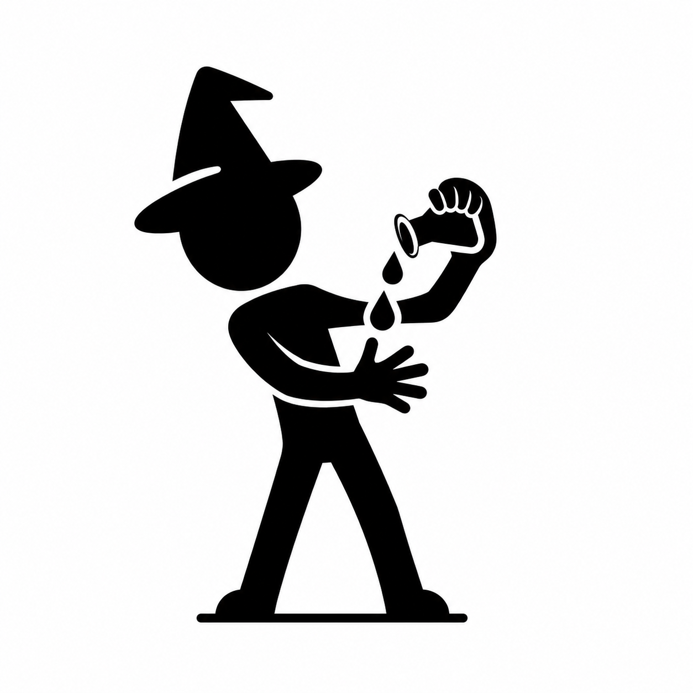

Tilted flask and two drops above the other hand. The lower drop sits close to the forearm; check that the spill reads clearly and does not look like intentional pouring.

Stable ID: `chemical-accident-02`. [Original PNG](media/mascot-chatgpt-round-02/chemical-accident-02.png). **Revision requested.**

### 10 / Fleeing fire / magic

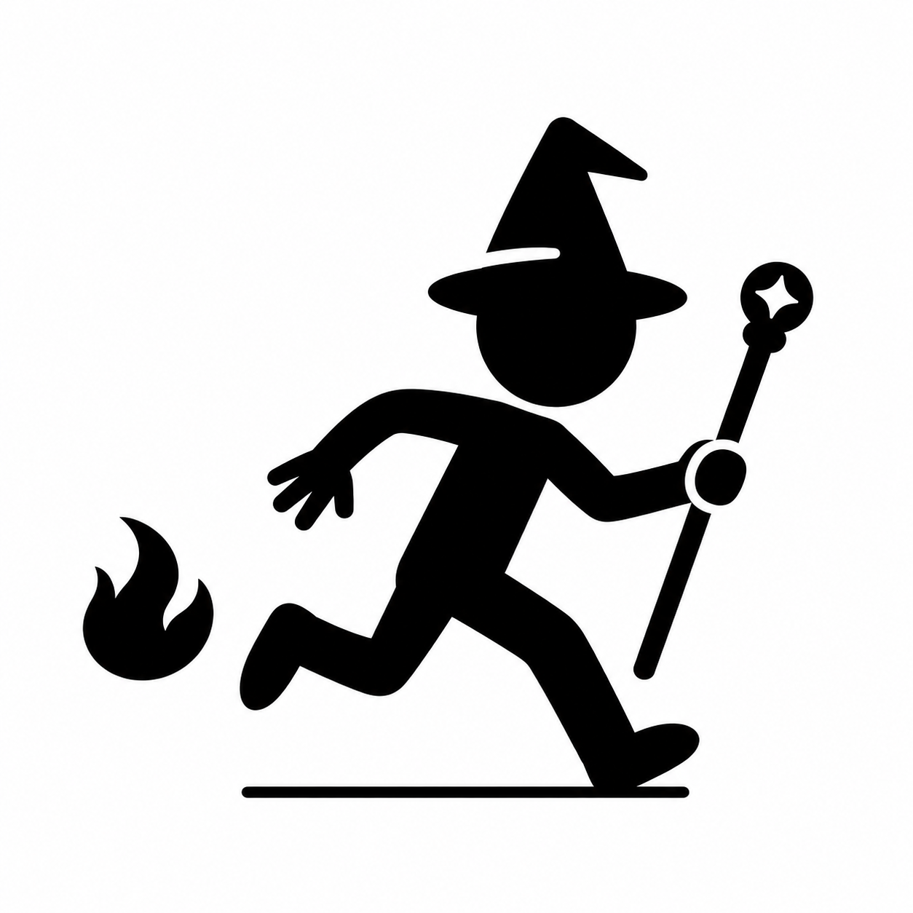

Running toward the right with a staff and one separate flame behind. Compare the larger action framing with the standing poses.

Stable ID: `fleeing-fire-magic-02`. [Original PNG](media/mascot-chatgpt-round-02/fleeing-fire-magic-02.png). **Revision requested.**

## Method and next step

Ten separate submissions produced ten images, each **1254 × 1254**, using ChatGPT built-in `image_gen`. The original `Stick_figure_mascot_waving_33412cac_2K.jpg` was the sole supplied visual input for every call. No v01 geometry, generated action, or earlier SVG was used as a generator reference. The tool exposes no underlying model identifier, seed or quoted price; none is inferred. No external API/provider or automatic variation batch was used.

[Exact prompts](MASCOT_ROUND_02_PROMPTS.md) · [Paths, input/output hashes and review notes](MASCOT_ROUND_02_MANIFEST.json) · [Editable ten-pose review sheet](sources/mascot-round-02/contact-sheet-02.svg) · [Editable twelve-pose overview](sources/mascot-round-02/library-overview-02.svg). The review-sheet SVGs embed the original raster proposals for layout; they are not mascot vector masters.

The original output bytes are preserved in Workspace and `Pet/Development/Stage4_ChatGPT_Round_02`. Both approved action rasters and all v02 SVG/PNG sources remain unchanged. No new mascot tracing, atlas edit or Unreal import occurred.

The next review covers the six v03 SVG traces and the four revised hazard rasters. The complete signage/UI review and stages 5–7 remain pending.
