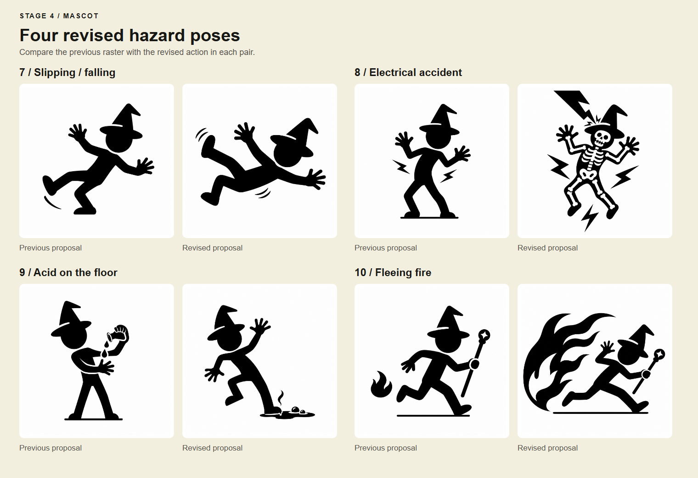
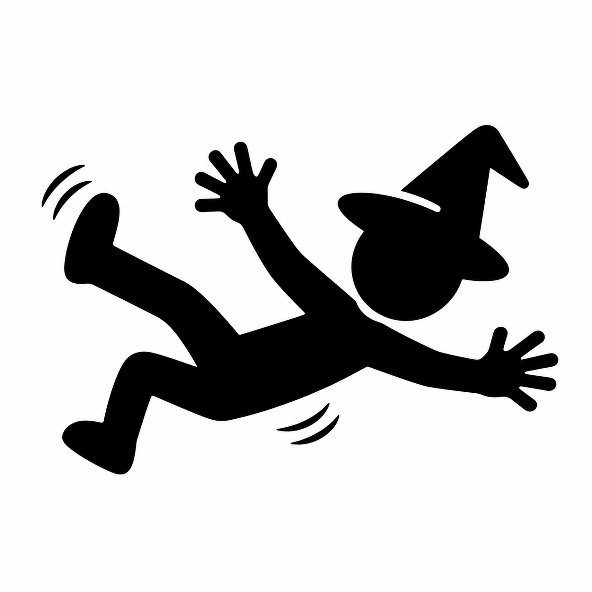
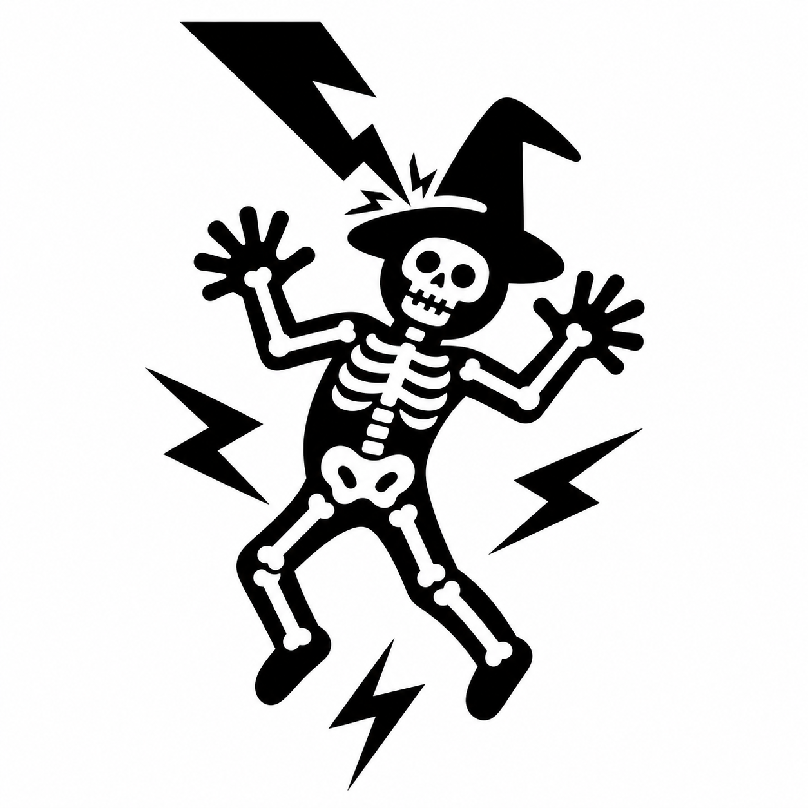
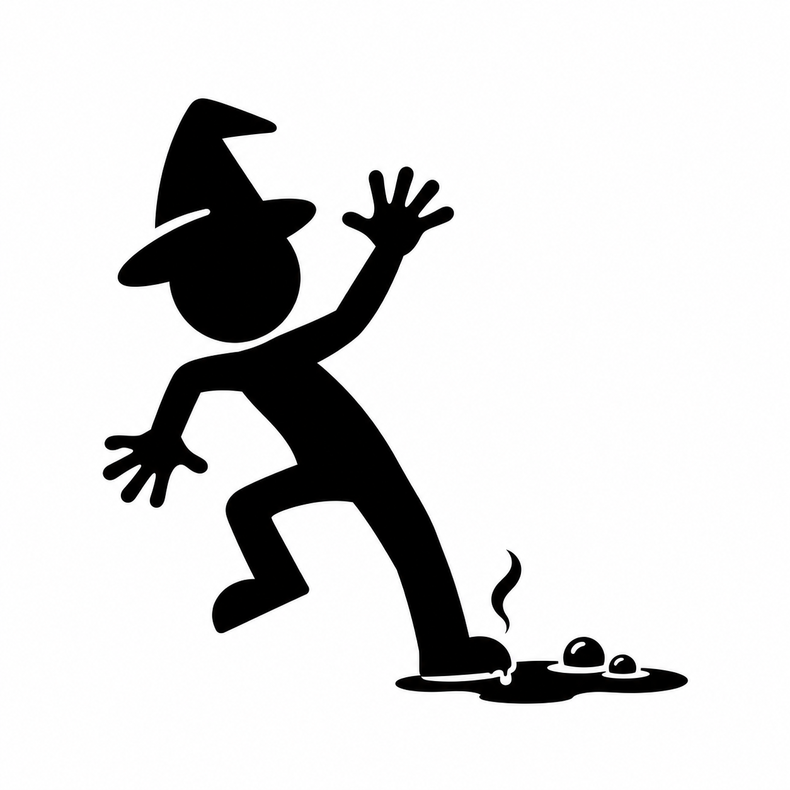
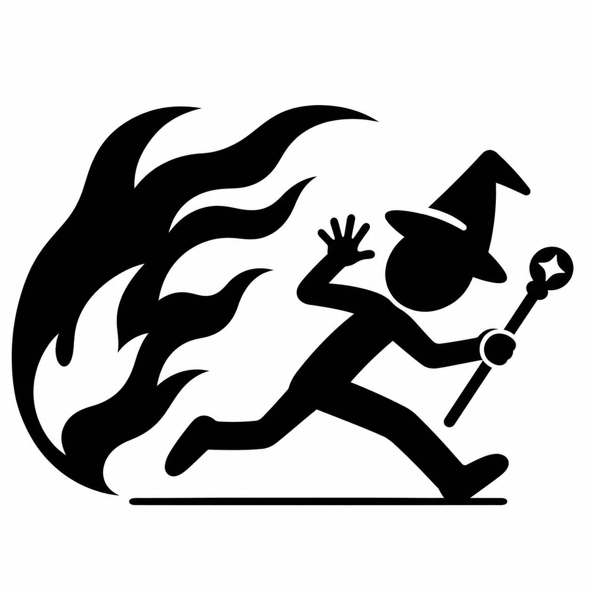

# Wizard mascot / revised hazard poses

The owner accepted poses 01–06 and requested changes to 07–10. The owner selected 07, 09 and 10 and accepted 08 with a five-digit correction. [The complete library contains the corrected 08 and all four hazard SVGs](MASCOT_STAGE4_LIBRARY.md). The images below show the round-03 proposal history.

## 7 / Slipping / falling

The torso is nearly horizontal, both feet are airborne, and the outstretched arms and motion arcs emphasize the fall.

[Full size PNG](media/mascot-chatgpt-round-03/slipping-falling-03.png)

## 8 / Electrical accident

The shock lifts both feet and reveals a simplified X-ray skeleton. One large strike and surrounding bolts make the cause clear.

[Full size PNG](media/mascot-chatgpt-round-03/electrical-accident-03.png)

## 9 / Acid on the floor

One shoe touches the bubbling floor puddle. A small wisp and the softened toe show contact while the rest of the figure stays intact.

[Full size PNG](media/mascot-chatgpt-round-03/chemical-accident-03.png)

## 10 / Fleeing fire

A large wall of flame follows the wizard. The longer stride, forward lean, and raised hand show alarm while keeping the face blank.

[Full size PNG](media/mascot-chatgpt-round-03/fleeing-fire-magic-03.png)

[Exact prompts, references, and file hashes](MASCOT_ROUND_03_MANIFEST.json) · [Editable comparison layout](sources/mascot-round-03/hazard-comparison-03.svg).
