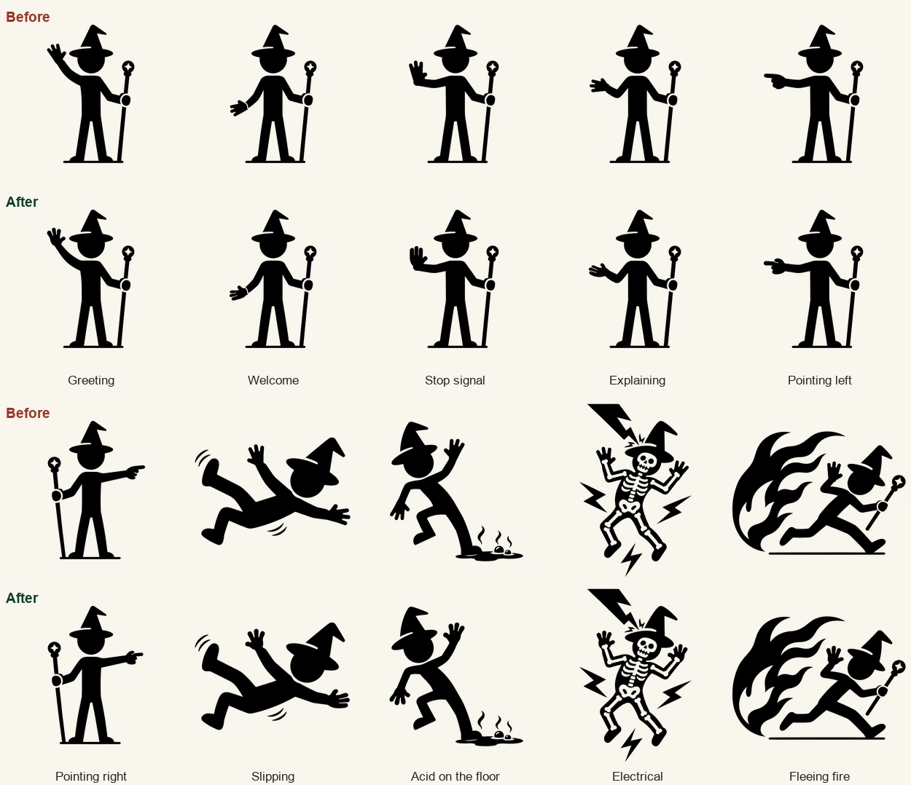
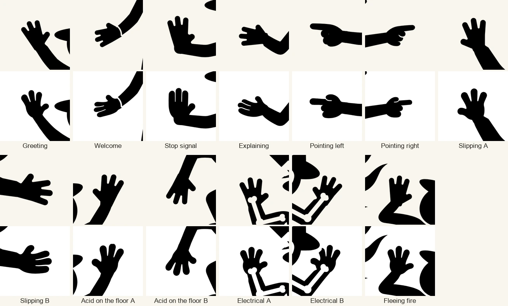
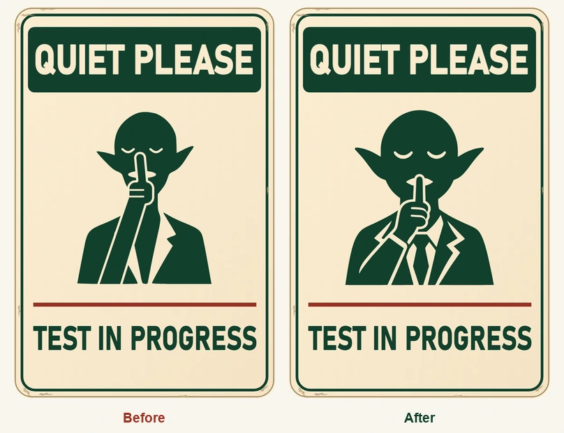

# Mascot and signage revision

The atlas resources include thirteen wizard poses in black and white and twelve signs. Open **Art bible → Mascot** and **Art bible → Signage & UI** for full-size previews and individual SVGs. [Download all 38 SVGs and the palette](sources/mascot-signage-revision.zip).

- The wizard uses three fingers and a thumb in the classic four-fingered cartoon style: a rounded palm, plump fingers of equal width with round tips, and a shorter thumb set lower on the palm. The 2026-11-20 revision replaced all thirteen open hands in ten poses. The skeleton hands keep their white wrist bones. Closed grips on the staff, tools and supplies retain their simplified silhouette. [Hand revision](#hand-and-quiet-elf-revision-2026-11-20).
- **Stop signal** (`wizard-stop-v01`) is a new pose built on the approved Pointing left body: the forearm ends in an upright open palm. It replaces the pointing wizard on Restricted Area and Keep Out, re-centred by about 6 units on each sign.
- The Quiet Please elf is a front-facing bust in a suit and tie. Its index finger stands vertically across the centre of the lips, which are visible on both sides, with the fist below the chin and the eyes closed. The elf is centred between the header and the red rule.
- Sign 04 reads **EQUIPMENT** on one centred line. The file keeps the name `04-cleaning-equipment.svg` so existing atlas links remain valid.
- Chemical Spill and the standalone acid pose share the same updated art. Three vapor trails rise above the puddle, and the boot and puddle meet in one continuous outline.

## Safety yellow

The palette comes from Chemical Spill. Chemical Spill, Wet Floor, Toxic Vapors and Low Clearance use the same sRGB gradient. The Wet Floor CAUTION letters and the Restricted Area stripe use its center color. [Palette JSON](sources/mascot-signage-revision/signage-palette.json).

| Gradient position | sRGB hex |
| --- | --- |
| 0% | `#FFD035` |
| 55% | `#FFCA28` |
| 100% | `#F6BC22` |

## Atlas resources

`General_Atlas/Resources/Pet/SVG` contains the 26 mascot SVGs on 2048 × 2048 canvases. The original 1254 × 1254 framing is centered at its original scale. `General_Atlas/Resources/Signage_Atlas/SVG` contains the twelve signs at their existing power-of-two dimensions and positions. The nine revised signs retain editable lettering. [Signage canvas sizes](SIGNAGE_ATLAS_STAGE7.md#power-of-two-resource-canvases).

All SVGs were rendered in Chromium and checked against the files in the resource folders. They are ready for the owner's next Substance Designer import and atlas export; the import should add `wizard-stop-v01` and its white mask.

## Hand and Quiet elf revision (2026-11-20)

The owner found the earlier hands deformed and the Quiet Please gesture unreadable. Both were redrawn with ChatGPT's built-in image generator in a visible Codex worker (`gpt-6.2-sol`, medium), then traced to SVG. The rasters are development sources; the SVGs await the owner's review.

**Hands.** A [hand design sheet](media/hands-quiet-revision/generated/hand-sheet-01.png) fixed the four-digit style first. Each of the thirteen open hands was then rendered as a 1024 px close-up crop of the approved pose and redrawn using that sheet. Only the hand was taken from each generated image. It was aligned to the approved forearm, joined across the forearm below the wrist with a 40 px blend, and the whole pose was retraced at 3.2× scale. Outside the hand areas, every pose matches the previous SVG to within the one-pixel anti-aliasing boundary at 1254 px. Black and white masters share identical geometry and now use the even-odd fill rule. The canvas, framing, ground lines and all other contours are unchanged.

**Quiet Please elf.** Three bust variants were generated: [side profile, front view and three-quarter view](media/hands-quiet-revision/quiet-elf-variants.webp). The front view was selected because the finger visibly crosses the lips, and it stays legible at 80 px. Its trace matches the selected raster with 99.82% intersection-over-union, and all differences fall within the one-pixel boundary. It uses the sign's `#123F2C` green and is centred at its previous scale. The lettering, red rule, panel and wear marks are unchanged.

| Updated file | Change |
| --- | --- |
| `Pet/SVG`: 20 SVGs (ten poses × black and white) | New hands |
| `01-employees-only.svg`, `02-restricted-area.svg`, `03-keep-out.svg`, `05-chemical-spill.svg`, `clean-start-poster.svg`, `wet-floor.svg` | Wizard geometry replaced with the revised pose at the same transform |
| `10-quiet-testing-elf.svg` | New elf |

Mopping, Pushing equipment and Carrying supplies, together with signs 04, 06–09, keep their previous files. [Generation log with every prompt and take](media/hands-quiet-revision/generated/prompts.json) · [Input crops and splice coordinates](media/hands-quiet-revision/inputs/crops/crops.json) · [Worker handoff](../../projects/total-insanitation/HANDOFF_HANDS_QUIET_ELF.md). Rejected takes and the pre-revision SVG backup are in the ignored runtime folder `.mrmak/total-insanitation/hands-quiet-revision/`.
