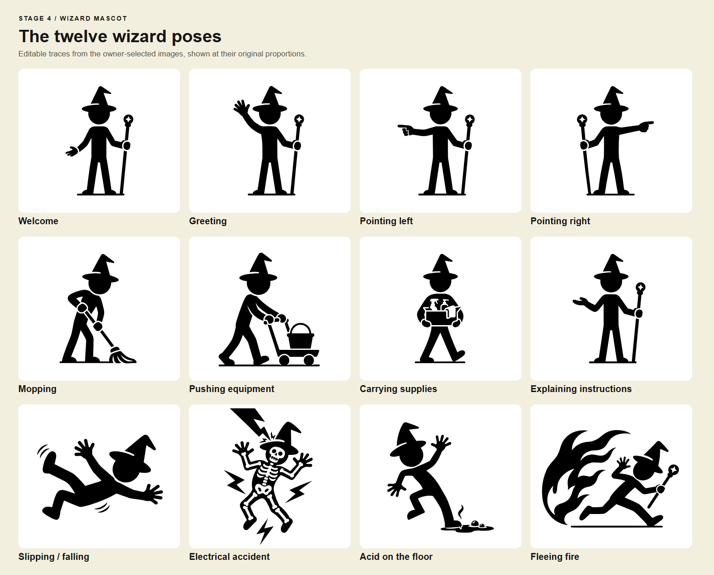

# Wizard mascot library

Art bible → **Mascot** contains twelve owner-approved poses for signs and UI. The electrical accident pose has five visible digits on each hand.

[Download the complete library](sources/mascot-stage4-library.zip). It includes 24 editable SVGs, 192 transparent PNGs in eight sizes from 32 to 1024 px, the selected source rasters, and a contact sheet.

## Pose files

| Pose | Black SVG | White SVG |
| --- | --- | --- |
| Welcome | [Black](sources/mascot-trace-v03/wizard-neutral-welcome-v03.svg) | [White](sources/mascot-trace-v03/wizard-neutral-welcome-v03-white.svg) |
| Greeting | [Black](sources/mascot-trace-v03/wizard-greeting-v03.svg) | [White](sources/mascot-trace-v03/wizard-greeting-v03-white.svg) |
| Pointing left | [Black](sources/mascot-trace-v02/wizard-point-left-v02.svg) | [White](sources/mascot-trace-v02/wizard-point-left-v02-white.svg) |
| Pointing right | [Black](sources/mascot-trace-v03/wizard-point-right-v03.svg) | [White](sources/mascot-trace-v03/wizard-point-right-v03-white.svg) |
| Mopping | [Black](sources/mascot-trace-v02/wizard-mopping-v02.svg) | [White](sources/mascot-trace-v02/wizard-mopping-v02-white.svg) |
| Pushing equipment | [Black](sources/mascot-trace-v03/wizard-pushing-equipment-v03.svg) | [White](sources/mascot-trace-v03/wizard-pushing-equipment-v03-white.svg) |
| Carrying supplies | [Black](sources/mascot-trace-v03/wizard-carrying-supplies-v03.svg) | [White](sources/mascot-trace-v03/wizard-carrying-supplies-v03-white.svg) |
| Explaining instructions | [Black](sources/mascot-trace-v03/wizard-explaining-instructions-v03.svg) | [White](sources/mascot-trace-v03/wizard-explaining-instructions-v03-white.svg) |
| Slipping / falling | [Black](sources/mascot-trace-v04/wizard-slipping-falling-v04.svg) | [White](sources/mascot-trace-v04/wizard-slipping-falling-v04-white.svg) |
| Electrical accident | [Black](sources/mascot-trace-v04/wizard-electrical-accident-v04.svg) | [White](sources/mascot-trace-v04/wizard-electrical-accident-v04-white.svg) |
| Acid on the floor | [Black](sources/mascot-trace-v04/wizard-chemical-accident-v04.svg) | [White](sources/mascot-trace-v04/wizard-chemical-accident-v04-white.svg) |
| Fleeing fire | [Black](sources/mascot-trace-v04/wizard-fleeing-fire-magic-v04.svg) | [White](sources/mascot-trace-v04/wizard-fleeing-fire-magic-v04-white.svg) |

## Placement

Keep the original 1254 × 1254 framing and scale the artwork uniformly. Use black on light or yellow surfaces and white on dark surfaces. Check clear space, silhouette and fine details at the target size, especially the electrical pose's hands and skeleton. Verify sign distance and mip behavior in Unreal when importing.

[Usage notes](sources/mascot-stage4-library/USAGE.md) · [Editable contact sheet](sources/mascot-stage4-library/wizard-library-contact.svg) · [File catalog](sources/mascot-stage4-library/catalog.json).
