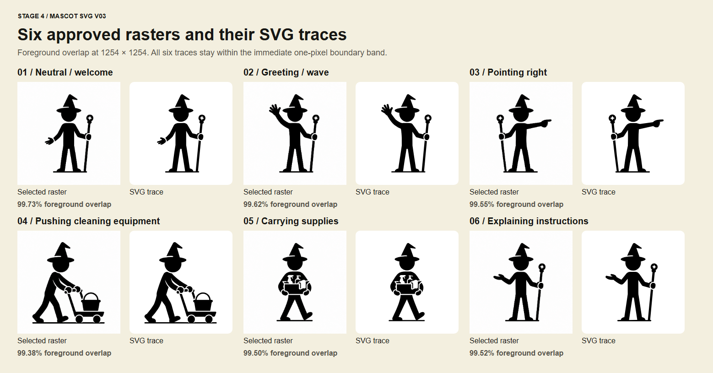
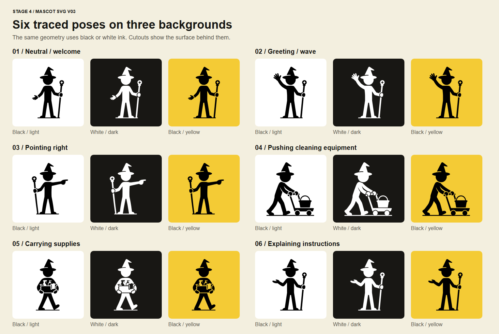
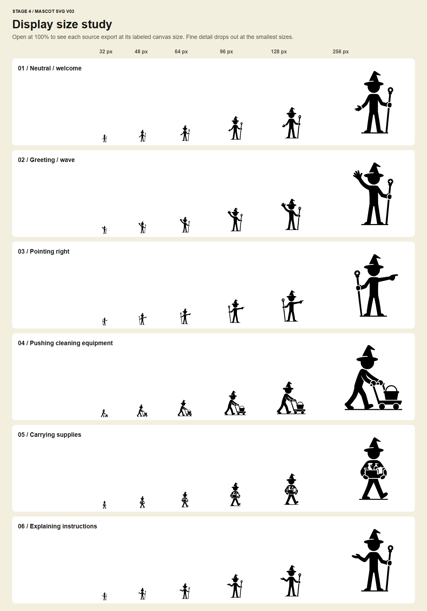

# Wizard mascot / six editable SVG traces v03

The owner selected raster poses 01–06. Their v03 SVGs are ready for review alongside the previously approved pointing-left and mopping v02 files. [The complete twelve-pose library](MASCOT_STAGE4_LIBRARY.md) now includes these files and the four final hazard traces.

[Download the source package](sources/mascot-trace-v03.zip). It includes 12 editable black and white SVGs, 96 transparent PNGs, three review sheets and the original Adobe traces.

The display-size sheet is labeled by canvas size. Open at 100%. The smallest sizes lose some detail in the hands, trolley and supplies box. World-sign viewing distance and engine mip behavior await native review.

| Pose | Black SVG | White SVG | Foreground overlap |
| --- | --- | --- | ---: |
| 01 / Welcome | [Black](sources/mascot-trace-v03/wizard-neutral-welcome-v03.svg) | [White](sources/mascot-trace-v03/wizard-neutral-welcome-v03-white.svg) | 99.73% |
| 02 / Greeting | [Black](sources/mascot-trace-v03/wizard-greeting-v03.svg) | [White](sources/mascot-trace-v03/wizard-greeting-v03-white.svg) | 99.62% |
| 03 / Pointing right | [Black](sources/mascot-trace-v03/wizard-point-right-v03.svg) | [White](sources/mascot-trace-v03/wizard-point-right-v03-white.svg) | 99.55% |
| 04 / Pushing equipment | [Black](sources/mascot-trace-v03/wizard-pushing-equipment-v03.svg) | [White](sources/mascot-trace-v03/wizard-pushing-equipment-v03-white.svg) | 99.38% |
| 05 / Carrying supplies | [Black](sources/mascot-trace-v03/wizard-carrying-supplies-v03.svg) | [White](sources/mascot-trace-v03/wizard-carrying-supplies-v03-white.svg) | 99.50% |
| 06 / Explaining instructions | [Black](sources/mascot-trace-v03/wizard-explaining-instructions-v03.svg) | [White](sources/mascot-trace-v03/wizard-explaining-instructions-v03-white.svg) | 99.52% |

Adobe Image Vectorize traced the selected rasters. The same winding-aware consolidation as v02 turns the light areas into transparent spaces. The 1254-square framing and original ground strokes are preserved. Each master has one editable compound path. The black and white files share identical geometry. At 1254 px, all thresholded raster differences stay in the immediate one-pixel boundary band. The transparent PNGs span 32, 48, 64, 96, 128, 256, 512 and 1024 px. Across 48 black and white size pairs, alpha differs by at most one level out of 255. See the [trace manifest](sources/mascot-trace-v03/manifest.json) for exact measurements and source hashes.

The production source is `Pet/Development/Stage4_Trace_v03` within the existing General Atlas resources.
