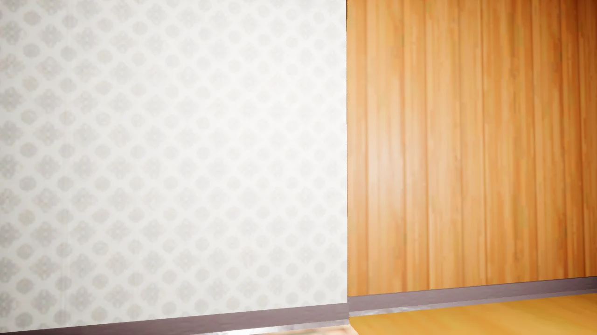

# Office Level Builder

Build 4 m modular layouts from room volumes and stair markers using the project's existing modular Blueprints. Use Z scale for height, **Enclosed Room** for a room within a larger one, and **Keep Shared Walls** for separate finishes where two rooms touch.

## Files

| Item | Location |
| --- | --- |
| Builder | `/Game/Art/Tools/OfficeLevelBuilder/BP_OLB_Builder` |
| Room marker | `/Game/Art/Tools/OfficeLevelBuilder/BP_OLB_Room` |
| Stair marker | `/Game/Art/Tools/OfficeLevelBuilder/BP_OLB_Stair` |
| Installed runtime script | `BoomeRacist/Content/Art/Tools/OfficeLevelBuilder/Python/olb_build.py` |
| Matching editable runtime source | `projects/total-insanitation/scripts/olb_build.py` |
| Blueprint setup/refresh source | `projects/total-insanitation/scripts/olb_setup_assets.py` |

The editable runtime source matches the installed script. Setup/refresh changes tool packages and is only needed for installing or maintaining the Blueprint assets.

## Use

1. Place one `BP_OLB_Builder` in the target level; its location is the 4 m grid origin. Set `Group` and select wall, corner, floor, ceiling and lit-ceiling classes.
2. Add `BP_OLB_Room` markers of the same group. **Scale X/Y** sets the footprint in 4 m cells, and **Scale Z** sets the height in 4 m increments. For example, a scale of **4 × 3 × 2** makes a 16 × 12 m room with an 8 m ceiling. Keep yaw 0. The actor's Z location sets the base floor.
3. Place a smaller marker inside a larger room of the same group and enable **Office Builder → Enclosed Room** on the smaller one. It gets walls, floor and ceiling, with its own piece and light overrides. At a shared floor or ceiling plane, the enclosed room provides the tile within its footprint.
4. For adjoining rooms, align their edges on the grid and enable **Office Builder → Keep Shared Walls** on both markers. Assign **Wall Classes** on each room for its own finish.
5. Give the room whose wall should stay flush the higher **Priority**. For example, set the wallpaper room to **1** and its neighbor to **0** to keep the wallpaper face on the grid line. The opposite face shifts 30 cm into the lower-priority room. With equal priorities both faces move inward 15 cm. **Priority** also selects pieces in overlapping ordinary markers, including floor patches. Empty piece lists inherit the Builder.
6. Set **Light Spacing X/Y** to 1 for every cell, 2 for every other cell, 0 for no lights or −1 on a room to inherit the Builder. The pattern is centered per room and retains a center row in narrow corridors.
7. Place `BP_OLB_Stair` on the upper floor. Its 1 × 2-cell footprint descends one 400 cm floor. The orange arrow points downhill. Rotate in 90° steps and connect upper/lower room cells to the stair ends.
8. Press **Build** from a marker's Details panel after changes. **Clear** on the Builder removes generated actors. Each operation is a single undo transaction.

Use separate groups for independent layouts. Generated actors carry `OLB_Generated` and live under `OfficeBuilder/<Group>/L<floor>/`. A rebuild replaces that group's generated actors: remove the tag or change the marker group before preserving hand-edited results. Marker Blueprints are editor-only.

## Rules and limits

- Grid: 400 cm; standard wall thickness: 15 cm. Open convex corners use the 385 cm wall variant to avoid overlapping end faces. Keep the kit's edge pivots and ceiling offsets.
- Ordinary rooms connect by default. At an open 4 m to 8 m join, the passage stays open up to 4 m and wall modules close the space above it. A tall room has one floor and one ceiling across its clear height. Stacking separate 4 m room markers retains their dividing floor and ceiling.
- **Keep Shared Walls** works between adjoining ordinary rooms or adjoining enclosed rooms. Both markers opt in. Overlapping ordinary rooms still merge. The two wall modules meet back to back, with 30 cm between their interior faces. At a height difference the taller wall continues at the same inset. Shared partitions are solid, and doorways require manual authoring.
- An enclosed marker must fit within the footprint and height of a larger ordinary marker. Overlapping enclosed markers are skipped with a warning. Enclosed walls are generated solid. Doorways require manual authoring.
- Stair cells receive no ordinary floor/ceiling. The tool uses a mirrored copy of the chosen stair piece for the stepped ceiling; inspect orientation and adjoining walls in the actual scene.
- A stair that crosses an enclosed room's footprint or lands inside it is skipped with a warning.
- Build snaps markers to the grid. Review warnings, collision and walkability before accepting a layout.
- Lit ceiling materials are not a promise of sufficient real lighting. Verify with the target lighting setup.

## Shared wall alignment in Unreal

The same camera shows the wallpaper-to-wood joint on a temporary test map. With equal priorities, the wallpaper face sits 15 cm in front of the adjacent wood wall.

With wallpaper set to **Priority 10** and the room across the partition set to **0**, the wallpaper and wood faces meet flush. Collision traces measured both faces at the same grid coordinate and the opposite partition face 30 cm away. Reversing the priorities moved the offset to the wallpaper side.

## Revision history

- Room Z scale sets the ceiling height in 4 m increments. **Enclosed Room** adds a separate floor, walls and ceiling inside a larger room.
- **Keep Shared Walls** builds a back-to-back pair between touching markers, retaining a separate wall finish for each room.
- **Priority** controls the alignment of that pair. The higher-priority face lines up with ordinary walls on the same grid line and the other room absorbs the full partition thickness. Equal priorities keep the centered placement.
