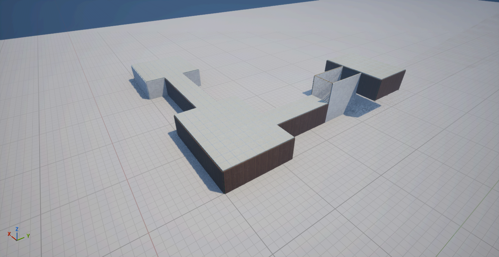
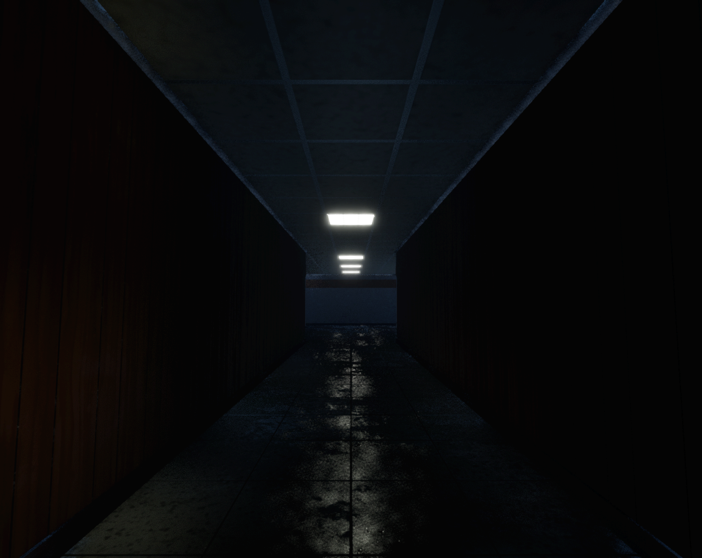
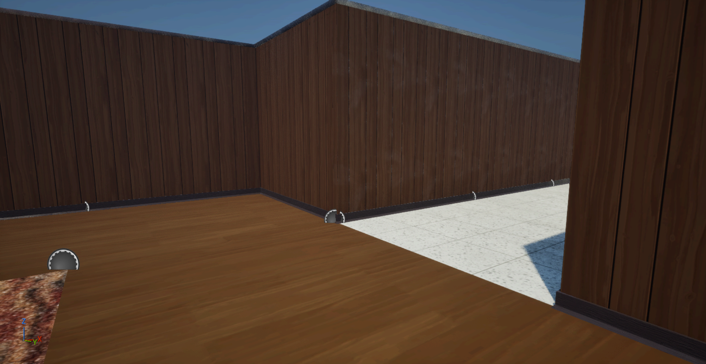
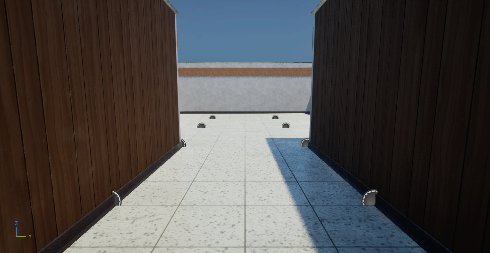
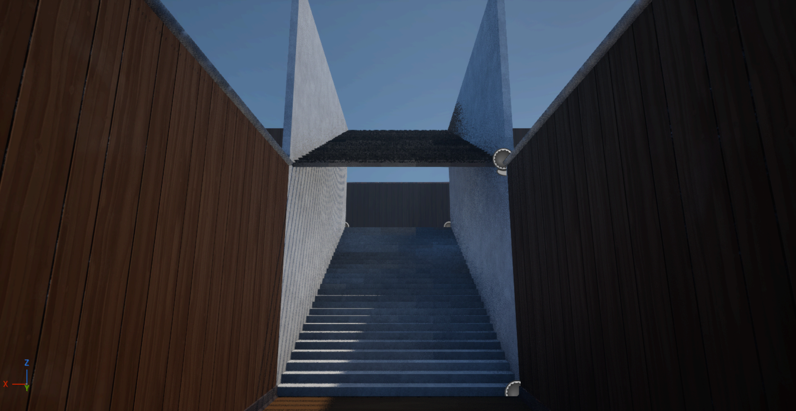
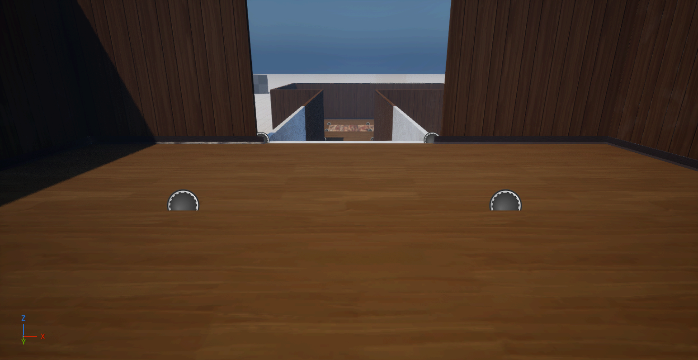

# Office Level Builder

**12 November 2026. Implemented and agent-verified in Unreal 5.8.4; the owner has not yet reviewed it.** This is a drag-and-build system for 4 m modular levels like the Basement. It is aimed mainly at the future **Office** floors. You place room rectangles and stair markers, choose the modular Blueprints for walls, corners, floors, ceilings and stairs, and press **Build**. The tool then places your ordinary modular Blueprint actors, exactly as in the hand-built Basement. Open corners automatically get the shorter **corner** Blueprint, so walls do not Z-fight. The shop is not part of this system.



## Where it is

| Item | Location |
| --- | --- |
| Builder (piece selection and buttons) | `/Game/Art/Tools/OfficeLevelBuilder/BP_OLB_Builder` |
| Room rectangle | `/Game/Art/Tools/OfficeLevelBuilder/BP_OLB_Room` |
| Stair marker | `/Game/Art/Tools/OfficeLevelBuilder/BP_OLB_Stair` |
| Run script (installed execution script) | `BoomeRacist/Content/Art/Tools/OfficeLevelBuilder/Python/olb_build.py` |
| Setup script (recreates/refreshes the three Blueprints) | `projects/total-insanitation/scripts/olb_setup_assets.py` |
| Demo placement script | `projects/total-insanitation/scripts/olb_place_demo.py` |
| Live demo | LaCarlota, outliner folder `Art Review/Office Level Builder 2026-11-12`, starting at **(14000, 2000, 0)** cm |

## How to use it

1. Open the target level and drag **BP_OLB_Builder** into it. Its location is the origin of the 4 m grid.
2. In its Details panel (**Office Builder → Pieces**), choose:
   - **Wall Classes**: one or more wall Blueprints. With several, each wall uses a stable random choice; `Random Seed` changes the mix.
   - **Corner Class**: the fallback corner. Normally you can leave the default. The tool first uses the corner from the chosen wall family (`BP_Wall_Wood_02` → `BP_Wall_Wood_Corner_01`, `BP_Wall_LabConcrete_01` → `BP_Wall_LabConcrete_Corner_01`).
   - **Floor Classes**, **Ceiling Classes**: one or more Blueprints, randomized the same way.
   - **Ceiling Light Class** + **Light Spacing X** / **Light Spacing Y**: a lit ceiling every *N* cells along each axis, set separately (updated 12 November 2026 at the owner's request). 1 = every cell, 2 = every other cell, 0 = no lights. The pattern is centred in each room. A room narrower than the spacing (a 1-cell-wide corridor) always gets its centre row, so a corridor along X with **X = 2** has a light every other tile. A light appears where both axes match.
3. Drag in **BP_OLB_Room** actors and **scale** them with the normal scale gizmo: **scale 1 = one 4 × 4 m cell** (scale 4 × 3 = a 16 × 12 m room). The pivot is the room's corner. Height is one floor (4 m). Move a room up or down by 400 cm for another floor.
   - **Rooms that touch or overlap join** into one space; no wall is placed between them. Use a narrow room (scale 1 × N) as a corridor.
   - Each room can override any piece list (empty = use the Builder's). Example: a laboratory room with `BP_Wall_LabConcrete_01` and a mosaic floor.
   - **Priority**: where rooms overlap, the higher priority decides the floor/ceiling/wall pieces of those cells. Use a small room with priority 1 and a rug floor to make a carpet patch.
   - **Light Spacing X/Y** on a room (−1 = use the Builder's) gives that room its own interval, for example a corridor along Y with X = 1, Y = 3. A priority patch that sets no light values keeps the surrounding room's light pattern.
4. For stairs, drag **BP_OLB_Stair** onto the **upper** floor. Its yellow box covers 1 × 2 cells, and the **orange arrow points downhill**. Rotate it in 90° steps. It descends exactly one floor (400 cm): the cell before the arrow's start must belong to an upper-floor room, and the cell after its end to a lower-floor room. The chosen stair Blueprint already includes the side walls. A second, Z-mirrored copy forms the stepped ceiling and the upper side walls (the Basement convention).
5. Select the Builder, a Room or a Stair, and press **Build** in its Details panel. Press **Build** again after any change: previous generated actors are replaced. **Clear** (on the Builder) removes them. Each Build or Clear is a single undo step (**Ctrl+Z**).

Generated actors are tagged `OLB_Generated`. They are named `OLB_<Group>_L<floor>_<Kind>_<cell>` and placed under the outliner folder `OfficeBuilder/<Group>/L<floor>/`. The Builder, Rooms and Stairs are **editor-only actors**, so packaged builds do not include them.

**Groups.** All three markers have a `Group` field (default `Office`). One Builder serves the rooms and stairs of its group. To create a second independent layout in the same level, use another group name.

**Keeping hand edits.** Build regenerates every actor in the group. To make a generated area permanent and edit it manually, remove its `OLB_Generated` tag (or change the markers' group) before the next Build.

## Rules the tool follows

- **Grid:** walls, floors and ceilings are 400 cm. Floors use their pivot at the walking height. Ceiling Blueprints use their own 400–415 cm offset.
- **Walls:** every edge between a room cell and empty space gets a wall facing into the room, with its 15 cm thickness outside the room. This uses the Basement pivot and yaw convention (0° / 90° / 180° / −90°).
- **Open corners:** at an outward-pointing (convex) corner, two walls' thickness overlaps in a 15 × 15 cm square, and their end faces would Z-fight. One of the two walls becomes the 385 cm corner Blueprint. When the short end must be at the wall's start, it is placed at the wall's end and mirrored (X scale −1), exactly as in the Basement. Each wall is shortened at most once; the tool assigns the corners across connected corners automatically. Inside (concave) corners use normal walls, as in the Basement.
- **Stairs:** stair cells get no floor or ceiling. Room walls stop where the stair's own side walls are. A room wall that meets a stair side wall at an open corner becomes the corner piece, because the stair wall cannot be shortened.
- **Snapping:** on Build, rooms and stairs snap to the grid and their rotation is cleaned. Rooms keep yaw 0 and integer scale; stairs keep multiples of 90°.

## Verification

**Per-axis lights (update):** the demo was rebuilt with the Builder at X = 2 / Y = 2 and the LabConcrete room overridden to X = 1 / Y = 3. Result:
- The 4 × 1 corridor now has lights at alternate tiles; before this change it had none.
- The 1 × 3 corridor has lights at its first and third tiles.
- The 3 × 3 lab has one centred row of three lights.
- The 4 × 3 office has lights at alternate tiles on both axes, and the rug patch keeps the office pattern.

All 13 lit cells matched the expected positions. Existing marker values were migrated: each old `LightSpacing` value was copied to both X and Y before the old variable was removed.



**Original build:**

The demo has a 4 × 3 office with a priority rug patch, a 4 × 1 mosaic corridor, a 3 × 3 LabConcrete room and a corridor rising by stair to an upper room. The Builder's real Details-panel **Build** button produced:

| Walls | Corners | Floors | Ceilings | Stair pieces | Warnings |
| --- | --- | --- | --- | --- | --- |
| 38 | 8 | 34 | 34 | 2 | 0 |

The 8 corners match the expected open corners: 6 on the ground floor and 2 at the upper-floor stair entrance. Three Builds replaced the same 116 generated actors without duplicates. Close-ups show continuous skirting around the open corners and no visible Z-fighting. The images below were captured from the editor viewport with ceilings temporarily hidden for daylight. They are not PIE gameplay captures.









## Installed execution script

The owner authorized installing an execution script. **What was installed:** one Python file, `Content/Art/Tools/OfficeLevelBuilder/Python/olb_build.py`. Non-asset files inside `Content` are not cooked into the game.

**How it runs:** each **Build/Clear** button is a `Call In Editor` custom event. It calls `Execute Console Command` with an editor `py` command that runs this file from the project's Content folder. **Project settings and startup scripts were not changed, and no plugin was added.** It uses the Python Editor Script Plugin, which was already enabled during setup. The `py` command exists only in the editor; the markers are editor-only actors, so the call never runs in a packaged game.

**Manual run** (Output Log, `Cmd`):

```
py import runpy,unreal; runpy.run_path(unreal.Paths.convert_relative_path_to_full(unreal.Paths.project_content_dir())+'Art/Tools/OfficeLevelBuilder/Python/olb_build.py', init_globals={'OLB_ACTION':'build'})
```

`OLB_ACTION` is `build` or `clear`. Optional `OLB_GROUPS=['Office']` limits the run. Without it, the script uses the groups of the selected markers, or every group if none is selected. Results and warnings appear in the Output Log with the `OLB:` prefix.

**Recreating the Blueprints:** run `olb_setup_assets.py` in the editor. It is idempotent. UE 5.8 does not let Python or the Unreal MCP set the `Call In Editor` flag, so if the Blueprints are recreated, tick **Call In Editor** once per Build/Clear event in the Blueprint editor.

## Limits and next decisions

- **Two adjacent rooms that need a dividing wall:** the kit's walls are closed 15 cm boxes with their thickness outside the room. Two back-to-back walls on the same edge would show one wall's back face or Z-fight. The tool therefore joins touching rooms. For now, separate rooms with a one-cell gap, as in the Basement, or connect them with a corridor. A real partition needs either a double-sided partition wall mesh or an owner decision on a 30 cm wall offset.
- **Doorway walls:** the doorway mesh still has no modular Blueprint, so there is no "door" option yet. Once that Blueprint exists, a door marker can replace a wall on a chosen edge.
- **Lighting:** `BP_Roof_Lights_01` is an emissive ceiling panel with no light component. The office demo is therefore dark in the editor unless lights are added, for example via a lights streaming level like `Main_Lights`. `BP_Roof_Lights_02` includes a spot light.
- **Stairs:** one stair Blueprint per marker, exactly one floor and 1 × 2 cells. A room cell placed alongside a stair's side is reported as a warning, because the stair wall's back face would show.
- **Scope:** the demo lives in LaCarlota. On 12 November 2026 the owner authorized creating new Office maps; none has been created yet.

## Exact changes

- **Added (Unreal):** the three Blueprints above and `Content/Art/Tools/OfficeLevelBuilder/Python/olb_build.py`.
- **Modified (Unreal):** `Content/Levels/LaCarlota.umap`. It gained the 8 marker actors and the 116 generated actors in the folders above; no existing actor was changed. A pre-save copy is in `.mrmak/total-insanitation/office-level-builder/LaCarlota.before-olb-demo.umap`.
- **Unchanged:** all modular wall/floor/ceiling/stair Blueprints and meshes, project settings and plugins. Other maps were not saved. Pre-existing uncommitted Unreal changes were left as they were.
- **Per-axis light update:** modified `BP_OLB_Builder` and `BP_OLB_Room` (`LightSpacing` replaced by `LightSpacingX`/`LightSpacingY`) and `olb_build.py`. The demo was rebuilt in the open LaCarlota session, but **LaCarlota was not saved**: it already had the owner's unsaved work (group `Office`, folder `NewFolder1`), which was not rebuilt. Migration script: `projects/total-insanitation/scripts/olb_migrate_light_spacing.py`.
- Setup receipt and captures: `.mrmak/total-insanitation/office-level-builder/` (ignored).
