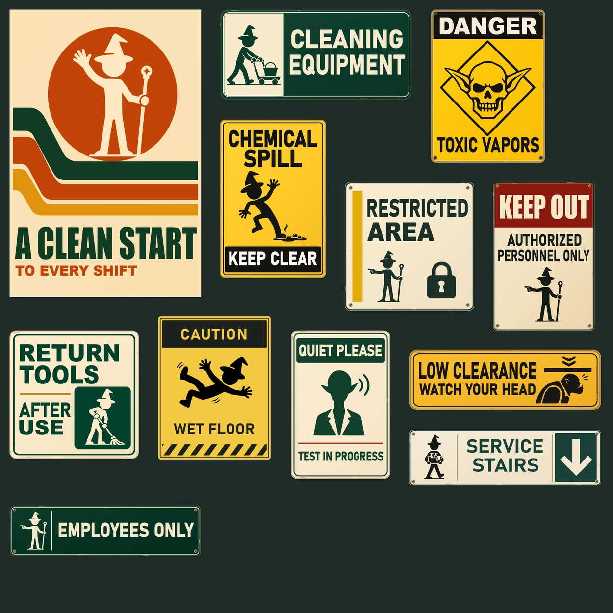
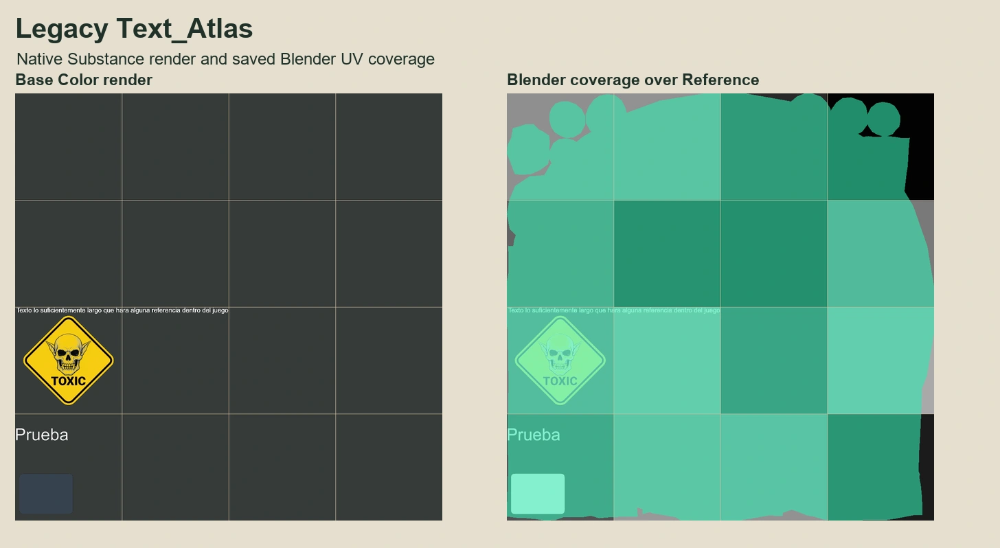
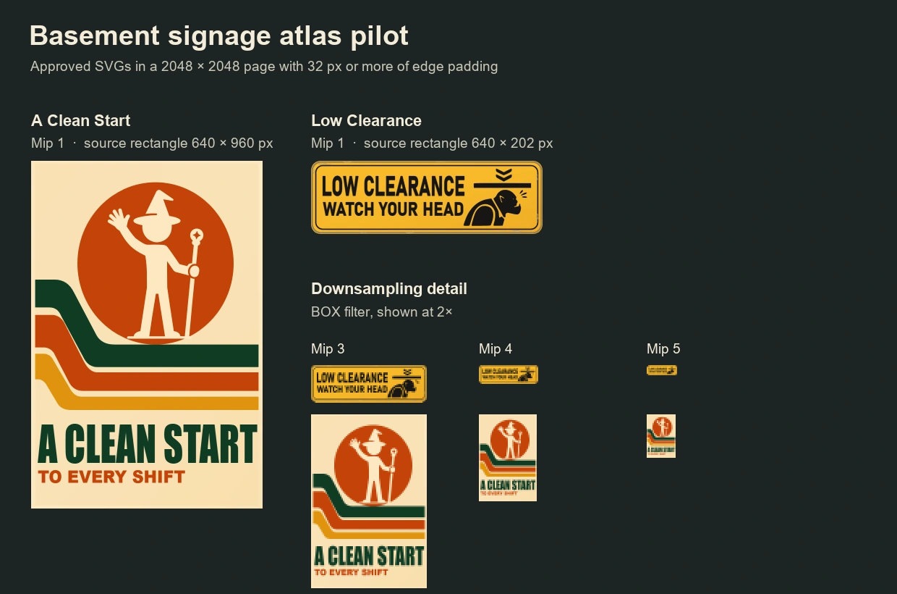

# Signage Atlas · Stage 7 specification

The twelve current graphics are in **Art bible → Signage & UI**. The editable Designer resources are under `Utility_Materials/TrimSheet&Atlas/General_Atlas/Resources/Signage_Atlas/SVG/`. The owner imports these resources and builds and exports the atlas in Substance Designer. The 2048 × 2048 pilot page and its UV rectangles remain a reference for the Unreal check. [Current artwork and palette](MASCOT_SIGNAGE_REVISION.md) · [Pilot pixel rectangles and UVs](sources/basement-stage7-atlas-layout.json).

## Power-of-two resource canvases

Every texture canvas uses a power-of-two width and height. Rectangular sizes such as 1024 × 512 are valid. Each SVG uses the smallest such canvas that contains its original viewport. The extra space is transparent and centered around the editable artwork. A Chromium comparison matched all twelve originals pixel for pixel at equivalent canvas positions. Low Clearance uses a 2048 × 512 canvas around its 1190 × 376 artwork viewport. A Clean Start uses a 1024 × 2048 canvas around its 800 × 1200 artwork viewport.

| Canvas | Resources |
| --- | --- |
| 512 × 1024 | Wet Floor |
| 1024 × 2048 | Keep Out, Chemical Spill, Toxic Vapors, Quiet Testing, A Clean Start |
| 2048 × 512 | Employees Only, Service Stairs, Low Clearance |
| 2048 × 1024 | Cleaning Equipment |
| 2048 × 2048 | Restricted Area, Return Tools |

## Previous packed-page proof

Adobe's Substance cooker and renderer read the previous pilot package and resolved both links. Base Color and Coverage rendered at 2048² and matched their corresponding inputs pixel for pixel. The page used the approved standalone PNG exports resized into the recorded rectangles. Packing passed BOX isolation through mip 5 on all twelve allocations. Confirm the owner's final exported rectangles before Unreal binding. [Adobe publishing documentation](https://experienceleague.adobe.com/en/docs/substance-3d-designer/using/substance-graphs/publishing-substance-3d-asset-files-sbsar).

## Historical Text_Atlas audit

A disposable copy of `Utility_Materials/TrimSheet&Atlas/General_Atlas/General_Atlas.sbs` cooked and rendered through the installed Substance tools. Its `Text_Atlas` graph exported Base Color, Normal, Roughness and Reference at 1024 × 1024. In Base Color, visible art sits mainly in the lower-left quarter. The native render places the legacy strip at pixel Y 513–528, the goblin symbol at Y 532–747, the test word at Y 802–832 and the dark rectangle at Y 911–1008. The top-left origin is used for these measurements. The Reference output has a full-frame grid behind the graphics.

A read-only Blender audit covered all ten consumers of the `Atlas` material. Its two image nodes use repeat addressing and the active render UV. The union of their polygon coverage spans the full sheet and touches about 93% of the 1024² texels in the rasterized diagnostic. The ten are `Ashtray_01`, `Cigarette_01–05`, `Pipes_01–03` and `SM_Centrifuge`. The centrifuge also samples the repeated tile above V=1. The two PNG links in the saved blend are missing. This render establishes the current graph's layout, with historical export identity still unverified.

The owner removed the old `Text_Atlas` graph. The saved historical audit documents why this page has independent outputs, padding and localization. The current `General_Atlas.sbs` contains the `General_Atlas` graph. The current mascot resources in `Resources/Pet/SVG` are the twelve revised poses in black and white on 2048 × 2048 canvases. Interface labels and dynamic values belong in localized UMG text. [Current mascot resources](MASCOT_SIGNAGE_REVISION.md).

## Update and test the page

1. **Rasterize each approved SVG into its content rectangle.** Keep the word objects editable in the SVG sources. Use the matching fonts and the exact `content_xywh_px` values from the layout JSON. The proof uses 640 × 960 for A Clean Start, original aspect ratios, stable identifiers and zero rotations. Lock the rectangles across re-exports and localizations.
2. **Pack and bleed the edges before import.** Reserve 32 px on every side of each graphic and extend the nearest texel colors out to its padded rectangle. Preserve artwork coverage in a separate linear channel or file where a masked silhouette requires it. Align each outer rectangle to four-texel blocks. The tested plan allocates 76.25% of the page including gutters. Its largest continuous open rectangle is 1344 × 392 px, plus smaller gaps.
3. **Use the owner's atlas exports.** Use sRGB for Base Color and linear sampling for Coverage. Use material-instance roughness and a flat tangent-space normal for the initial Unreal check. Create matched packed-rect masks when a specific material needs ink wear or exposed metal. Keep paper dielectric and reserve metalness for exposed metal.
4. **Import and bind in Unreal.** Keep the world texture and instances under a proposed `/Game/Art/MI/Utility_Materials/Signage/` branch and put the shared surface parent with the existing basic materials. On a plane with local 0–1 UV0, calculate `AtlasUV = UVOffset + saturate(LocalUV) * UVScale`. The layout records half-texel-centered offsets and scales in top-left raster/Unreal convention. Verify the V axis through a single FBX before baking atlas UVs in Blender. Keep opaque planes for paper and solid signs. Use masked coverage where the actual silhouette requires it. Set texture address mode to Clamp and use world mips and streaming for these surfaces. Interface widgets can reference compatible icons separately. [Epic texture settings](https://dev.epicgames.com/documentation/en-us/unreal-engine/texture-asset-editor-in-unreal-engine?application_version=5.8).
5. **Verify the pilot before filling production.** Start with A Clean Start on a provisional 45 × 67.5 cm plane and one wide sign with small letters. Review straight ahead, at a grazing angle, near, far and with forced mips under the existing aisle light. Confirm the neighboring tiles, color, letter readability and exact SVG source. The current layout passed a synthetic BOX-filter border test at mip 0–5. Unreal compression, streaming, anisotropy and longer-distance cases remain native implementation checks. If a particular sign needs more headroom, increase resolution or assign it an isolated page after the native comparison.

## Two-sign raster proof

A Clean Start uses the recorded 640 × 960 px rectangle at (32, 32). Low Clearance uses 640 × 202 px at (1368, 1168). Its smaller “WATCH YOUR HEAD” line and rounded corners exercise fine lettering and the coverage mask. Both renders match the approved SVG hashes and use the originals' installed fonts. The paper poster is opaque. Low Clearance has a separate linear coverage mask for its rounded panel.

The A Clean Start mounting study places a 45 × 67.5 cm paper plane on the solid wall above the shop gate. Use a back-face mount pivot and the wall's existing collision. The proposed mesh belongs in `Modular_Blocks/Wall_Decorations`. [Approved SVG](sources/mascot-signage-revision/Signage_Atlas/clean-start-poster.svg) · [Counter concept](media/building-stage6/basement-counter-concept-v2.png).

The padding kept both color and coverage identical through mip 5 when the area outside the padded rectangles was filled with contrasting test colors. Five half-texel UV samples per sign matched the top-left atlas coordinates. In the enlarged offline samples, the small copy becomes hard to read by mip 4. Test the wide sign at the distance where the player needs the warning, using the actual mesh, Basement light and Unreal's compression and streaming settings. The FBX V direction and native readability are pending.

[Base Color PNG](sources/basement-stage7-signage-pilot/signage-pilot-basecolor.png) · [Linear Coverage PNG](sources/basement-stage7-signage-pilot/signage-pilot-coverage.png) · [Raster and packing checks](sources/basement-stage7-signage-pilot/packing-evidence.json).

The layout and UV audit are editable as data. [Atlas layout JSON](sources/basement-stage7-atlas-layout.json) · [Base Color proof](sources/basement-stage7-signage-pilot/signage-pilot-basecolor.png) · [Linear Coverage proof](sources/basement-stage7-signage-pilot/signage-pilot-coverage.png).
