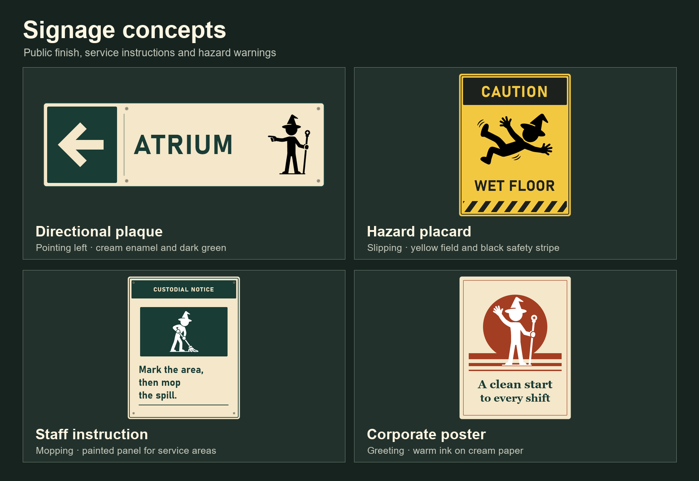
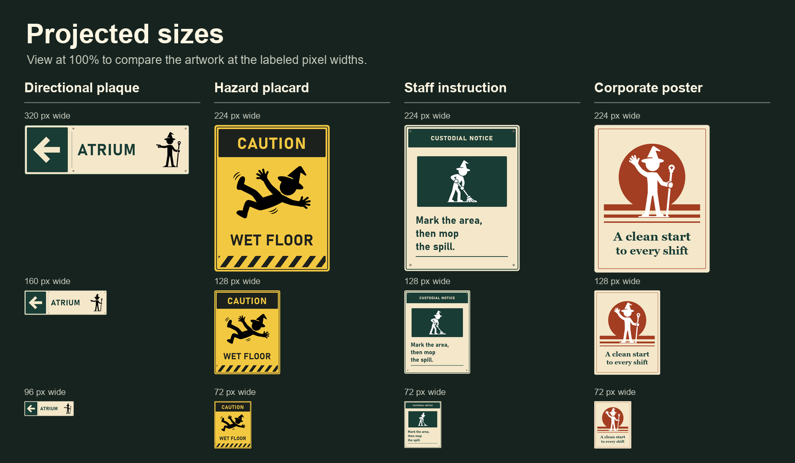
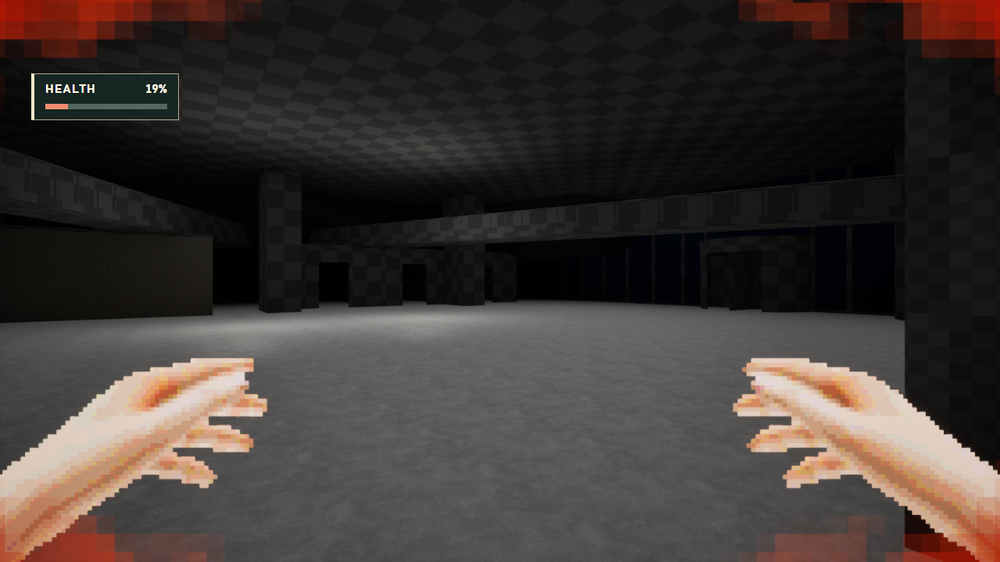
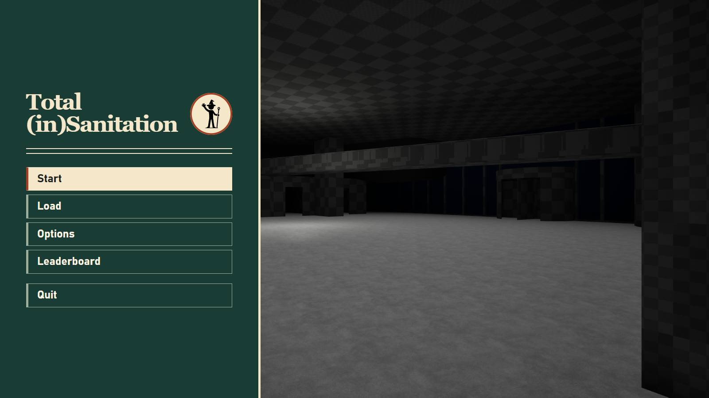

# Stage 5 · Signage and UI review

Four signs and two UI layouts are ready for graphic direction review in **Art bible → Signage & UI**. The proposal uses the approved wizard with cream and dark green for public information, yellow and black for hazards, and rust ink for decorative graphics. [Editable source ZIP](sources/signage-ui-stage5.zip).

## Graphic rules

| Example | Reading order and finish | Unreal context |
| --- | --- | --- |
| Atrium plaque | Read the left arrow, then the destination. The pointing wizard reinforces the same direction. Clean enamel, narrow green keyline and visible fasteners. | Lobby entry wall, about 428 px wide in the composite |
| Wet floor | Read the CAUTION header and WET FLOOR label with the slipping silhouette between them. A single black stripe band anchors the A-frame. | Basement corridor floor, about 303 px wide |
| Custodial notice | Read the department header and the short instruction at arm's length. The mopping wizard occupies one ink block. | Janitor stair wall, about 175 px wide |
| Corporate poster | The greeting wizard and the message carry the fantasy accent. Rust ink and cream paper keep it distinct from direction and caution. | Reverse lobby view, about 178 px wide |

**Typography.** Bahnschrift Bold is the proposed sign and control face, with spaced capitals for destinations and warning labels and sentence case for staff instructions. Georgia Bold is reserved for the poster and menu title. The existing UI contains Roboto and Cinzel. The new faces are visual choices for this review.

**Spacing and wear.** Use a clear margin around type and symbols, a single keyline on public and service signs, and enough room between a warning header, pictogram and label for each to read independently. Public panels use clean edges and restrained fasteners. Service wear sits near the outer edge. Hazard type and the arrow stay clear of scratches, seams and stripe patterns. [Clean and worn comparison](media/signage-ui-stage5/service-wear.webp).

The owner’s goblin prototype supplied the bold yellow warning field. The Stop prototype supplied the header and diagonal stripe rhythm. The approved slipping wizard carries the wet-floor message.

**Contrast.** Flat-color ratios are cream on dark green **9.85:1**, yellow against ink **10.20:1**, rust against cream **5.21:1** and chalk on dark green **11.31:1**. In-scene faces are shaded to match their surroundings for this comparison. Screen-space sizes are measured from the composites. Actual light, mounting, viewing angles and mips need a native check after approval.

**Text.** Four source SVGs retain text objects. Direction has roughly 30% expansion room at the proposed type size. The hazard label and staff copy can reflow to two or three short lines. Keep arrow, stripe and wizard independent of wording. For Unreal UI, keep labels and numbers live as localized text and bind the latter to the existing health data. Maintain the existing order of the five main menu actions.

The arrow stays distinguishable at 96 px while its label becomes marginal. At 72 px the warning's yellow field and slipping silhouette do most of the work. Give the staff notice a near reading position and the poster room to read on approach. These are screen-space observations at 100%.

## HUD and main menu

**HUD.** The first-person Lobby capture shows the hands occupying both lower corners. A transient damage test also showed the existing red vignette at the viewport edges. The proposed health card sits below the top vignette and away from the hands and center of view. Full and low readings show a value and bar length. The low state adds a warm fill. The 100% and 19% labels are mockup samples. The existing character references `BPW_HealthMeter` and `WDG_PlayerStats`. The standalone captures show damage feedback and no persistent number. Health visibility, runtime thresholds and transitions remain review decisions. [Native damage feedback](media/signage-ui-stage5/native-damage-feedback.webp) · [Full-health mockup](media/signage-ui-stage5/proposal-hud-1600.webp).

**Main menu.** Cream and green carry over from public signage. The greeting wizard appears on the title panel. The native menu supports Start, Load, Options, Leaderboard and Quit. The mockup preserves those actions and corrects the displayed spelling of Leaderboard. It proposes a hands-free Lobby view behind the menu. Start is distinguished by a cream fill, hover by green shading and keyboard focus by a visible outline. A disabled Load example and longer English labels test the layout. Existing UMG behavior stays the integration reference. [Native main menu](media/signage-ui-stage5/native-main-menu.webp) · [Long-label and focus study](media/signage-ui-stage5/menu-localization-stress.webp).

The first-person lobby runs used `/Game/Levels/Inteior_Lobby` at 1600 × 900, with a transient camera setup near **(−3508, 1194, 177) cm**, yaw **35°**, FOV **95°**. The menu uses the same world with the pawn hidden in the capture process. The native menu reference comes from `/Game/Levels/MainMenu`. The sign placements use the Stage 3 editor captures. [Environment capture provenance](REFERENCE_LIBRARY.md).

The editable UI study was checked across seven preview sizes, including 1920 × 1080, 1280 × 720, 4:3 and ultrawide. [HUD at 1280 × 720](media/signage-ui-stage5/proposal-hud-1280.webp) · [Main menu at 1280 × 720](media/signage-ui-stage5/proposal-menu-1280.webp).

## Atlas findings

`Utility_Materials/TrimSheet&Atlas/General_Atlas/General_Atlas.sbs` contains the 55-node `Text_Atlas` graph. The linked goblin bitmap feeds all four output branches. The stored parent size is `10x10`. Export options specify sRGB Base Color and Reference, Raw Normal and Roughness, and a legacy export folder. This establishes the current graph structure. The effective output layout and occupied UV regions still need to be recovered from the graph and consumer UVs.

The Blender `Atlas` material still has ten mesh consumers in `Enviroment_Assets.blend`: Ashtray_01, Cigarette_01–05, Pipes_01–03 and SM_Centrifuge. Its normal and reference PNG links are missing. The native inventory found no verified corresponding `Text_Atlas_*` Unreal package. The Stop stripe remains in the dialogue example and the blood cover in the cleaning flipbook referenced by the first-person character. [Current file and dependency audit](FILE_PLACEMENT.md).

After graphic approval, map the existing occupied regions and compare a compatible addition with a controlled repack. The atlas specification will record asset identifiers, UV rectangles, bleed, mip tests, required channels, resolution and expansion space. Runtime text remains in the UI and any variable sign label.

## Owner review

1. Review the cream and green public identity, black and yellow warning, and rust poster accent on the four scene examples.
2. Choose the staff sign wear level and review the visibility and position of the proposed health card.
3. Review the menu typography, five-action order and Lobby backdrop before Unreal UI or atlas production.

The project uses the existing sign and UI assets in Unreal today. The review package contains the new graphics, editable English text and static UI previews.
