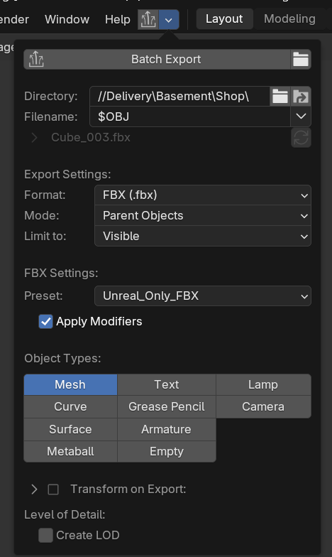

# Rules & tools

Essential connections and production rules retained after the reset. Earlier setup succeeded with Unreal 5.8.4, Blender 5.2.4 LTS and Designer 15.0.1. Recheck the current application, project and live schema before each native task; historical availability is not a current connection check.

## Sources and destinations

- Source root: `D:/GameJam/Total (in)Sanitation/`.
- Unreal: `D:/GItHub/BoomeRacist/BoomeRacist.uproject`.
- New art: `/Game/Art`; new UI: `/Game/Art/UI`; characters: `/Game/Art/Characters`; maps: `/Game/Levels`.
- Structure/shop source: `Assets/Building/Interior_Building.blend`; individual props: `Assets/Enviroment_Assets/Enviroment_Assets.blend`.
- Asset materials: reuse `/Game/Art/MI/Utility_Materials`. The **File rules** subtab contains the [stage-2 placement/export contract](FILE_PLACEMENT.md), [existing-FBX map](FILE_MAP.csv) and [audit evidence](FILE_AUDIT.json).
- Static export: Super Duper Batch Exporter, `$OBJ`, FBX, Parent Objects, Visible, `Unreal_Only_FBX`, modifiers on, Mesh only, transform-on-export off, LOD creation off. Set Directory for the actual asset. Recheck the preset and verify the first new delivery in Unreal. Preserve the rigged-tool and unparented-UCX exceptions described in File rules.
- Density references: 256/512 px/m; preserve intentional floor/ceiling UV/tiling exceptions.



## Native connections

**Unreal:** Epic's experimental native MCP, previously configured at `http://127.0.0.1:8000/mcp`. Discover `list_toolsets → describe_toolset → call_tool`; calls are sequential. EditorToolset, ModelContextProtocol, PythonScriptPlugin, EditorScriptingUtilities and SlateInspectorToolset were enabled. Verify project/map and unsaved state first. Do not broaden toolsets or change settings without a task need.

**Blender:** reuse Blender Lab `bl_ext.lab_blender_org.mcp`, previously on `127.0.0.1:9876`; do not replace it with another similarly named addon. Existing executable: `C:/Program Files (x86)/Steam/steamapps/common/Blender/blender.exe`. The local client/source and isolated Python environment remain under `.mrmak/total-insanitation/blender-mcp/` and `venv/`. Read-only background audits can use `--background --factory-startup --disable-autoexec`; preserve the graphical session. Production exports require the owner's addon/preset.

**Designer:** installed cooker/renderer live under `C:/Program Files/Adobe/Adobe Substance 3D Designer/`. Prior batch export worked; interactive graph control still needs a native check when required. The `sd` API runs inside Designer. Do not upgrade or overwrite `.sbs` files during an audit.

## Retained helpers

Project scripts: `blender_audit.py`, `unreal_audit.py`, `designer_audit.py`, `mcp_client.py`, `olb_setup_assets.py` and the retained builder's `olb_build.py` source. The generic audit helpers are read-only. MCP access can mutate data when explicitly called with a mutation tool; discover/inspect first.

The native client can be used without restarting this chat:

```powershell
.mrmak/total-insanitation/venv/Scripts/python.exe projects/total-insanitation/scripts/mcp_client.py --server unreal
.mrmak/total-insanitation/venv/Scripts/python.exe projects/total-insanitation/scripts/mcp_client.py --server blender
```

Use `--tool`, `--arguments` and `--output` only with a verified schema/request. Keep receipts/credentials out of Git. Existing connection configuration, environments and pre-setup settings copies were preserved.

Read the **Level builder** subtab for the retained Office Level Builder. Do not restart editors or active chats to apply changes without the owner's permission.
