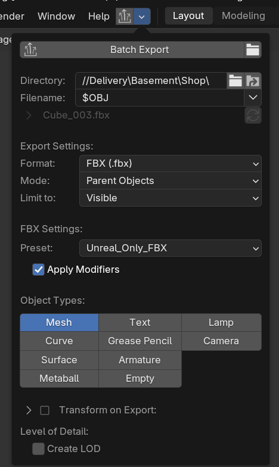

# Art tools

**Verified on 12 November 2026.** Unreal and Blender both answered real native MCP calls. Designer successfully cooked and rendered an existing project material through Adobe's installed tools. No paid generation or extra account connection was needed.

| Application | Installed version | Current capability | Remaining verification |
| --- | --- | --- | --- |
| Unreal Engine | 5.8.4, build 58902052 | Epic MCP connected; read current map, found the shop actor, captured the Basement viewport | Validate each future import/material/level edit in the engine |
| Blender | 5.2.4 LTS | Blender Lab MCP connected to `Interior_Building.blend`; path and clean state verified; native window capture | Owner’s addon/preset inspected; verify its first asset delivery in Unreal |
| Substance 3D Designer | 15.0.1, build 9305 | `sbscooker` + `sbsrender` cooked and rendered `Brutalist_Concrete_01.sbs` into a local scratch folder | Interactive Python API audit is prepared, not yet run inside Designer |

## Unreal: installed and configured

Epic's **Unreal MCP** is bundled with the installed engine. It is experimental. The project now enables these existing plugins for the editor:

- `ModelContextProtocol` — native HTTP MCP server.
- `EditorToolset` — assets, actors, meshes, materials and scene tools.
- `PythonScriptPlugin` and `EditorScriptingUtilities` — editor scripting.
- `SlateInspectorToolset` — native editor UI inspection and screenshots.

Their bundled dependencies load automatically. `AllToolsets` is available but is not needed to enable unrelated gameplay toolsets for this environment task. No third-party C++ plugin, compiler installation or engine upgrade was necessary.

The native endpoint is `http://127.0.0.1:8000/mcp`. Auto-start is enabled in the project's `Config/DefaultEditorPerProjectUserSettings.ini`. Project-local client entries were merged into this Workspace's `.codex/config.toml` and `.mcp.json`; existing Photoshop entries were preserved. No global client settings or permission modes changed.

Discover tools using **list_toolsets → describe_toolset → call_tool**. Toolset names are complete identifiers, for example `editor_toolset.toolsets.scene.SceneTools`. Calls must be sequential. In this build, `CaptureViewport` requires explicit `null` for unused `captureTransform` and `annotations`, even though the discovery schema marks them optional.

The allowed maps are **Inteior_Lobby**, **LaCarlota**, **Streaming_Levels/Main_Lights** and **Streaming_Levels/Basement**. This is an instruction-level scope rule; the general editor MCP does not enforce that allowlist. Check the project and current map before every production edit. Shared asset changes also need a reference check.

Setup changed only the `.uproject` plugin declarations and an added MCP section in the existing editor settings file in the Unreal repository. Copies of the user's already-modified project descriptor and the prior editor settings were saved before the change in `.mrmak/total-insanitation/`. Existing changes, including the already-deleted `Lights.umap`, were retained. No level or asset was saved by setup.

[Epic: Unreal MCP for UE 5.8](https://dev.epicgames.com/documentation/en-us/unreal-engine/unreal-mcp-in-unreal-editor?application_version=5.8)

## Blender: reuse the existing Blender Lab extension

The existing extension is **MCP 1.0.3**, maintained by Blender Lab, module `bl_ext.lab_blender_org.mcp`. Its local socket runs on `127.0.0.1:9876`. It is a different integration from the community `ahujasid/blender-mcp` addon, which also commonly uses port 9876.

The matching Lab client **1.0.2** was installed in an isolated Python **3.11.15** environment at `.mrmak/total-insanitation/venv/`. Source checkout: `.mrmak/total-insanitation/blender-mcp/`, pinned to `dbbf836ad4b1025f14a2b3b504c43903f39e0b04`. The client includes local Blender API and manual lookup. Its source, dependencies and runtime receipts are outside Git.

Blender executable: `C:/Program Files (x86)/Steam/steamapps/common/Blender/blender.exe`. It is supplied through `BLENDER_PATH`, so clients do not depend on a terminal's PATH. The client launches with the venv's Python and `-m blmcp`.

For offline audits use `--background --factory-startup --disable-autoexec`: the user's HardOps and UVPackmaster addons tried to initialize GPU drawing in a background process. Factory startup avoids those headless-only errors without disabling or changing the user's installed addons. The graphical Blender session connected normally.

[Blender Lab source](https://projects.blender.org/lab/blender_mcp) · [Blender Lab MCP guide](https://www.blender.org/lab/mcp-server/)

## Designer: working native automation, no extra MCP installed

Both executables are in `C:/Program Files/Adobe/Adobe Substance 3D Designer/`. The local verification used the real `Brutalist_Concrete_01.sbs` and exported only to `.mrmak/total-insanitation/designer-check/`:

1. Cook the `.sbs` to `.sbsar` using `sbscooker`, with `sbs://` pointing to Designer's installed `resources/packages`.
2. Render its outputs using `sbsrender` at a 256 × 256 verification resolution.
3. Keep the original `.sbs` and existing game textures unchanged.

The export produced base color, normal and occlusion/roughness/metallic maps. This verifies the batch material path; it does not verify interactive graph edits or an Unreal import.

The tested commands, run from this Workspace, were:

```powershell
& 'C:\Program Files\Adobe\Adobe Substance 3D Designer\sbscooker.exe' --inputs 'D:\GameJam\Total (in)Sanitation\Utility_Materials\Concrete\Brutalist_Concrete_01\Brutalist_Concrete_01.sbs' --output-path 'D:\AI\MarkWorkspace\.mrmak\total-insanitation\designer-check' --alias 'sbs://C:/Program Files/Adobe/Adobe Substance 3D Designer/resources/packages'
& 'C:\Program Files\Adobe\Adobe Substance 3D Designer\sbsrender.exe' render --inputs 'D:\AI\MarkWorkspace\.mrmak\total-insanitation\designer-check\Brutalist_Concrete_01.sbsar' --output-path 'D:\AI\MarkWorkspace\.mrmak\total-insanitation\designer-check' --set-value '$outputsize@8,8'
```

The official Python API is installed under Designer's `resources/python/sd/`, with reference documentation under `resources/documentation/pythonapi/html/index.html`. A read-only script is ready at `projects/total-insanitation/scripts/designer_audit.py`. Run it through Designer's Python scripting interface to list already-open packages and their graphs. `import sd` requires Designer's process; system Python is not a substitute.

Continue with existing exported texture maps. Add Adobe's Substance runtime plugin for Unreal only if a concrete need for runtime `.sbsar` parameter changes emerges and its compatibility with 5.8.4 is verified. It is not needed for the current tileable texture workflow. The plugin-directory search did not return a relevant Blender/Unreal/Designer connector; additional listings may exist in the [plugin directory](https://chatgpt.com/plugins).

## Continue without restarting this conversation

Project-local MCP configuration is ready for subsequent trusted Workspace sessions. Newly configured servers are not retroactively added to this conversation's original tool catalogue; both were verified now through the same MCP protocol using the standalone client. No active editor or agent session was restarted.

From `D:/AI/MarkWorkspace`, with the target editor open:

```powershell
.mrmak/total-insanitation/venv/Scripts/python.exe projects/total-insanitation/scripts/mcp_client.py --server unreal
.mrmak/total-insanitation/venv/Scripts/python.exe projects/total-insanitation/scripts/mcp_client.py --server blender
```

Add `--tool TOOL_NAME --arguments path/to/arguments.json --output .mrmak/total-insanitation/report.json` for a discovered call. The output folder also keeps native image results. The client exits with a failure code if the tool reports an error. Epic's server returns HTTP 202 to the SDK's session-close request; the SDK logs that close warning even after successful calls.

[Official OpenAI documentation: project-scoped MCP configuration](https://developers.openai.com/codex/mcp/)

## Blender production sources and FBX export

**Owner configuration, 12 November 2026.** Create structures and shop assets in the existing `Interior_Building.blend`, and individual environment assets/props in the existing `Enviroment_Assets.blend`. Create a new `.blend` only when the task explicitly requires one.

Use the installed [Super Duper Batch Exporter](https://extensions.blender.org/add-ons/superduperbatchexporter/) (local manifest: **2.9.3**) with the supplied configuration:

| Setting | Value |
| --- | --- |
| Directory | Set for the current destination; the pictured `//Delivery\Basement\Shop\` is an example |
| Filename | `$OBJ` |
| Format / Mode / Limit to | FBX / Parent Objects / Visible |
| Preset | `Unreal_Only_FBX` |
| Apply Modifiers / Object Types | Enabled / Mesh only |
| Transform on Export / Create LOD | Disabled / Disabled |



The installed `Unreal_Only_FBX.py` was inspected locally: scale 1, apply unit scale, `FBX_SCALE_NONE`, forward **`-Z`**, up **`Y`**, face smoothing, tangent space enabled, SRGB vertex colors, no animation and no embedded textures. The addon overrides the stale filepath stored in the preset with the panel Directory and generated filename.

The earlier copied module test used direct export with different axes (`-Y / Z`). Keep that as historical test evidence; use the owner’s preset for future delivery and verify size, orientation, pivots, UVs and vertex colors on the next asset import. This documentation update did not perform a round trip through the exact addon/preset.

Full source/export contract: `projects/total-insanitation/BLENDER_WORKFLOW.md`. Preserve deliberate floor and ceiling tileable-alignment exceptions to 256/512 px/m. A fresh read-only check found no missing unpacked file images in either saved blend; the old texture warning is closed.

## Files and recovery

- `projects/total-insanitation/scripts/blender_audit.py`: read-only source inventory.
- `projects/total-insanitation/scripts/unreal_audit.py`: read-only audit of allowed loaded levels.
- `projects/total-insanitation/scripts/designer_audit.py`: read-only in-app package inventory.
- `.mrmak/total-insanitation/`: tool source, venv, logs, pre-change settings copies, JSON receipts and scratch renders. Do not commit.
- To remove this setup later, compare the saved descriptor with the current one and remove only the five added plugin entries and MCP settings. Do not restore the full backup over later user edits.

## Production check / Basement pass 01

Native Unreal and Blender tools completed the first art pass on 12 November 2026. The original graphical source session was preserved. The generic Blender CLI timed out with normal user addons; direct factory-startup Blender completed historical test exports and independent UV/color checks. Future production export uses the installed batch addon and owner preset above.

The project `MODULE_CONTRACT.md` records verified dimensions, pivots, export settings, density exceptions and collision checks. A default trial import ignored vertex paint; a fresh copy with explicit Replace retained alpha. The isolated legacy FBX check restores the session's Interchange FBX flag immediately afterward. No global configuration or renderer change is required.

Adding native Blueprint components compiles/reinstances the class. Reacquire final templates before saving material arrays, refresh only the new components on existing instances, then save and reload affected maps. Pass 01 checked actual materials afterward. Save newly imported meshes explicitly; saving a referencing Blueprint alone is insufficient.

`CaptureViewport` returned the editor view while PIE was active. The matched gameplay evidence therefore uses native `HighResShot` in the game world, with camera/FOV provenance. These are real first-person views with Main_Lights; editor-only captures are labeled separately.

Full native receipts, recovery copies and failed probes stay in `.mrmak/total-insanitation/basement-review/`, outside Git. The Pass 01 report lists four changed existing packages and nine new art/test packages. The original building blend hash is unchanged.

## Unreal: Office Level Builder execution script

Installed on 12 November 2026 at the owner's request: `BoomeRacist/Content/Art/Tools/OfficeLevelBuilder/Python/olb_build.py`. It is triggered by the **Build/Clear** buttons on `BP_OLB_Builder`, `BP_OLB_Room` and `BP_OLB_Stair` in `/Game/Art/Tools/OfficeLevelBuilder/`. Those `Call In Editor` events run the file through the editor `py` console command. No project setting, startup script or plugin was added. In this session, Python was run inside the live editor by typing `py "<file>"` into the Output Log `Cmd` box through the Slate inspector, because Python remote execution is disabled in the project. Usage, rules, verification and limits are in the **Level builder** tab.
