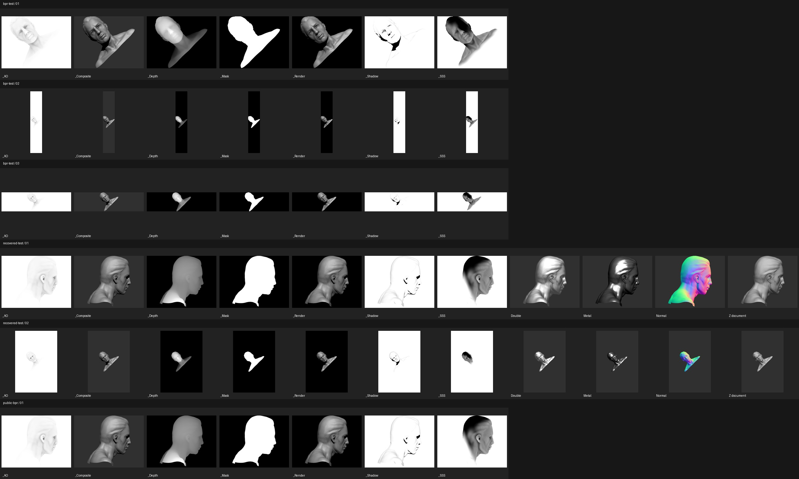
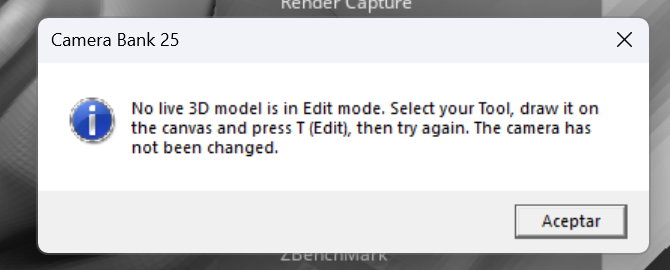

# ZBrush Camera Bank and Render Capture

**Version 3.1.0 source adds merge-compatible visibility for ZTL/ZPR camera handoffs.**
Native compilation and visual verification remain pending. ZBrush was not launched
or controlled. Both plugins now use bank data v8; load both updated sources.

Camera Bank adds a 20-character visibility-group marker to each SubTool name.
Parts sharing that marker have the same effective visibility in all occupied
cameras. The recipient can reorder or merge compatible parts while retaining
a source marker. Recall and both render phases use those groups after preparation.

1. Store and inspect the cameras on the original unmerged Tool.
2. **PREPARE TRANSFER**, then save the prepared **ZTL/ZPR**.
3. **EXPORT BANK** and send both matching files. Export auto-prepares if needed.
4. Preserve the markers and merge only parts matching in **every stored camera**.

[Handoff instructions, verification and limits](merge-handoff-3.1.0.md)

Offline verification passed: **32 logic scenarios**, installer/uninstaller fixtures,
and a 1,000-SubTool duplicate-name smoke check. Native naming, framing and actual
before/after images require an application check. Missing/foreign markers stop
recall; the system cannot reconstruct arbitrary incompatible native merge ancestry.
Legacy banks need every occupied camera inspected/updated on the unmerged source.

[Download the current source package](zbrush-plugins-source.zip)

The editable folder is `D:/Descargas/Plugin de zbrush`. Run `INSTALAR.cmd` when
ready, then **Macro > Reload All Macros > Mak Plugins > Load Camera Bank** and
**Load Render Capture**. No new ZSCs are included. ZBrush compiles the TXT sources
when loaded; rerun the installer afterward for normal automatic startup.

The previous features remain:

| Feature | Value |
|---|---|
| BPR Shadow | Rays 30, Angle 15 |
| BPR AO | Rays 30 |
| BPR RenderPass SPix | 2 |
| NON BPR copies | ZPass_…/Screenshots/01.png, 02.png, etc. |

[Previous screenshot-copy verification](verification-3.0.5.md) ·
[Previous BPR-quality verification](verification-3.0.4.md)

## Historical 3.0.3 corrections

- Camera redraw now avoids the Thumbnail overlay, closes LightBox and checks
  that the model is back in Edit before applying the stored view.
- Saving without a live 3D model shows an explanatory warning and preserves
  camera data. It does not convert or replace the user's mesh.
- Both previous crash logs stopped at `Light:Save`, before BPR. That operation
  is removed. The plugin preserves and restores the changed light-2 settings
  in memory instead of saving and reloading the entire lighting setup.

## Historical 3.0.3 native results

| Check | Result |
|---|---|
| Thumbnail enabled | Three cameras, two complete recall cycles; model remains in Edit |
| Canvas sizes | 1120 x 840, 500 x 2604, 2604 x 710 and 2604 x 3818 |
| BPR | 42 valid PSDs; all seven passes and native 16-bit Depth |
| Non-BPR | 8 valid PNGs with the requested materials |
| Previous crash project | Copied recovery project completes non-BPR followed by BPR |
| Final plugin buttons | Camera 03 stored; invalid 04 blocked; public BPR callback completes |
| Regression checks | 13 logic scenarios; installer and uninstaller fixtures pass |
| Clean installation state | 11 installed package files removed; standard Maxon plugins hash-checked unchanged |

[Download render review](media/native-review-3.0.3.jpg)

[Detailed verification](verification-3.0.3.md)

## Backups and scope

The 3.0.3 records listed backups at
`Recovery/Uninstalled-20261113-190822-295`. The previous release is in
`Recovery/before-3.0.3`; earlier project and camera-bank recovery files remain.
Those historical Recovery folders are absent from the current trimmed source package.

During the 3.0.3 native test session, plugin controls, loaders and the test bank were
cleared. ZBrush was not restarted. Original sculpts and saved banks were preserved.

Testing covers ZBrush 2023.2.1 and these meshes/resolutions. Other versions and
large production sculpts were not stress tested. The bank format stays at v7;
old cameras with missing canvas sizes still require UPDATE ACTIVE.
