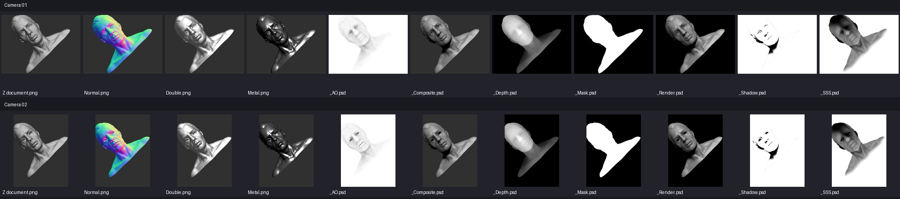
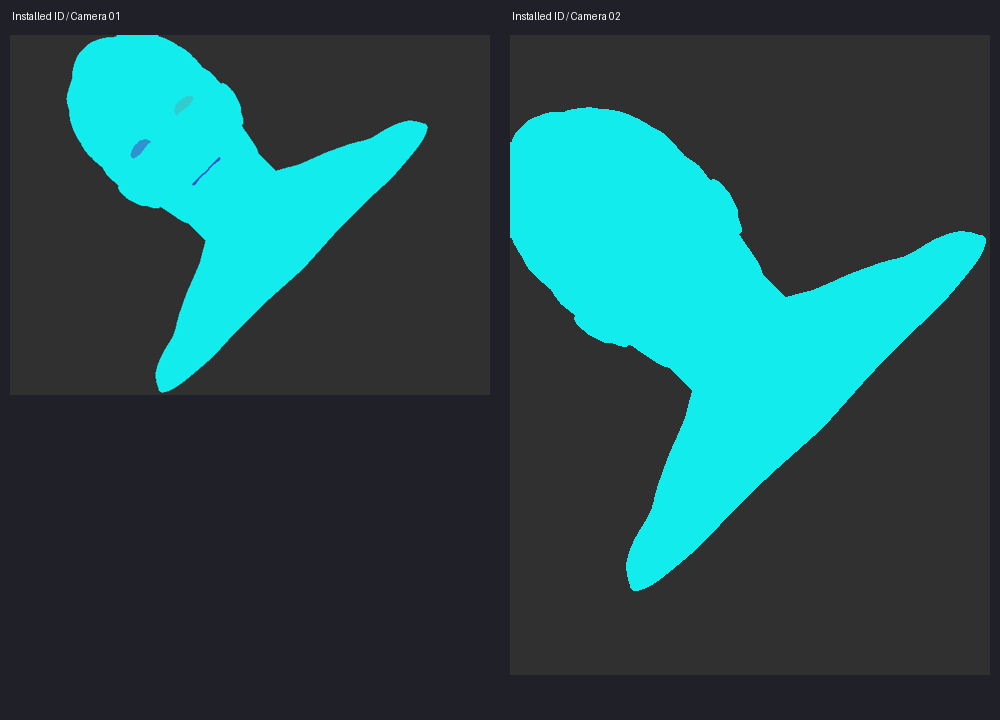
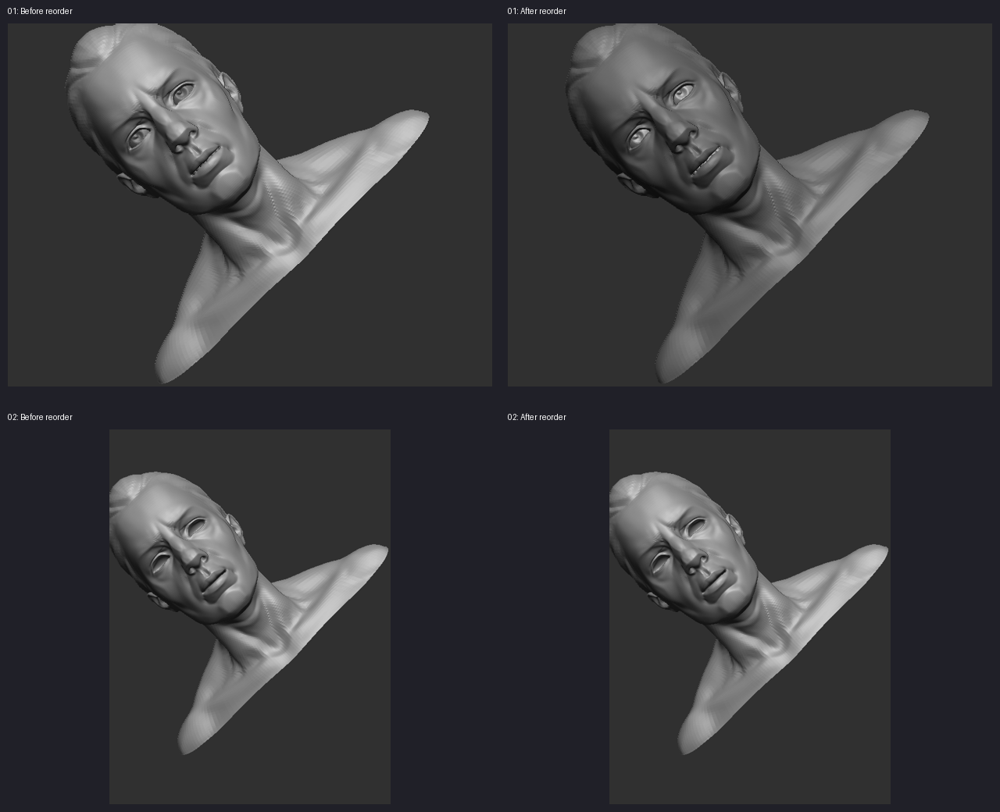

# ZBrush 3.2.0 — verified delivery

All three plugins are integrated, compiled and installed in ZBrush 2023.2.1. The three worker branches were reviewed and merged locally. No push, application restart or worker closure occurred.

The integrated suite passed **100 tests**. Six installer/uninstaller checks then passed after adding two loaded-file regressions, covering **102 distinct scenarios** in total. Native tests covered bank export/import, name tracking after actual reorder and compatible MergeDown, both render orders, ID generation and backup reopening.

## Native renders

Both phase orders produced 48 valid files in the shared camera folders, including identical Screenshots copies and 16-bit Depth. The gray camera produced no output.

[Download render review](media/render-review-3.2.0.jpg)

## Final installed ID action

The sole button selected a new output folder, created ZPass_1 and exported both enabled cameras. Colors remain consistent between views; Colorize stays on. Existing render files were preserved, and a repeat action refused to overwrite ID.png.

[Download ID review](media/id-review-3.2.0.png)

The exact-name ZTL backup reopened with original surface treatment and the matching camera bank. ID changes PolyGroups, RGB, assigned materials and masks; load that backup to recover the original mesh data.

## Name matching after reorder

Both views retained geometry and framing after native MoveUp. Camera 02 was byte-identical. Camera 01 shows ZBrush's inactive-SubTool material dimming when active selection changes; the comparison does not claim pixel equality there.

[Download reorder comparison](media/reorder-review-3.2.0.png)

## Delivery and limits

[Download the 3.2.0 package](zbrush-plugins-source.zip)

The package includes editable sources, generators/tests, native ZSCs, installer/uninstaller, manifest hashes and the full Development/VERIFICATION_3.2.0.md record. Keep the marked default ZTL filename or use ZPR for an arbitrary project name. Compatible merges retain one matching marker; unknown ancestry is never guessed from position.

The original owner document, visible brush settings and 60-second screen-saver timer were restored; test cameras were cleared. The 1,000-SubTool check is a mock test. Other versions, maximum production scenes and every interruption point were not natively stress tested. Automatic startup awaits the next normal application launch; no restart was performed.
