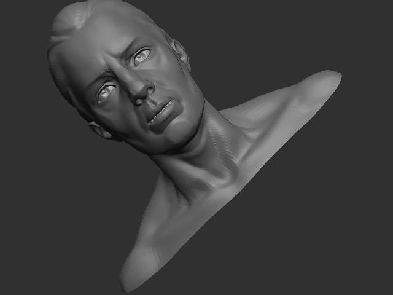
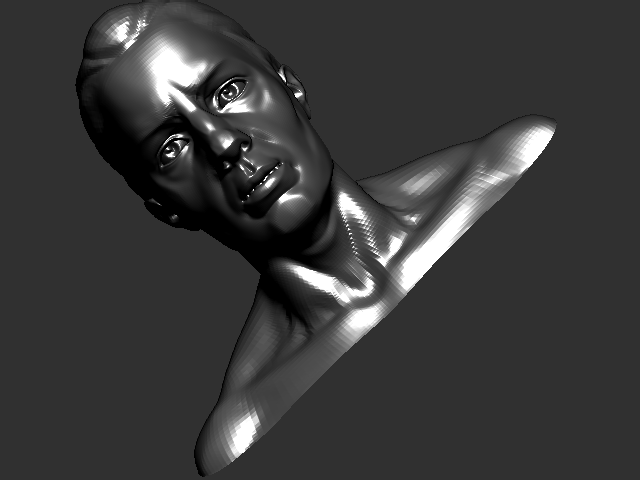

# ZBrush 3.2.1 — verified delivery

**All three plugins are compiled and installed in ZBrush 2023.2.1.** The filename-alias correction is shared by Camera Bank, Render and ID. The final package contains data-v9 sources, native binaries and their hashes.

[Download the 3.2.1 package](zbrush-plugins-source.zip) · [Usage and migrated bank location](PROJECT.md)

## Arbitrary ZTL filename

Three stored views survived Save As and reopening as `my new.project.ztl`. All three before/after exported PNG pairs were **byte-identical**, including gray camera 03. The fixture used duplicated meshes with distinct native IDs; repeated-ID ambiguity and IDs above float precision were tested offline.

[Download camera 01](media/321-fresh-after-0.png)

Native IDs are stored in two 16-bit halves. A missing first marker is resolved only when the displayed name matches the Tool basename and the ID/group evidence is unambiguous. Other name markers remain required. No positional guess is used.

## ID export and actual recovery

The installed public ID action processed three meshes and exported two enabled cameras at 640 × 480. Gray camera 03 was omitted. The two head duplicates receive different colors; the shared eye geometry retains its color.

[Download ID 01](media/321-id-01.png)

[Download ID 02](media/321-id-02.png)

The actual pre-ID recovery ZTL reopened with the original metallic surface. Real Camera Bank buttons 01/02 recalled it successfully despite the unmarked filename alias.

[Download backup recall](media/321-id-backup-camera-02.png)

## Verification scope

| Check | Result |
| --- | --- |
| Automated suite | 114 tests passed in 150.279 seconds; production source hashes unchanged afterward. |
| Original supplied ZTL | All five views pass with the migrated bank; original ZTL and v8 bank hashes unchanged. |
| Render reader | Two native recall images match Camera Bank byte-for-byte. Full BPR/non-BPR acceptance remains historical 3.2.0 evidence. |
| Public export/import | Success dialogs observed; 123,088-byte v9 bank with three exact ID/group records. Camera 02 visibility and all persistent bank cells preserved. |
| Installation | Three genuine compiled binaries match the package and installed sources. All three controls also loaded at startup. |
| Final owner state | Original document 2122 × 1280, Edit off, screen saver 60, RGB/Z intensity 25, Dots and Alpha Off restored. Desktop client released/closed; ZBrush still running afterward. |

Tracked v8 banks need a one-time import on their matching marked Tool in Edit mode, followed by export. A bank without native IDs cannot identify an already unmarked first SubTool alone. The supplied migrated bank is at `D:/Descargas/a/Recovered/CameraBank25_v3_2_1.zcv` and works with the original `a.ztl`.

During continuation, the control client's shutdown unexpectedly terminated ZBrush instances launched by that client. Saved original and QA files remained intact. Launching ZBrush independently fixed the lifecycle issue; restoration was repeated and the app was verified running after client shutdown. No commit or push was made.

The package's `Development/VERIFICATION_3.2.1.md` and `Verification/v3.2.1/validation.json` record evidence and limits. Other ZBrush versions, arbitrary lost merge ancestry and production-scale native stress tests remain outside this verification. The earlier [3.2.0 report](verification-3.2.0.md) retains its original scope.

Delivery checks passed for archive hashes, 44 local links and all four changed tabs at 1440/768/390 px in both themes, including image preview/download/close. The unrelated repository starter-template check still fails because its four expected sample cards were already absent in HEAD; other card entries were preserved.
