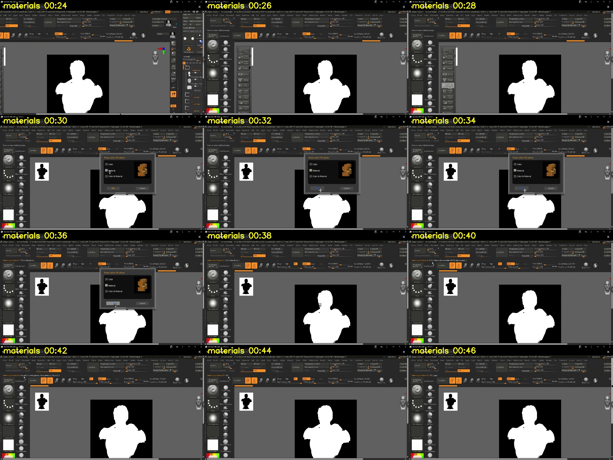
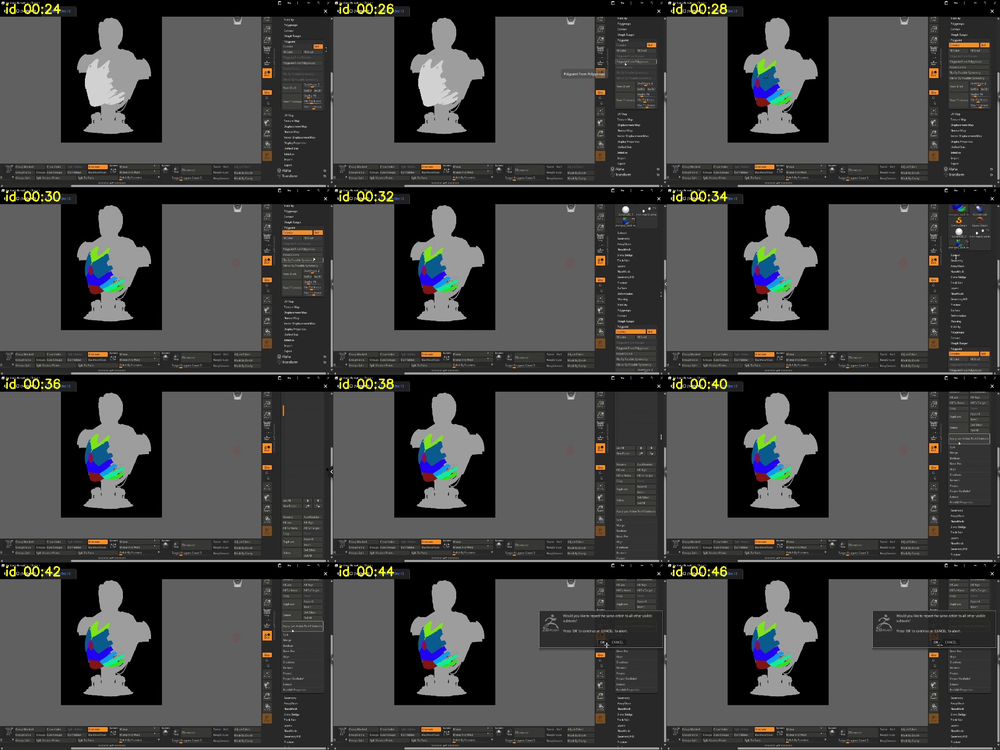
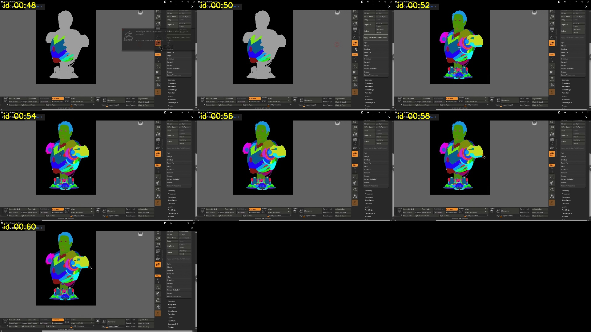

# ID reference review — 3.2.0

The requested third plugin prepares a flat, colored ID image for **every enabled Camera Bank camera**. The owner confirmed the camera scope. The two supplied recordings were analyzed before the worker handoff was written.

The material recording shows SubTool Master > Fill with **Material** selected and **Flat Color** active, around 00:30–00:36. It proceeds through the SubTools at 00:38–00:48. This is a material-only fill: it must not replace RGB with a single solid color.

[Download material reference sheet](media/material-reference-3.2.0.jpg)

The ID recording shows **Polypaint From Polygroups** around 00:26, with **Colorize** becoming active. At 00:42–00:48, Apply Last Action To All Subtools asks to repeat the operation on the other visible SubTools. The whole visible bust displays flat colored regions by 00:52. Auto Groups is visible in the custom shelf and is explicitly required by the owner's written brief; its exact click is not established by these samples.

[Download ID process sheet](media/id-reference-process-3.2.0.jpg)

[Download ID result sheet](media/id-reference-result-3.2.0.jpg)

These are scene samples plus a denser two-second series and selected enlarged frames, not a claim of frame-by-frame viewing or audio transcription. Neither clip shows file export. The `ID.png` filename and reuse of the camera output folders are implementation decisions; the camera batch scope is owner-confirmed.

The implementation prepares the union of required visible meshes once so colors remain consistent across views. It must keep Colorize active, protect existing outputs, and save a recoverable Tool before changing PolyGroups, polypaint or material assignments. Native output verification is reported separately from this reference analysis.

Editable specification and full evidence notes: `projects/zbrush-plugins/VIDEO_ANALYSIS_3.2.0.md`. Original recordings: `projects/zbrush-plugins/A Materails All Tools.mp4` (50.32 s) and `projects/zbrush-plugins/A ID Zbrush.mp4` (61.95 s).
