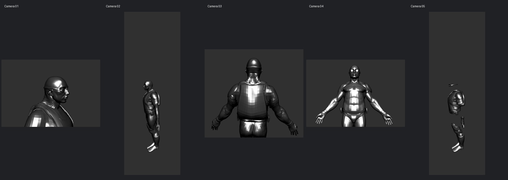

# ZTL import recovery

Historical file-only recovery, completed before the plugin correction. The later [3.2.1 update](verification-3.2.1.md) supports the original ZTL with its migrated bank; [Delivery](PROJECT.md) gives the current instructions.

**The supplied model and all five cameras are recovered.** The original ZTL and bank remain unchanged. This recovery uses the installed 3.2.0 plugin; it does not change its identifier rules.

[Download the recovered project, ZTL and camera bank](ztl-import-recovery.zip)

## Open the recovered files

1. Open `a-recovered.zpr` with **File → Open**.
2. Use **Camera Bank 25 → IMPORT BANK** and select the included `CameraBank25_v3_2.zcv`.
3. Recall cameras 01–05 normally.

The same files are available locally in `D:/Descargas/a/Recovered/`. Alternatively, load the included marked ZTL, draw it in Edit mode and import the bank. Keep the full marked ZTL filename; ZPR filenames can be changed freely. Camera data remains in the separate `.zcv` file.

## Cause and recovery

Loading the original `a.ztl` exposed its first SubTool as `a`, losing the marker required by the bank. The file still contained the original `CB620092277855G0003_shirt` name; all nine other native names matched the same bank. A byte-identical copy named `CB620092277855G0003_shirt.ztl` loaded with all ten correct identifiers. No guessed positional remapping or geometry edit was needed.

## Native checks

All five views recalled and exported in ZBrush 2023.2.1. Every SubTool visibility flag matched its saved visibility group, and all output dimensions matched the bank. Camera 04 hides the shirt and backpack; camera 05 hides the main body.

| Camera | Saved/output size | Visible SubTools |
| --- | --- | --- |
| 01 | 1872 × 1280 | 10 |
| 02 | 1564 × 4561 | 10 |
| 03 | 710 × 636 | 10 |
| 04 | 1872 × 1280 | 8 |
| 05 | 1564 × 4561 | 9 |

[Download the review image](media/recovery-five-cameras.jpg)

The public IMPORT BANK action passed. The recovered ZPR was saved and reopened with all ten names preserved; public camera buttons 01 and 02 also recalled after reopening. Native transform readback had small rounding differences (maximum approximately 0.00342 in a transform component); no pixel-identical comparison to a pre-error render is claimed. The images show the current display material, not a new surface treatment.

ZBrush remains open on the recovered project and camera 01. The screen-saver timer is restored to 60 seconds, desktop control is released, and no application restart or plugin rebuild was performed for this recovery. Private diagnostics and the pre-recovery session backups remain outside the distribution ZIP.
